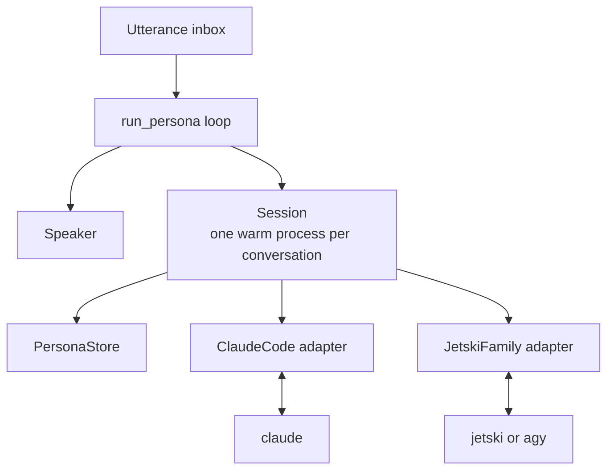

# Unified Headless Wrapper
One wrapper, three headless agent CLIs: Claude Code, Jetski and AGY, all driven as NDJSON on stdin and stdout with one warm process per conversation.

## Status

**Prototype (v0.0.1).** The wrapper passes its test script against a mock engine that replays captured frames. It has not yet been run end to end against a real engine, and the Claude Code interrupt path is unverified.

**Phase 0 captures (2026-10-18):** complete for AGY and Jetski; both pass Gate G1. Claude captures (C5–C7) belong to Phase 3. How to run them: [`src/captures/RUNBOOK.md`](src/captures/RUNBOOK.md).

## What's here

| Path | What it is |
|---|---|
| `src/lupin_headless.py` | The wrapper: engine adapters, `Session`, `PersonaStore`, `Speaker` and the single-persona loop |
| `src/fake_engine.py` | Mock engine reproducing the captured stream-json behavior of both protocol families |
| `src/test_headless.py` | Scenario script that drives the wrapper through the mock |
| `src/rnd/v0.0.1/00-status.md` | Where the work stands: phase, open items, next three, session log. Read first |
| `src/rnd/v0.0.1/01-framework.md` | The master design: decisions D1–D44, design per component, captures, phases and gates, TODO register |
| `src/rnd/v0.0.1/specs/` | Role table, AH4L capability inventory, ticketed-asks spec, Phase 1 spec |
| `src/rnd/v0.0.1/evidence/` | Capture results: Phase 0 Parts A/B, Jetski and AGY C11–C14, Claude C5–C7 |
| `src/rnd/v0.0.1/archive/` | Superseded: the 10-12 prototype [design doc](src/rnd/v0.0.1/archive/2026.10.12-unified-headless-wrapper-claude-code-jetski-and-agy.md), build order, design gap review |
| `src/captures/` | Phase 0 capture scripts, probes and the [runbook](src/captures/RUNBOOK.md); outputs go to the gitignored `src/captures/out/` |

## Architecture



Adapters translate each engine's protocol into one normalized event stream, so nothing above the adapter is engine-specific. Adding an engine means writing one adapter class.

## Usage

Requires Python 3.10+ on a POSIX system, with no third-party packages.

```bash
# Talk to an engine; typing while it speaks is a barge-in
python3 src/lupin_headless.py --engine agy --persona alpha

# Run the mock-engine scenarios
cd src && python3 test_headless.py
```

Options: `--engine claude|jetski|agy`, `--persona <id>`, `--system <prompt>`, `--cwd <dir>`, `--skip-permissions` to auto-approve tools, `--new` to forget the persona's stored session.

## License

Apache License 2.0. See [LICENSE](LICENSE).
