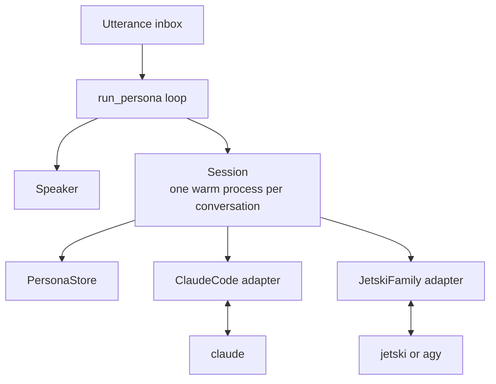

# Unified Headless Wrapper
One wrapper, three headless agent CLIs: Claude Code, Jetski and AGY, all driven as NDJSON on stdin and stdout with one warm process per conversation.

## Status

**Prototype (v0.0.1).** The wrapper passes its test script against a mock engine that replays captured frames. It has not yet been run end to end against a real engine, and the Claude Code interrupt path is unverified.

## What's here

| Path | What it is |
|---|---|
| `src/lupin_headless.py` | The wrapper: engine adapters, `Session`, `PersonaStore`, `Speaker` and the single-persona loop |
| `src/fake_engine.py` | Mock engine reproducing the captured stream-json behavior of both protocol families |
| `src/test_headless.py` | Scenario script that drives the wrapper through the mock |
| `src/rnd/v0.0.1/` | [Design doc](src/rnd/v0.0.1/2026.10.12-unified-headless-wrapper-claude-code-jetski-and-agy.md): empirical findings, architecture, failure rules and open questions |

## Architecture



Adapters translate each engine's protocol into one normalized event stream, so nothing above the adapter is engine-specific. Adding an engine means writing one adapter class.

## Usage

Requires Python 3.10+ on a POSIX system, with no third-party packages.

```bash
# Talk to an engine; typing while it speaks is a barge-in
python3 src/lupin_headless.py --engine agy --persona alpha

# Run the mock-engine scenarios
cd src && python3 test_headless.py
```

Options: `--engine claude|jetski|agy`, `--persona <id>`, `--system <prompt>`, `--cwd <dir>`, `--skip-permissions` to auto-approve tools, `--new` to forget the persona's stored session.

## License

Apache License 2.0. See [LICENSE](LICENSE).
