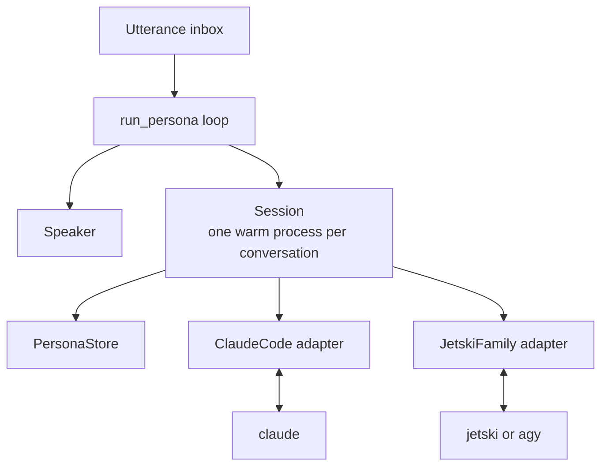

# Unified Headless Wrapper
One wrapper, three headless agent CLIs: Claude Code, Jetski and AGY, all driven as NDJSON on stdin and stdout with one warm process per conversation. This repo also holds the design record for the Lupin kernel, the host service that will run every Lupin persona on any of those engines and replace AH4L, the Claude-only harness Lupin uses today.

## Status

**Prototype (v0.0.1).** The wrapper passes its test script against a mock engine that replays captured frames. It has not yet been run end to end against a real engine, and the Claude Code interrupt path is unverified.

**Design.** The Lupin kernel is being specified one register item at a time. As of 2026-11-11: decisions D1 to D68 ruled, Phase 0 captures complete, Phase 1 specified (acceptance tests Kernel-1 to Kernel-8), no kernel code written yet. This README does not track progress; [`src/rnd/v0.0.1/00-status.md`](src/rnd/v0.0.1/00-status.md) does.

## Start here

For a person or a Claude Code session picking up the design work, in this order:

1. [`CLAUDE.md`](CLAUDE.md): imports the ruling protocol, so every Claude Code session opened in this repo loads it at start.
2. [`src/rnd/v0.0.1/02-ruling-protocol.md`](src/rnd/v0.0.1/02-ruling-protocol.md): **the ruling protocol.** How a register item goes from open to ruled: grounding in the record and the code, the narrative, the one-decision-at-a-time walk-through, recording the ruling, the session close, and the house style rules.
3. [`src/rnd/v0.0.1/00-status.md`](src/rnd/v0.0.1/00-status.md): where the work stands and the next three items. Read first in every session, update last.
4. [`src/rnd/v0.0.1/01-framework.md`](src/rnd/v0.0.1/01-framework.md): the master design. Read the sections the item names, not the whole file.

## Repository layout

```
unified-headless-wrapper/
├── CLAUDE.md                     loader for the ruling protocol
├── README.md                     this file
├── LICENSE                       Apache License 2.0
├── .gitignore
├── hook.ndjson                   empty; committed with "Add hooks", candidate for removal
├── hook_block.ndjson             empty; committed with "Add hooks", candidate for removal
└── src/
    ├── lupin_headless.py         the v0.0.1 prototype wrapper
    ├── fake_engine.py            mock engine for the prototype
    ├── test_headless.py          scenario script for the prototype
    ├── captures/                 capture and inventory scripts, RUNBOOK.md, out/
    └── rnd/v0.0.1/               the design record
        ├── 00-status.md          where things stand; read first, update last
        ├── 01-framework.md       master design: decisions, components, register
        ├── 02-ruling-protocol.md how each item is ruled and recorded
        ├── chronicle.md          one narrative entry per session
        ├── narratives/           one cold-readable write-up per item
        ├── specs/                one ruled specification per item, plus foundations
        ├── transcripts/          one transcript per session
        ├── evidence/             analyses of capture rounds
        ├── captures/             the first AGY capture bundle, kept with the record
        ├── kernel-explainer/     shareable explainer page and figures
        └── archive/              superseded documents
```

### The prototype: `src/`

| Path | What it is |
|---|---|
| `src/lupin_headless.py` | The wrapper: engine adapters, `Session`, `PersonaStore`, `Speaker` and the single-persona loop |
| `src/fake_engine.py` | Mock engine reproducing the captured stream-json behavior of both protocol families |
| `src/test_headless.py` | Scenario script that drives the wrapper through the mock |

Phase 1 kernel code will be built in this repo at `src/uhw_kernel/` (decision D45) and move to lupin's `src/lupin_kernel/` once Kernel-1 to Kernel-8 pass (D38).

### Captures: `src/captures/`

Scripts that measure engine behavior or inventory a host before a design depends on it. The current invocation is always the top block of [`RUNBOOK.md`](src/captures/RUNBOOK.md).

| Pattern or file | What it is |
|---|---|
| `cNN_<what>.py` / `.sh` | Capture CNN from framework Section 14 (C1 to C20). These spend engine calls |
| `tNN_<what>.py` / `.sh` | Zero-token host inventory or probe for register item TNN (T08, T19, T22, T25, T31, T32) |
| `run_engine.sh`, `agy_round.sh`, `claude_round.sh`, `jetski_followup.sh`, `capabilities_followup.sh`, `capabilities_round2.sh` | Round drivers: run a set of captures for one engine and write one bundle to paste back |
| `common.sh`, `capture_lib.py` | Shared plumbing sourced or imported by the captures |
| `drive.py` | Sends turns to one stream-json engine process, records every frame, summarizes each turn |
| `facts.py` | Reduces a capture's output folder to `facts.json` and a verdict |
| `probe_hook.py`, `probe_mcp.py` | Hook probe and dependency-free MCP server for C1 to C3 |
| `approval_hook.py`, `approval_mcp.py` | Tool-approval hook and the MCP server that plays the human, for C18 |
| `out/` | Results: `<capture>-<engine>-<timestamp>/` per run and `<item>-<host>-<date>.txt` per inventory |

`src/captures/.gitignore` commits only the readable results (bundles, `verdict.txt`, `facts.json`, `results*.tsv`, `spoken*.txt`, `tool-map.tsv`, `version.txt`). Raw frames, hook and MCP logs, engine stderr and MCP configuration backups stay local because they carry full payloads and tokens.

### The design record: `src/rnd/v0.0.1/`

| Path | What it is |
|---|---|
| `00-status.md` | Phase, open items, the next three, the working rhythm and the session log (newest first). Holds no design |
| `01-framework.md` | The master design, and the one document every facet branches out from. Section 1 decisions log (D-numbers); 2 conclusions from reading the code; 3 to 13 design per component (architecture, core types, engine layer, voice in, voice out, tool gate, turn-end policy, fleet, observability, AH4L coverage, persona bootstrap); 14 captures; 15 build phases and gates; 16 fill-in order; 17 risks; 18 Lupin application changes; 19 platform and operations; 20 TODO register (T-numbers); 21 companion documents |
| `02-ruling-protocol.md` | The ruling protocol (see Start here) |
| `chronicle.md` | The design process as narrative, one entry per session, written at its close: what was asked, read, found, corrected and ruled. A reconstruction; the transcripts are the record |
| `narratives/` | `YYYY.MM.DD-tNN-<slug>.md`: the plain-language write-up of one item, readable cold: problems, options with pros, cons and a recommendation, and the decisions table with the rulings |
| `specs/` | `YYYY.MM.DD-tNN-<slug>-spec.md`: the ruled design of one item, with its reference Python module and tests inlined and its acceptance tests; later items append amendment sections rather than rewrite. The October foundations sit beside them: the AH4L capability inventory, the role table, the ticketed-asks spec, the interfaces figure and the Phase 1 kernel and Jetski-family adapter spec. `t22-reference/` is the T22 reference module from before it was inlined, now redundant |
| `transcripts/` | `YYYY.MM.DD-tNN.md`: one per session, written from inside it at its close. Rick's turns verbatim, the assistant's abridged, tool activity in brackets |
| `evidence/` | Written analyses of the capture rounds: Phase 0 parts A (AGY) and B (Jetski), Jetski C11 to C14, the Claude round, the AGY round, AGY capabilities |
| `captures/2026.10.15-agy/` | The first AGY capture bundle (C1 to C4 and the pyramid results), kept beside the evidence that cites it |
| `kernel-explainer/` | A shareable explainer of the Lupin kernel and its four interfaces: `lupin-kernel.html`, four SVG figures, and `build_svgs.py`, which regenerates the figures from `style.inc` |
| `archive/` | Superseded: the 2026-10-12 prototype design document and build order, and the 2026-10-26 design gap review |

### Names used across the record

| Name | Meaning |
|---|---|
| AH4L | The ad hoc harness for Lupin: today's Claude-only harness, which the kernel retires |
| UHW | This repo, the unified headless wrapper |
| Lupin kernel | The host service UHW is designing: one per host, runs every persona, gates every tool call |
| AGY, Jetski | The two Jetski-family engine binaries; AGY runs on the development server and the test VM, Jetski on the work laptop |
| D-numbers | Decisions, framework Section 1 |
| T-numbers | Register items, framework Section 20; one working session (or more) per item |
| C-numbers | Captures, framework Section 14; the script names carry them |
| Kernel-1, Convention-9, Quota-1 … | Acceptance tests and gates, each prefixed with a word saying what it proves |

The working branch is `wip-v0.0.1-2026.10.15-planning-prep`.

## Architecture



Adapters translate each engine's protocol into one normalized event stream, so nothing above the adapter is engine-specific. Adding an engine means writing one adapter class.

## Usage

Requires Python 3.10+ on a POSIX system, with no third-party packages.

```bash
# Talk to an engine; typing while it speaks is a barge-in
python3 src/lupin_headless.py --engine agy --persona alpha

# Run the mock-engine scenarios
cd src && python3 test_headless.py
```

Options: `--engine claude|jetski|agy`, `--persona <id>`, `--system <prompt>`, `--cwd <dir>`, `--skip-permissions` to auto-approve tools, `--new` to forget the persona's stored session.

## License

Apache License 2.0. See [LICENSE](LICENSE).
