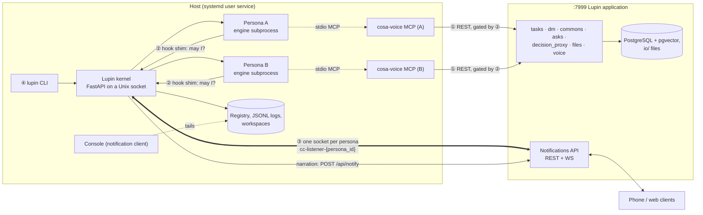
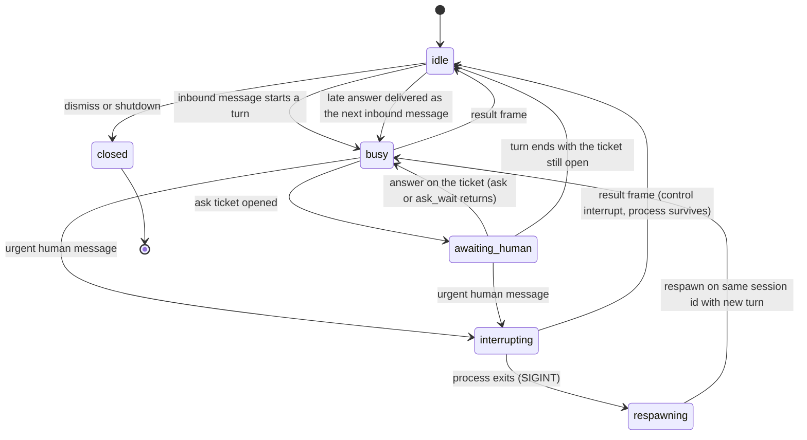
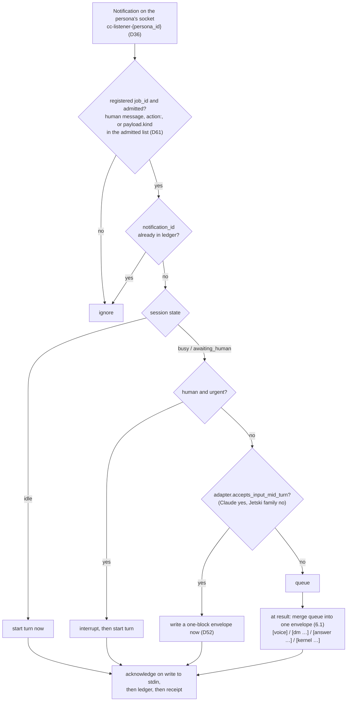
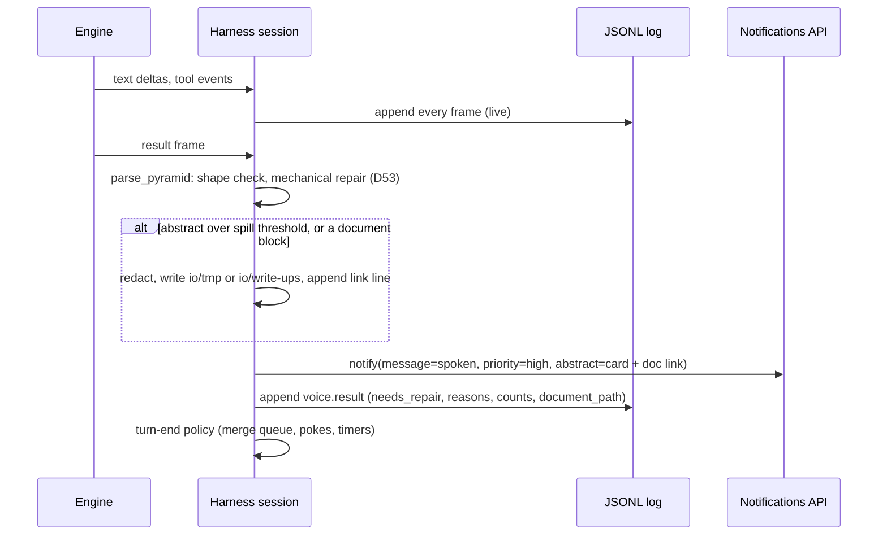
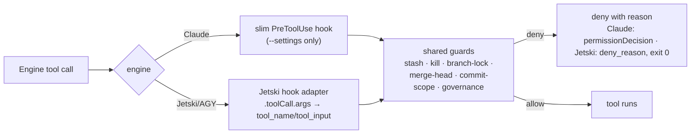
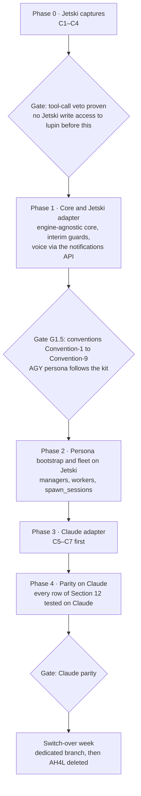

# UHW and the Lupin kernel: master design and implementation framework

**As of:** 2026-11-10 (created 2026-10-14) · **Author:** Rick Ruiz · **Status:** the master design. It holds every decision, every component and every open issue for building the Lupin kernel and retiring AH4L. Companion documents (Section 21) hold detail and evidence, and branch out from here.

**How to read it:**
- Decisions are locked in Section 1.
- Everything not yet designed or decided carries a `TODO(Tnn)` marker where it belongs. All of them are listed in the register in Section 20, which is the single list of remaining work.
- Search for `TODO(` to find them in place.

---

## 0. Purpose and bottom line

The Unified Headless Wrapper (UHW) replaces the ad hoc harness for Lupin (AH4L) completely. AH4L drives Claude Code inside tmux through eight user-scope hooks, a notification listener per session, and tmux keystroke injection. UHW drives Claude Code, Jetski and AGY as headless subprocesses that speak stream-json, from one host-side kernel. All voice enters and leaves through the Lupin notifications API.

The kernel is on the **control path, not the data path** (D35). It starts every agent, decides every tool call and holds the inbound sockets. Agents still call Lupin's REST endpoints themselves, through cosa-voice, so Lupin stays the system of record and its endpoints stay largely as they are (Section 18).

The work happens on one dedicated branch. The Jetski/AGY family is built first, then Claude reaches full parity, then there is a one-week switch-over, after which AH4L is deleted. The two modes never run at the same time.

---

## 1. Decisions log

| # | Decision | Ruling | Where decided |
|---|---|---|---|
| D1 | Naming | No abbreviations. `Ev` becomes `EngineEvent`. `Event` collides with `asyncio.Event`/`threading.Event` (23 uses in lupin) and with SSE/WS/heartbeat "events". `UhwEvent` names a project that disappears at cutover. | 10-13 |
| D2 | Code style | Lupin house style: spaces inside parentheses, Requires/Ensures docstrings. | 10-13 |
| D3 | Rollout | One dedicated branch. AH4L and UHW never run at the same time. One switch-over week after implementation and testing, then AH4L is removed entirely. No backend switch, no compatibility re-exports, no coexistence tests. | 10-13 |
| D4 | Hook isolation during development | Claude children launch with `--setting-sources project,local` + a generated `--settings` file + `--strict-mcp-config --mcp-config`. The flags stay after cutover: explicit config, never whatever happens to be in `~/.claude`. | 10-13 |
| D5 | Voice transport | All voice I/O goes through the notifications API, in both directions. | 10-13 |
| D6 | Inbox topology | ~~One WebSocket per kernel~~ **superseded by D36** for the socket count. Still in force: routing by `job_id` to an `asyncio.Queue` per persona; no buffer files, no tmux injection, no pane probing. | 10-13, amended 10-26 |
| D7 | Identity | One stable identity per persona, used for `job_id` (routing in), `sender_id` (speech out and client mute state) and the log directory. It survives respins. | 10-13 |
| D8 | Inbound routing | idle → start a turn · busy + human + urgent → interrupt, then start · everything else → queue, merged into the next turn. Peers and answers never interrupt. | 10-13 |
| D9 | Sync vs async | Asks the harness makes are awaitables (`asyncio.to_thread( notify_user_sync, … )`) and never block. Asks the model makes are MCP tool calls, **ticketed per D37**; while a ticket is open the session is in `awaiting_human`. | 10-13, amended 10-26 |
| D10 | `progress_group_id` | Only for real iterative progress (tests 40/120 → 80/120). Never for grouping a turn's speech. | 10-13 |
| D11 | Speech policy | Narrate for every persona. Spoken lines go out at `priority="high"`. Muting stays in the client (per-session quiet mode keyed on `sender_id`, plus the global TTS slider). | 10-13 |
| D12 | Response pyramid | Three layers: spoken (headline + 2 supporting lines) → abstract card → document link. Opus writes all three once, in plain text with section markers, headline first. The harness parses mechanically. `needs_repair` is logged every turn. JSON-schema output (Option A) is the fallback if plain text proves unreliable. **Amended:** the kernel checks shape only. Length and rewriting belong to Lupin's rewriter and the KISS protocol (lupin, planning-is-prompting), which UHW inherits; the word-count rule was dropped. | 10-13, amended 10-26 |
| D13 | Streaming | Tokens stream to the log. Voice gets one notification at `result`. Measure the gap between the spoken block closing and `result` before adding early speech. | 10-13 |
| D14 | Session log | One append-only JSONL per persona/session with every frame, from a single writer. The source of truth for all observation. **Amended 11-08 (D56):** "every frame" is "every frame, bounded" (1 MiB per record, head and tail kept with a hash beyond it); "one file" is one writer-owned chain of segments per log directory; the engine's stderr is in it, not beside it. | 10-13, amended 11-08 |
| D15 | Console | ~~The console is a notification client:~~ **Amended 11-09 (D58):** the terminal console is a reader of the session log. History scrolls into normal terminal scrollback, the input box stays at the bottom (`prompt_toolkit` + `patch_stdout`), a voice **mirror line sits above the prompt**, a **`!` prefix means urgent**. ~~Typed input is posted to the notifications API.~~ Typed input goes to the kernel socket and is logged with `channel: console`. | 10-13, amended 11-09 |
| D16 | Web view | Reuse the console-tee pipeline (`cc_transcript_tailer`, REST backlog, roster, multiplexer client), pointed at the harness logs instead of Claude transcripts. | 10-13 |
| D17 | Switch-over scope | **Full parity**: managers, workers, `spawn_sessions`, arbiter inputs and owed-work pokes all run on UHW before switch-over week. | 10-13 |
| D18 | Kernel placement | A new host-side service with its own systemd user unit. **Amended:** its API listens on a Unix socket (mode 0600, default `~/.lupin/kernel/kernel.sock`), not a TCP port. It replaces `lupin-arbiter-app` rather than sitting beside it (D24). | 10-13, amended 10-26 |
| D19 | Build order | Jetski/AGY first, Claude second. Parity is still measured on Claude. | 10-13 |
| D20 | Document venue | ~~A Claude doc in the project plus Markdown in `unified-headless-wrapper/src/rnd/`.~~ **Amended 11-03:** the repo is the single source of truth. Every UHW document lives only in `unified-headless-wrapper/src/rnd/v0.0.1/`; edits are made live in the laptop checkout when the laptop is connected, and pushed at the end of every working night; sessions without the laptop read the pushed branch from GitHub. The claude.ai project copies under `uhw/` carry a superseded header from 11-03 and are deleted after one week (on or after 11-10). | 10-13, amended 11-03 |
| D21 | Owed-work source | The global task store is the only source of owed work. Retire `heartbeat_task_state` (native `Task*` transcript replay) and the deprecated mirror. | 10-18 |
| D22 | Native task tools | Ignored in every engine (Claude `TodoWrite`/`TaskCreate`, any Jetski-family equivalent). Workflows that reference them are rewritten to use the store. | 10-18 |
| D23 | Jetski behavior layer | planning-is-prompting: all of its skills, with explicit use of the cascade review and adversarial SWE crew workflows. Inventoried before the interface decision. | 10-18 |
| D24 | Arbiter | Folded into the kernel as its fleet-health module. It reads the session logs and the registry, not Claude transcripts; its tmux live-notify path is retired. | 10-18 |
| D25 | Threat model and authorization | Guard against confusion and prompt injection, not against a deliberately adversarial agent; no OS isolation. Role filtering of `tools/list` is published and documented as exposure only. The authorization check at `tools/call`/kernel endpoints and the engine veto exist from day one but run in **observe** mode: allow, and log "would deny". Each rule carries a mode (`enforce`/`observe`/`off`), so turning one on is a config change. Guards ported from AH4L keep `enforce` (parity). **Clarified 10-26:** exposure means `tools/list` hides a tool from a role. A call to a hidden tool is still served, and the gate logs a would-deny until that rule is set to enforce. | 10-18, clarified 10-26 |
| D26 | Chief of staff | A `chief_of_staff` role sits above managers: the persona you talk to, which staffs managers. All crew communication goes through the crew's manager. When human-in-the-loop can't reach you, the chief of staff consults the online preference learner and answers in your stead. This is the integration point for testing that infrastructure. | 10-20 |
| D27 | Escalation | Workers always ask through their manager. Managers may ask you directly; when you're unavailable and they need an answer, they fall back to the chief of staff. No manager exists without a chief of staff. The preference learner already runs in shadow mode, watching asks and your answers and predicting yours; the improvement target is its Bayesian learner, possibly an LLM working inside strict design-system parameters. | 10-20 |
| D28 | Narration | All work is narrated; only some is spoken. Every persona, crew included, narrates through `notify` and its end-of-turn reply. Speech is a client-side decision (priority, quiet mode by `sender_id`, slider): progressive disclosure for voice. Replaces the 10-18 narrowing that silenced crew replies. | 10-20 |
| D29 | Interface architecture | Accepted as partitioned. MCP (cosa-voice) for models; the notifications API for AI-to-human communication; one PreToolUse hook shim per engine family for the engines; the `lupin` CLI for operators; the kernel owns all state, and persona manifests are rendered per engine at spawn. **11-08:** the rationale for the process boundary (subprocess with streaming I/O, not SDK objects) is recorded in Section 2.4a. | 10-20, annotated 11-08 |
| D30 | Commands become skills | All slash commands (lupin and planning-is-prompting) become skills, so Claude and Jetski run from the same source. | 10-20 |
| D31 | Models per role | Not a decision now. Jetski runs any listed Gemini or Claude model; only Claude Code is limited to Claude. Noted: `gemini-launch-candidate-high` was slowest to first token (about 19 s, C13). | 10-20 |
| D32 | Build platform | The Jetski-family adapter is built and tested against **AGY on the GCP test VM**, alongside a test Lupin instance with a dedicated destructive-test server. AGY reaches Gemini, Opus and Fable, with OpenAI models expected. Jetski is checked occasionally on the internal cloud workstation, not used day to day. Claude is installed on the VM, but Claude adapter testing there is constrained (see open items). | 10-23 |
| D33 | Name: Lupin kernel | The host service every persona goes through is the **Lupin kernel**: "the kernel" in prose, `lupin kernel …` on the CLI. It replaces "supervisor", which collided with the manager hierarchy. Definition for docs and persona instructions: the kernel brokers everything — voice, tools, spawns, Lupin — and a persona acts only through its system calls (cosa-voice tools), which the hook shim traps. "Brokers" means authorizes, not relays (D35). | 10-23, clarified 10-26 |
| D34 | No snap engines | Engines run from a non-snap install. A snap's confinement hides `/tmp` workspaces, project hooks and `~/.gemini` (the 2026-10-23 AGY round on the test VM was invalid for this reason). The kernel checks this at spawn and refuses a snap binary. | 10-23 |
| D35 | Control path, not data path | The kernel gates and configures; it does not proxy. Each agent's own cosa-voice MCP server calls Lupin's REST endpoints directly, as AH4L sessions do. The kernel starts and configures that server (identity in its env, role-filtered tool list) and gates every MCP call through the hook shim, arguments included, before the server sees it. Lupin endpoints authenticate the account (`X-API-Key` or JWT); role logic lives in the kernel (Section 8.1). | 10-26 |
| D36 | Inbound sockets | One WebSocket per persona, all held by the kernel in one asyncio process, at `/ws/queue/cc-listener-{persona_id}`. Lupin routes persona-targeted notifications to a session named exactly `cc-listener-{job_id}` (`websocket_manager.emit_to_user_or_listener_sync`), so this needs no server change. One socket per kernel would need the auth message to register job ids (a later, optional server change). Replaces AH4L's per-session listener processes. | 10-26 |
| D37 | Ticketed asks | Every ask the model makes (`converse`, `ask_*`, `commons_ask_sync`) opens a ticket and holds at most 150 s, because AGY and Jetski cut MCP calls at 180 s. Deadline = the ask's `timeout_seconds`. An answer before the deadline is kept on the ticket, or delivered as the persona's next inbound message. An answer after the deadline is rejected and the respondent told. New tool `ask_wait( ticket )`; ticket store at `/api/asks/{ticket}`. Same contract on every engine. Detail: `specs/2026.10.20-ticketed-asks-spec.md`. | 10-20 |
| D38 | Code location | The kernel lives in the lupin repo at `src/lupin_kernel/` ~~from day one~~, on the dedicated branch (D3), importing lupin modules rather than copying them. The UHW repo keeps captures and R&D. **Amended by D45:** it moves there after Phase 1 acceptance; until then the code is in the UHW repo. | 10-26, amended 11-02 |
| D39 | Subagents on AGY | `invoke_subagent` is denied on AGY for every role, chief of staff included, because AGY hooks don't fire inside subagents. The chief of staff staffs through `spawn_sessions` there. Revisit if AGY adds subagent hooks. Jetski and Claude keep the role table's rule. | 10-26 |
| D40 | Dogfooding | Once Phase 1 acceptance (Kernel-1 to Kernel-8) passes on the test VM **and the conventions gate Convention-1 to Convention-9 passes (amended 11-06, D51)**, an AGY persona running under the kernel implements the kernel from Phase 2 on. Planning stays in Claude. | 10-26, amended 11-06 |
| D41 | Skills and commands on every engine | Per D30, every command is a skill. The kernel installs each persona's skills into its workspace's `.agents/skills/` (Jetski family) or `.claude/skills/` (Claude). A turn that starts with `/name` is expanded by the kernel from that skill's `SKILL.md` before the engine sees it, the same behavior as Claude Code's command loader. No `load_skill` MCP tool. Installer paths and Claude-only workflow content (`/clear`, `TodoWrite`, hook events, tmux) remain part of T18. | 10-26 |
| D42 | `sender_id` names the engine | Non-Claude personas use `agy@<project>.deepily.ai#<8 hex>` and `jetski@…`; Claude personas keep `claude.code@…`. `parseSenderId` already accepts any local part as `agentType`. Display code that matches `claude.code` literally must be found and generalized (T27). | 10-26 |
| D43 | Instruction files in worktrees | The kernel writes each persona's `AGENTS.md` and `.agents/` into its lupin worktree and adds both to that worktree's `.git/info/exclude` at provisioning. No global `--agent` definitions on AGY. | 10-26 |
| D44 | Default model per role | Jetski-family model ids (`agy models`): `chief_of_staff`, `manager`, `steward`, `author` → `fable-5.1-high` (Claude Fable 5.1, High); `implementer`, `reviewer`, `tester` → `opus-5.5-high` (Claude Opus 5.5, High). These are defaults in the persona manifest, overridable per persona. Claude Code personas use the same models under Claude Code's own model ids. D31 stays open for any change beyond these defaults. | 10-26 |
| D45 | Phase 1 code location and write locations | Phase 1 is built in `unified-headless-wrapper/src/uhw_kernel/` on the test VM, written by a Claude Code session under AH4L and driven by voice through the test instance on :7999; the kernel under test targets the destructive-test server. The package imports nothing from lupin and reaches it only over REST and WebSocket; any lupin behavior needed before the move goes behind one boundary module, `lupin_compat.py`, never copied into the package tree. After Kernel-1 to Kernel-8 pass, the package moves to `lupin/src/lupin_kernel/` (D38) and an AGY persona under the kernel takes over implementation (D40). Write locations until then: lupin is written on the dev server only (laptop clone read-only, VM checkout pull-only); in the UHW repo, `src/rnd/` is written from the laptop and `src/uhw_kernel/` and `tests/` on the VM; disjoint paths, one branch, `git pull --rebase` before starting. | 11-02 |
| D46 | Persona id | **One identifier, eight lowercase hex characters** (`[0-9a-f]{8}`), minted at random by the kernel when a persona is created and checked for uniqueness against the registry and every known memento id. It is, unchanged, the `job_id`, the `sender_id` suffix, the inbound socket name `cc-listener-{persona_id}` and the persona directory name. No UUID form exists; today's `stable_session_id` and the two-width join in the roster disappear. The id survives respins and engine changes; dismiss followed by spawn mints a new one. Engine ids (`conversation_id`, Claude `--session-id`) are registry fields, never identity. ~~At switch-over every live persona keeps `stable_session_id[:8]`, so `job_id`, socket name, suffix, client mute state and memento matches are byte-identical before and after.~~ **Amended 11-10 (D64, Rick):** the kernel fleet is spawned fresh at the switch-over; names carry over, identifiers do not; the memento match falls back from the id to the slug. Detail: `specs/2026.11.03-t10-stable-id-spec.md`. Resolves T10. | 11-03 |
| D47 | Launch per persona | **Every Jetski-family persona runs `--mode auto`**; manifest validation admits no other value until a later item asks for one (`plan` is a second approve-then-execute loop whose artifact sits outside the worktree; `bestn` is unmeasured). `--mode` is passed explicitly on every spawn. Claude's counterpart is `--dangerously-skip-permissions` with `--tools` (D49; `--allowedTools` was wrong, see D49). Instructions reach the model in six kernel-rendered layers with identical text on every engine: kernel contract, role charter, persona instructions and format rules through `--append-system-prompt` (Claude) or the `--agent <role>` definition body in the worktree (Jetski family, with the role's native `tools:` allow-list in its frontmatter); project mandates through the worktree's `CLAUDE.md` (Claude) or a kernel-written `AGENTS.md` that copies it (Jetski family, D43); memento and charter brief in the first turn. The kernel depends on no global instruction file. Detail: `specs/2026.11.03-t11-launch-per-persona-spec.md`. Resolves T11. | 11-03 |
| D48 | Engine vetting at spawn | The kernel keeps `~/.lupin/kernel/engines/vetted-engines.json` (binary → version → tool table id, vetted time, run directory). At spawn it stats the binary; when inode and mtime match a vetted entry nothing more runs. Otherwise `--version`, and for an unseen version one vetting run under a per-binary lock: the C2 turn in a throwaway workspace plus one probe-MCP call, checked against the adapter's tool table, plus `modelName == pinned`. Pass: record and admit. Fail: refuse the spawn, the persona enters `respawn_blocked`, the reason is narrated. `engine_update_policy: vet | refuse | trust`, default `vet`. The shim identifies the binary from `LUPIN_ENGINE` in its environment, never from payload keys. Resolves T24's design; C16 measures the update mechanics. | 11-03 |
| D49 | Tool approval | **Approval is a gate concern, never an engine prompt.** Rule modes become `enforce` \| `ask` \| `observe` \| `off`. On an `ask` match the gate opens a `tool_approval` ticket in the D37 store and denies with an instruction (`needs approval · ticket ask-… · call ask_wait( "ask-…" ); when it returns answered:yes, repeat this exact call`); the repeat is allowed once when the ticket is answered yes, matched on the rule's `approval_key( call )` (the act, normalized), not the command text. Each `ask` rule names an `approver` (`human` \| `manager` \| `learner`; Phase 1 default `human`); the D27 chain is the fallback when the approver misses the deadline; the preference learner shadow-predicts every approval ticket from the first one and is promoted to approver per rule on measured agreement (T29). The rule table of record is the destructive-act taxonomy in the spec's Section 6 (reversibility × blast radius; added 11-05 after Rick called the parity-derived list of five ad hoc): about nine `ask` rows (history rewrite, branch lock, merge head, filesystem destruction outside the worktree, process and service, first push and external writes, dismissing a peer with `approver: manager`, installs and engine updates), `enforce` rows with no AH4L ancestor (kernel and Lupin liveness, database, secrets), and stash and commit scope demoted to `observe`; modes are a starting point, revisited from C18 and the first tickets. The `LUPIN_ALLOW_*` env vars are deleted; the git reference-transaction hook behind branch protection stays and must honor an approved bypass too. Per act in Phase 1; `scope: session` later. **Claude runs `--dangerously-skip-permissions`** (`bypassPermissions`), the family's flag; because that mode ignores allow rules, the role allow-list is `--tools "<list>"`, not `--allowedTools` (D47 corrected). Not used: `--permission-prompt-tool`, `PermissionRequest` hook, PreToolUse `defer`, `auto` mode (a deferred capture, Section 14.5), `--permission-prompts none` (pending C18). Nothing of `permission_request.py` survives. Detail: `specs/2026.11.05-t26-tool-approvals-spec.md`. Resolves T26. | 11-05 |
| D50 | Credential exposure | **On one operating-system user there is no credential boundary between personas; the user account is the boundary** (accepted under D25). Four credentials sit on a fleet host: the fleet key (account-level, shared by every seat), the per-project service login, the human owner's login (an optional `[owner]` section of `~/.lupin/config`, absent on the dev server 11-06) and the engines' vendor credentials. Six parts: (1) the `[owner]` section is never written on a fleet host; kernel config carries `owner_user_id`; the kernel refuses to start if it finds the section or a service login on Lupin's effective approver map (`GET /api/tasks/approval-settings`). (2) A human approval counts only through Lupin's second door (`authenticated_account_email` → `approver_persona_for_account`); a fleet-key answer is stored and ignored. A persona approver's answer counts only when the kernel witnessed the gated `ask_answer` call; Lupin's `answered_by` is not consulted for persona approvers. (3) The secrets row splits: `credential_read` enforce, `credential_print` observe, `direct_call` observe per instance and role (voice, destructive-test, kernel socket). (4) Direct calls: pattern rules now; a `User-Agent: cosa-voice/<v> persona=<id> gate=<call>` header on every outbound cosa-voice call now; reconciliation of Lupin's access log later, under this item. (5) One `redact()` at the two writers, the JSONL log and the narration path, with a per-kind fingerprint marker. (6) T36 opened: per-persona keys, first task the O(N) bcrypt sweep; the fleet key stays for Phase 1. Detail: `specs/2026.11.06-t32-credential-exposure-spec.md`; narrative `narratives/2026.11.06-t32-credential-exposure.md`. Resolves T32. **Amended 11-09 (test VM check):** where the persona account is privileged (passwordless `sudo` or `docker`, as on the test VM) the boundary is the host, not the account; accepted for the test VM; the kernel records `persona_account_privileged` in `kernel.started`; nothing that speaks as a human is kept on a persona host (D58); unprivileged persona accounts for production hosts go to T16. Credential files are mode 640 and their directory 750, enforced by a startup invariant and reported by the inventory script; applied on the test VM 11-09 (the Lupin container does not mount `~/.lupin`, so nothing depended on the looser modes; lupin ticket 1dcecdb9 stops `push-env` from recreating them). | 11-06, amended 11-09 |
| D51 | Convention parity before the AGY handoff | Kernel-1 to Kernel-8 prove plumbing, not behavior; the planning-is-prompting layer the implementer must follow was Phase 2's deliverable. Five parts: (1) a **minimum convention kit** is ported first, then a **conventions gate Convention-1 to Convention-9** sits between Kernel-1 to Kernel-8 and the handoff (G1.5); the crew layer stays in Phase 2, built by the AGY implementer once it lives under the kit. (2) The kit is the solo-implementer subset, about 25 workflows (session ritual; planning the work; doing the work; talking to the human, including `decision-walkthrough`); a convention missed in the first week is added to the kit, never improvised around. (3) Convention-1 to Convention-9 is the acceptance set, one convention observed end to end per item. (4) The Phase 1 Claude Code session builds the port after Kernel-8, as its last job before the handoff; T18 supplies the rules. (5) **One workflow set** with the engine plumbing behind kernel verbs (start cold, rehydrate, add a task, ask the human, plan first, mandates file, skills directory); AH4L honors the same verbs until switch-over. Detail: `specs/2026.11.06-t37-convention-parity-spec.md`; narrative `narratives/2026.11.06-t37-convention-parity.md`. Resolves T37; amends D40. | 11-06 |
| D52 | Inbox envelope and ledger | **Headed blocks, one plain-text grammar on every engine:** `[kind time attrs]` on its own line, body verbatim, blank line between blocks; kinds `voice` (the human, any channel), `dm`, `answer`, `kernel`; a count line opens any envelope of two or more; an interrupt leaves a `kernel` block naming the cut tool call; `/skill` expands per block; a body line that would parse as a header is indented, never cut. The header carries identifiers only (sender, message, thread, ticket); how each kind is answered is in the kernel contract once; no per-turn rider, with a **provision**: an optional per-persona `inbox.rider` (prepend/append, off by default, logged per envelope) if the contract alone proves insufficient over long sessions. `InboundMessage` gets `kind` and `channel`; `source` is gone. **Ledger:** `~/.lupin/kernel/personas/{persona_id}/inbox.json` (last 500 acknowledged ids, answers and DM cursors), rebuildable from the session log; the queue is memory only. **Order:** stdin write → ledger append → receipt (at-least-once; a replayed id in the ledger is dropped and logged). **Catch-up is a pull on every connect** (`answers-owed`, `dm/list`), because Lupin's reconnect replay serves device-slot holders only, never a `cc-listener-*` session; the Phase 1 spec's replay assumption is struck. **Voice gap** (a human message sent while the kernel is down and a browser is open is unrecoverable, as today) closed by a Lupin change after Phase 1 (T27). **Mid-turn:** `if adapter.accepts_input_mid_turn: write now else queue`, every non-urgent kind. Acceptance Inbox-1 to Inbox-6. Detail: `specs/2026.11.06-t12-inbox-envelope-spec.md`. Resolves T12. | 11-06 |
| D53 | Voice out | **One format text on every engine** (D47 layer 4): the probe's version 2 rule in the brevity mandate's vocabulary (one spoken line is enough when one answers, at most two more; a line is one sentence that makes a claim; plain words, no identifiers in speech; detail to the abstract; a document only when asked or too long for a card; longer only when asked), markers unchanged (`<<<abstract`, `<<<document transient | persistent`), the DM style line spelled out at its end. **Documents live in Lupin's `io/`** under `lupin.root`: `transient` → `io/tmp/yyyy.mm.dd-<persona_id>-<slug>.md`, swept by Lupin's existing daily cron at more than 7×24 h; `persistent` → `io/write-ups/…`, kept; the kernel never deletes; one appended line `[Open: <file>](/app/docs?path=lupin/io/tmp/<file>)` in the abstract; files pass `redact()`; `voice_out.documents: off` for a host that does not share the instance filesystem, the fleet-key upload door a T27 row. **Spill:** an abstract over `voice_out.abstract_spill_chars` (default 2,000) goes whole into a transient document; the card keeps the head to the last blank line plus the link; routing, not rewriting. **Shape** is four rules (spoken block of one to three lines before any marker; no markup in spoken lines; each marker once, own line, abstract before document; a document marker carries a mode) with seven reason codes; **repair is mechanical, never a model** (syntax stripped, extra lines moved to the abstract, a missing spoken line taken as the first sentence of the abstract, stray markers made body text, a missing mode read as transient); the "local 14B rewrite" step is deleted; `--json-schema` stays as the fallback. **Length:** the kernel logs `spoken_chars` and `spoken_sentences` and cuts nothing; Lupin's 500-character cap reaches only its MCP layer, and where `/api/notify` enforces for kernel senders is a T27 row. **Per-turn record** `voice.result`, fifteen fields, one per result. Acceptance Voice-1 to Voice-5. Detail: `specs/2026.11.06-t13-voice-out-spec.md`; narrative `narratives/2026.11.06-t13-voice-out.md`. Resolves T13. | 11-06 |
| D54 | Persona bootstrap | **The kit is rendered into the worktree from a pinned commit:** one planning-is-prompting checkout per fleet host at `~/.lupin/kit/` at the commit in `~/.lupin/kernel/kit.lock`; each kit skill a folder under `$LUPIN_SKILLS_DIR` holding `SKILL.md` (rendered wrapper) beside `WORKFLOW.md` (the canonical workflow, verbatim); project values from a required committed `<repo>/.lupin/project.yaml` (`prefix`, `history_file`, `todo_file`, `kit_groups`); `kit_commit` recorded per spawn. **Layer 5 is a kernel-rendered mandates file** `<worktree>/.lupin/mandates.md` (kit `global/CLAUDE.md` + project `CLAUDE.md` + `CLAUDE.local.md`), `$LUPIN_MANDATES_FILE` on every engine: copied to `AGENTS.md` on the Jetski family (D43); on Claude the project files load natively and the global part is the fifth `--append-system-prompt` block; `mandates_sha256` logged; the host's `~/.claude/CLAUDE.md` is nobody's dependency and the T11 spec's C15b conditional is withdrawn. **The memento writer stays, with three changes:** identity from `LUPIN_PERSONA_ID` before any bridge file; mirror root `$LUPIN_MEMENTO_MIRROR` (default `~/.lupin/mementos/<repo>/`); stamp key `persona_id=` with every reader accepting `session_id=` too (same eight hex, D46); slots, record/pointer/mirror and the nine-element contract unchanged; the kernel never writes a memento. **The kernel composes the first turn** as one `[kernel first-turn …]` block: spawn line (`cold` \| `rehydrate`, kit and mandates hashes), the session-start skill expanded (Convention-1 is a mechanism), the brief if any, then "Prior context" with the record's full content resolved by the kernel (persona-id match, then newest for the slug) with its age, stale records inlined and marked; `memento.rehydrated` logged. **Respin is a kernel handshake:** `lupin persona respin <id>` sends a `[kernel respin …]` block, waits for turn end within `respin.timeout` (600 s), looks for a record newer than the request; found → respawn with it; missed → repeat once; still none → respawn cold, `respin_without_memento` narrated and logged; default slot `io`; a persona's own request is a `tool_approval` ticket (D49) then the same handshake. **The provisioner is the installer:** `lupin persona spawn` renders everything, writes `.git/info/exclude`, records `kit_commit` and `mandates_sha256`; `lupin kit pin <commit>`; new gate rule `kernel_owned_file` in `enforce`; `doc_deploy_parity` gains the rendered copy; the wizard is not ported. Crew and cascade charter briefs (first-turn part 3) and a provisional-mandates verb stay Phase 2 (D51). Acceptance Bootstrap-1 to Bootstrap-7. Detail: `specs/2026.11.06-t18-persona-bootstrap-spec.md`; narrative `narratives/2026.11.06-t18-persona-bootstrap.md`. Resolves T18. | 11-06 |
| D55 | Lupin application changes | **Voice gap:** a receipt-gated pull mirroring the late-answer handback: column `listener_delivered_at`, set only by `POST /api/notifications/undelivered/ack`; `GET /api/notifications/undelivered?job_id=&since=` returns the human-to-persona rows not yet acked, regardless of browser state; the kernel's order per voice message is stdin write → ledger → ack, with a `voice_cursor` as the third pull row on every connect. **Treatment stamp:** `payload.rewrite = { applied, rule_version, chars_before, chars_after, outcome }`, written at delivery by any rewriter on any path, absent when none ran; the corpus keeps its fifteen tutor fields. **Spoken cap for REST senders:** `/api/notify` measures as the MCP layer does, under the same two INI keys, and over the cap routes the full line verbatim to the top of the abstract, speaks the leading sentences, and stamps `rule_version: spoken-cap-1`; the MCP layer keeps rejecting (a model is in the loop there), the REST layer routes (the turn has ended). **Upload door:** `POST /api/docs/upload` takes the fleet key, confined to `dir` ∈ {`io/tmp`, `io/write-ups`}, the document filename pattern, `on_conflict` ∈ {refuse, rename}; kernel `voice_out.documents: write \| upload \| off`, auto-chosen. **Engine label:** the kernel stamps `payload.engine = { name, version, model }` on every post; the card reads it; `projectFromSenderId` generalized to any local part; `notifications.js` gets no new work, the INI flag `legacy notifications redirect enabled` retires it at switch-over. **Tickets:** `payload.ticket = { id, kind, state, deadline, approver, asked_by, question, approval? }`; the action-required card keys on ticket id, gains `escalated`, the late-answer notice naming the question, and the `tool_approval` card; built after the ticket store. **Mobile** mirrors from the same keys in `lupin-mobile`, after web. The mandates deploy row moves to the T19 deletion list. Build order by daily-use impact (spec Section 11). Acceptance Lupin-1 to Lupin-8. Detail: `specs/2026.11.08-t27-lupin-application-changes-spec.md`; narrative `narratives/2026.11.08-t27-lupin-application-changes.md`. Resolves T27. | 11-08 |
| D56 | Log schema and rotation | **One envelope on every line:** `{ timestamp, monotonic, sequence, persona_id, turn_id, kind, data }`; `kind` is `owner.event`, the owner the kernel module that wrote it; payload only under `data`; the catalogue is the T17 spec Section 4 and a kind outside it fails the unit test. **Stderr through the writer** as `engine.stderr` records, capped per minute; the raw file is gone, so the credential ruling's two choke points hold. **Writer-owned segments** `log/{yyyy.mm.dd-HHMMSS}.jsonl`, rolled at 64 MB, at kernel start and at the UTC day, each opening with `log.segment`; an hourly in-kernel sweep (dry run by default) deletes by age (14 days in exact minutes, never the two newest), by a 1 GiB per-persona cap, and a `closed` persona's directory whole after retention; the ledger rebuild is complete with fewer than 500 ids because the cursors are recovered too. **Durability:** flush every record; sync `inbox.written`, `session.*`, `gate.deny`, `gate.ask`; the receipt waits on the sync. **Held turn:** the session task detects it (busy, open tool call past `watch held turn seconds`, no frame since, never in `awaiting_human`), writes one `watch.held_turn` per call id and one advisory up the escalation chain; manifest `watch.held_turn_action: advise | interrupt`, default `advise`; the fleet-health module reads records and detects nothing; the arbiter's watchdog and context-pressure writer retire. **Web console:** Lupin's tailer, wire and client kept; the resolver and roster read the kernel socket; a kernel-record mapper emits the same blocks (kernel annotations as role and kind `kernel`, which the renderer already shows); `~/.lupin/kernel/` mounted into Lupin's container; a segment roll is the existing `rotated` state; `cc_transcript` paths kept until the switch-over rename; `claude_code_queue`'s tombstones to the deletion list. **The kernel's own log** under `~/.lupin/kernel/log/`, same writer, `persona_id: null`. Spec `specs/2026.11.08-t17-log-schema-and-rotation-spec.md`; acceptance Log-1 to Log-6, folded into Kernel-1, Kernel-3, Kernel-5, Kernel-7. **Amended 11-09:** `engine.stdin` and `engine.frame` carry `text_at`, a path into `raw` to the display text; the mapper follows it and nothing is stored twice. | 11-08, amended 11-09 |
| D57 | Context exhaustion | **Lines are ratios of the engine's ceiling, not the model's window.** `[context windows]` holds `window_tokens` and `ceiling_tokens` per engine and model id; the ceiling is where the engine compacts on its own (AGY: a fixed **256,000** for every model, confirmed by Google staff 2026-11-04/06 and users' session databases; Jetski the same until measured; Claude its effective window). Two lines per ceiling class, the 2026-08-13 fractions unchanged: at or above 500,000 → notice 0.40, respin 0.50; below → notice 0.60, respin 0.75 (AGY: ≈154,000 and ≈192,000). **Occupancy** is the newest model call's prompt size (Claude `input + cache_creation + cache_read`; Jetski family `input_tokens + cache_read_tokens` of the `agent_response` DONE step), never the cumulative `result.usage`. **The session task detects on every `usage` event and the kernel acts:** crossing the respin line runs the D54 handshake with `trigger: pressure` and one `type: info` line up the chain; manifest `pressure.action: respin \| advise`, default `respin`; per-persona `respin_ratio` override. **No emergency interrupt:** reaching the ceiling on AGY is a ~70 s stall and a summary, not a failure; `pressure.compaction_action: none \| interrupt` defaults to `none`. **The engine's own compaction is recorded** (`watch.compacted`, explicit from the `checkpoint` step, implicit from a drop of more than half) and answered with a non-urgent `[kernel memento]` request. **Records:** seven-field `watch.pressure` once per upward crossing per line; `pressure: { ratio, status, measured_at }` on the roster, which readers read and never derive; an unlisted model is `unknown`, narrated once, never acted on. **Retired at switch-over:** lupin's `context_pressure.py`, `context_pressure_writer.py`, `self_respin_observer.py`, the tick script and cron, the arbiter's state section; `GET /api/arbiter/context-pressure` repointed at the roster; the manager-context-monitoring workflow reduced to one kit rule. **Process:** a research step precedes any capture that burns context (Rick, 11-09); C19 confirms the record per D44 model. Spec `specs/2026.11.09-t23-context-exhaustion-spec.md`. | 11-09 |
| D58 | The console | **One mapper, in the kernel package** (`log/mapper.py`, pure, standard library only, written in Phase 1), imported by Lupin's tailer after the move; it emits meaning and readers style to their own capacity. **Every kernel block carries `name`** (the record's kind) **and `level`** (`info`, `notice`, `alert`) from one closed table; ten kinds join the D56 mapper table (the four `ask.*`, the three `respin.*`, `gate.unreachable`, `gate.would_deny`, `log.truncated`). **Style:** a dim monospace row with a rule coloured by level; consecutive stderr lines fold into one counted row. **Filter:** three views, `conversation`, `work` (default), `everything`, applied by the reader after the mapper; an alert passes every view. **Pressure:** the roster's published `status` picks the colour (amber `notice`, red `over_budget`, grey `unknown`) on the terminal status line, the web console header and the fleet table; no reader derives one from the ratio. **Phase 1 gains a read-only `lupin persona watch <id>`** with Kernel-3. **The interactive console runs on Rick's laptop,** after Kernel-8: the kernel socket by SSH Unix-socket forward, the log over the same session, Rick's Lupin login on the laptop only, and the token never through the kernel. Checked on the test VM (11-10 UTC): the persona account has passwordless `sudo` and `docker`, so no on-host boundary exists. **Input:** plain is a message, `!` is urgent with the cut call named first, `/name` is a skill (D52), `:` is a console command. **Tickets:** `:answer <ticket> <reply>` goes straight to Lupin with Rick's token once the ticket store exists; a plain line never answers one. D15 amended. Spec `specs/2026.11.09-t20-console-spec.md`; acceptance Console-1 to Console-7, the first three folded into Kernel-1, Kernel-3, Kernel-7. | 11-09 |
| D59 | The fleet | **One process knows the fleet; the registry is the census, the lineage and the liveness record.** Ten parts. (1) **Staffing routes and the caller:** a spawn is a role's manifest template plus named overrides (`engine`, `model`, `project`, `brief`, `voice_preference`, `seed_memento`, `billing`); the three tool names stay; a persona caller is accepted only against an unused allow that the kernel's own gate recorded for that persona, tool and argument hash, at most 30 s old (the in-kernel half of T36's signed grants); the CLI is the operator; batches are admitted all or nothing, then created child by child. (2) **Admission in the kernel:** one ordered check list (skeleton crew, per-call cap, fleet cap, slots for engine quota and host capacity) under the registry lock; `[fleet]` re-read at each admission; Rick's 2026-09-03 rulings unchanged (one number, refuse and never reap, managers count); every decision logged with its census; re-spin is never admitted. (3) **Every persona its own worktree, outside every repository:** `<worktree_root>/<repository>/<persona_id>` (default root `~/.lupin/kernel/worktrees`), created detached at the main checkout's `HEAD` and locked `lupin-persona:<id>` by `worktree.py` before the provisioner runs; `worktree_setup:` in `.lupin/project.yaml`; the tree outlives the process. (4) **Dismissal is the D54 handshake with a different ending:** no record after two asks withholds the stop (`withheld_no_memento`), `force` overrides, `memento: skip` exists; the branch probe names and never withholds; teardown keeps and reports a tree with uncommitted, ignored-data or unmerged work, never pushes; open task rows go to the manager. (5) **Harvest is a fact on the row:** `harvest_ack( persona_id )` sets `harvested_at`; gate rule `dismiss_unharvested` in `observe`; built with the crew layer. (6) **A manager with live reports is not dismissed** unless the caller says `cascade` or names a new manager. (7) **Idle personas hibernate:** the process is stopped after 30 idle minutes, the row, tree, voice and task rows stay, the next message resumes the conversation; counts against the cap, not against host capacity; one advisory after 24 h; the kernel never retires a persona on its own. (8) **One kernel per host, one fleet per Lupin instance;** `host` recorded; no kernel-to-kernel protocol; the kernel does not serve its own tail. (9) **A dedicated unprivileged account on any host that holds a human's credentials;** `[host] class: production \| test`; on `production` the kernel refuses to start when its account is privileged; applied at switch-over, details after an inventory on the development server. (10) **`billing: default \| vertex` in the manifest;** `vertex` only for the Claude engine, through lupin's `vertex_env` unchanged, Phase 3. Retired at switch-over: `session_spawner.py`, the three cap modules, `respin_credit.py`, `reap_memento.py`, the seat-worktree scripts, the idle reap; kept and imported after the move: `reap_branch`, `seat_teardown`, `worktree_reaper`, `worktree_straggler_tickets`, `vertex_env`. Spec `specs/2026.11.09-t16-fleet-spec.md`; narrative `narratives/2026.11.09-t16-the-fleet.md`; acceptance Fleet-1 to Fleet-10 (Fleet-1, Fleet-10 with Kernel-1; Fleet-2 with Kernel-2). Resolves T16. | 11-09 |
| D60 | Host capacity | **Capacity is a memory budget charged by reservation; the persona's cgroup is the unit; the same remedy as context pressure.** Ten parts. (1) `budget = MemTotal − max( 4 GiB, 0.25 × MemTotal )`; every running (not hibernated) persona is charged its engine's `reserve_bytes`; admission check 4 refuses when `committed + count × reserve > budget`, naming budget, committed, running, fit and requested; a hibernated persona's wake re-acquires room and is deferred with the message queued when there is none. (2) **One transient scope per persona** under `lupin-personas.slice`, holding the engine, its tool server and MCP children; the kernel samples `memory.current`, `anon`, `memory.events oom_kill`, `memory.peak` (kept by the kernel where absent) every 15 s; "keyed on registry pids" withdrawn. (3) **Lines at 0.60 and 0.80 of the cap**, once per upward crossing, re-armed on respawn; 0.80 opens the D54 handshake with `trigger: memory`; manifest `memory.action: respin \| advise`; two memory re-spins in 6 h make the third `advise` with an alert; the cap is the operating system's kill, `session.oom_killed`, then the T08 crash rule. (4) **Host pressure** (slice ≥ 0.80 of budget or PSI `some avg60 ≥ 25`) shortens idle hibernation from 30 to 5 minutes and never stops a busy persona. (5) **Numbers:** reserve 2 GiB, cap 8 GiB, heap 6,144 MiB on the Node engines, identical per engine, re-set from a week of `memory.sample` records. (6) **Node engines launch with `GEMINI_CLI_NO_RELAUNCH=true` and `NODE_OPTIONS=--max-old-space-size=<heap>`**; Claude the cap alone. (7) **Two bounds:** per persona `MemoryMax=<cap>` + `MemorySwapMax=0`, no `MemoryHigh`, `oom_score_adj` 500; per fleet the slice at `MemoryMax=<budget>` + `MemorySwapMax=0`; never a property on a unit the kernel does not own. (8) **Uncappable host:** `test` starts uncapped and records it; `production` refuses (as D50). (9) **Records** `memory.sample`, `watch.memory`, `session.oom_killed`, `session.resume_deferred`, `memory.uncapped`, `host.memory`, `host.pressure`; roster field `memory`; `respin.*` trigger gains `memory`. (10) **Before Kernel-2:** `t25_host_inventory.sh` per host and C20, no token capture; D59's revisit trigger does not fire (the development server holds the fleet two to one). Spec `specs/2026.11.10-t25-host-capacity-spec.md`; narrative `narratives/2026.11.10-t25-host-capacity.md`. Acceptance Capacity-1 to Capacity-7, folded into Kernel-1 and Kernel-2. Resolves T25. **Amended 11-11 (development-server inventory):** systemd-oomd is active with pressure-kill on the user service, so `lupin-kernel.service` carries `ManagedOOMPreference=avoid`, personas stay eligible, and a scope whose processes all vanish with no `oom_kill` increment is `session.oom_killed { killer: oomd }`, outside the crash-loop count; oomd state in `kernel.started` and `/health` (T09). The slice path has a `lupin.slice` parent; paths are read, never composed. | 11-10 |
| D61 | Broadcasts and application notices | **Lupin's broadcast door stays and the kernel is the receiver** (one `action:broadcast_received` per recipient persona on its socket; the console gains `:broadcast`; the route is renamed without `cc` under T38). **Whole-message addressing resolved at the door:** recipients are every `@name` in the message (`@multi word name:` colon-delimited), `@all` / `@everyone` or no mention means every persona, an unknown or ambiguous name is refused with 422 and the live roster; the kernel slices nothing and nothing is withheld; name normalization outside `[a-zA-Z]` is T35's. **A fifth block kind, `broadcast`:** `[broadcast HH:MM:SS from human | lupin id <id8> to all | <id8>[,…]]`, one contract sentence; a reply is not spoken. **The kernel acknowledges at stdin write** (`completed`, `deferred`), Phase 1 by Lupin's file protocol, `CommonsStore.post` after the move. **A broadcast naming a hibernated persona wakes it; one to all waits** (`deferred`, then `completed` on wake). **A broadcast-only envelope's result is posted at `priority: low`, ding suppressed.** **The DM tutor:** the rewrite is reported in the `dm_send` 201 (`rewrite`, D55's five fields); the grade is a `kernel` block admitted by `payload.kind: dm_grade`, behind a runtime switch `[inbox] dm_grades` overridable per persona through the control API, logged on every delivery so its effect on the sender is measurable; the pseudo-persona retires. **`set_session_topic` sets `topic` on the registry row; the speakerphone-off reminder is not carried** (T19). The per-engine reminder wrapper of the title: none, closed by D52. Section 6.3; `specs/2026.11.10-t28-broadcasts-spec.md`. | 11-10 |
| D62 | Turn-end policy | **One pure rule in the kernel, run when a turn ends with an empty queue and every `recheck seconds` (600) while idle; it reads stores, never files.** Ten parts. (1) **The poke is a `kernel` block as the next turn** (`[kernel HH:MM:SS poke owed N]`, body `Do not stop yet.` plus the owed specifics), sent only when the queue is empty; a message arriving meanwhile drops it. (2) **Four owed signals:** the persona's owed task rows (D21), live reports (registry rows with `manager_id` = me, D59), due tickets it raised or must approve (D37, D49), and verification debt (reports and no `turn_end.looked_in` for 600 s); a store outage is `unknown`, never "nothing owed". Transcript replay, unanswered-inbound, the spin-up nudge, the sweep ledger and the memento tick leave the oracle. (3) **The hold is a kernel verb on the registry row:** `hold( reason, ttl_seconds, awaiting, covers )` and `release()` through the gate, the kernel's clock, capped at 4 h, visible on the roster; **a hold defends only the work it covers** (Rick): `covers` defaults to the owed set at declaration, anything owed beyond it pokes through, and a due ticket or verification debt always does. No hold file. (4) **Cap 1 per re-check tick,** re-armed every tick; the episode resets on a `voice`, `dm`, `answer` or `broadcast` block, never on a poke or notice; `kernel turn end pokes` with a per-persona runtime override (the D61 pattern), suppressed pokes logged. (5) **Idle:** the "anything else?" ask and `idle_waiter` are deleted; one `priority: low` card per idle episode, only when the episode began with voice; roster `idle_since`, `owed`, `hold`, `stalled`. (6) **The poke body carries the role's goal line** (Rick overruled the recommendation to drop it: models still forget a mandate stated once; kernel configuration per role, a switch, `goal_line_version` on the record), the sweep count as a task-store query, and the hold it pokes through; the memento verify becomes a kernel job (T08). (7) **One poker:** the arbiter's stuck (720 s) and manager-stale (2,700 s) pokes retire; D56's held-turn advisory holds the stuck case, the idle re-check the stale case; liveness is `last_event_at`. (8) **A backlog is not nap time** (Rick): uncovered owed work means no hibernation and one poke per tick; three consecutive pokes with no store change set `stalled: true` and tell the manager once (owed work for the manager under part 2); a fully held or unowed persona hibernates as D59. (9) **Auto-narrate and the bridge-mtime liveness touches are gone,** subsumed by D53 and D56. (10) **Configuration lives in lupin's `lupin-app.ini` through the ConfigurationManager** (Rick, cross-cutting): inheriting blocks, lowercase space-separated keys explained in the splainer, `kernel turn end …` keys; no kernel section of its own, and the earlier specs' `[fleet]`/`[inbox]`/`[host]`/`[memory]`/`[context windows]` forms are read as such keys (the 11-09 `config.yaml` vs `config.ini` question closed). The Phase 1 kernel copies `configuration_manager.py` verbatim with a four-function shim, deleted at the move (D45 kept). Spec `specs/2026.11.10-t15-turn-end-policy-spec.md` with `turn_end.py` (nine tests); narrative `narratives/2026.11.10-t15-turn-end-policy.md`. Acceptance TurnEnd-1 to TurnEnd-8 (TurnEnd-1, TurnEnd-7 with Kernel-3; TurnEnd-2, TurnEnd-3, TurnEnd-5 with Kernel-5; TurnEnd-8 with Kernel-1). Resolves T15. | 11-10 |
| D63 | Exit criteria and the switch-over | **An exit criterion is a set of named acceptance families green on the phase's real engine plus one proof workload run under the kernel with no human intervention** (Section 15 table: Phase 1 Kernel-1 to Kernel-8 with their folded tests; G1.5 Convention-1 to Convention-9; Phase 2 the move into lupin then Fleet-3 to 9, Bootstrap-2 to 7, Broadcast-3 to 6, Console-4 to 7, Log-4 to 6, Inbox-6, Lupin-1 to 8, the ticket store, the grant, with the cascade review by an AGY manager and AGY workers as the workload; Phase 3 Kernel-1 to Kernel-8 on the `claude` adapter; Phase 4 every family on Claude in a shadow on the development server; G2 both families plus the soak). **The kernel carries real work for the first time in the Phase 4 shadow.** **The soak is five working days** (Rick) on the full daily load, AH4L stopped but startable, seven measures from the kernel's own records against thresholds set from the shadow baseline, a failure restarts the clock. **A mixed fleet is permitted only in the shadow and the soak**, bounded by a date, with Lupin's roster-bearing routes reading the union of bridge files and the kernel roster, `source` on each row. **Three clocks (Move, Switch, Delete) and six dispositions (Delete, Keep and import, Rename, Flip, Move key, Operate) on every list row.** **The hooks tree is Delete by default;** the five git guards ported as gate rule evaluators, `task_store_client` and `task_store_map` imported, `transcript_reader` kept until the last Claude transcript seat; an undecided module blocks the Delete commit. **The way back:** tag `ah4l-final`, a 30-day archive instead of deletion, the Delete commit merged only after the soak, a rollback runbook rehearsed on the test VM. **Rick runs the switch-over from the laptop console; a kernel-run Claude persona on the development server makes the lupin edits and the Delete commit.** **The list of record is Section 5 of the spec, checked by `src/captures/t19_switch_over_inventory.sh` (142 rows, all resolved at lupin `82fdc0182`).** Acceptance Switch-1 to Switch-6. Detail: `specs/2026.11.10-t19-exit-criteria-and-switch-over-spec.md`; narrative `narratives/2026.11.10-t19-exit-criteria-and-switch-over.md`. Resolves T19. | 11-10 |
| D64 | The switch-over data migration | **Names carry over; identifiers do not.** The kernel fleet is spawned fresh from the role templates at the Switch clock (Rick; the draft proposed importing hibernated rows with the old ids); a persona's continuity is its voice-persona name, which keys the memento resolver's slug fallback, the task store's `owner_persona` and `accountable_manager`, and `answers-owed`; the eight-hex id, the DM threads and the client's mute state start over. **The Switch clock opens with freeze, memento write, snapshot, quiescence check, stop AH4L, archive:** nothing is read from a bridge after AH4L stops and nothing migrates under a writer (D63's step order corrected). **A quiescence check gates the stop:** per live seat, zero human lines after its last turn, zero DMs after its ledger cursor, an empty voice buffer; owed answers and owed task rows are reported, not blocking, because they travel by name. **The voice-persona pool is a Lupin table** `voice_persona_allocations` keyed on `persona_id` with one open row per name; the endpoint keeps its contract; the kernel allocates after the mint and before the launch, releases at dismissal, never at hibernation. **Sweeps are a `task_sweeps` table** from the Move clock (D62's open choice); no ledger is imported, the freeze completes open sweeps. **The task store needs no migration**; a template whose name is not in the configured pool is refused at spawn. The four roster routes read the union at Move and the kernel roster at Delete; the manager badge follows `manager_id`; the speakerphone gate goes with the bridge and its toggle tools become no-ops; `set_session_topic` writes the registry row through the kernel socket. **The memento mirror is copied** to `~/.lupin/mementos/` at the archive step; the records in `io/mementos/` are untouched. **One host script, `src/captures/t31_switch_over.py` (`snapshot`, `check`, `archive`), dry-run by default; one tarball and manifest per host under `~/.lupin/archive/`, expired by the daily kernel job at `kernel archive retention days` (30).** Lupin runs on two hosts today, the development server and the test VM. Acceptance Migrate-1 to Migrate-7. Detail: `specs/2026.11.10-t31-switch-over-data-migration-spec.md`; narrative `narratives/2026.11.10-t31-switch-over-data-migration.md`. Resolves T31; the T10 spec's field map is superseded. | 11-10 |
| D65 | Kernel lifecycle | **`lupin-kernel.service` is a systemd user unit under the persona account, and the engines outlive its restarts.** Ten parts. (1) **The unit:** `Type=notify`, `WatchdogSec=60`, `Restart=on-failure`, `RestartPreventExitStatus=78` (a startup refusal is reported once, never retried), `StartLimitBurst=5/300 s`, `FileDescriptorStoreMax=256`, `KillSignal=SIGTERM`, `RestartKillSignal=SIGUSR1`, `TimeoutStopSec=230`; linger on; no memory property (the engines are in `lupin-personas.slice`, D60). (2) **Engines survive a `systemctl restart`:** at spawn the three pipe ends are parked in systemd's descriptor store (`persona-<id>-in|out|err`); on SIGUSR1 the kernel exits without closing anything; at start it takes them back, reattaches every row whose process is alive with all three descriptors, discards one partial line (`session.reattached { discarded_bytes }`) and tells the persona nothing; a kernel crash or watchdog kill is a restart and keeps the store. (3) **A plain stop drains:** spawns and wakes 503; idle and `awaiting_human` engines' stdin closed at once, SIGTERM after `kernel stop grace seconds` (10), SIGKILL after another; busy engines up to `kernel stop drain seconds` (180, the MCP call cap) for their result; rows `process_id: null`, `stopped_at`, `stopped_in_turn`; `kernel.stopping`, `kernel.stopped { drained, cut, killed }`. (4) **The start** in ten steps, refusals (exit 78) before any side effect: configuration, invariants and the one-kernel-per-host socket probe, registry with `schema_version` migrated forward only and the old file kept, slice, socket, store and reattach, WebSockets with catch-up, `kernel.started`, `READY=1`, the jobs' catch-up tick; **every persona without a process starts on its next block**, the hibernation path (`session.resumed { reason: hibernation | kernel_restart | crash }`); a D62 poke is a block, so an owed persona returns within 600 s. (5) **An engine crash** (process end with no result): `session.crashed { exit_code, signal, oom_killed, in_turn, turn_id, uptime_seconds }`; the row keeps everything but its process; the next turn opens with `[kernel HH:MM:SS crashed <reason>]` carrying the interrupted message's header and text; the kernel never re-runs it; `kernel crash loop count` (3) in `kernel crash loop minutes` (10) sets `crash_looping`, no automatic start, one notice to the manager, cleared by a re-spin or dismissal; a D60 memory re-spin is not a crash. (6) **The upgrade** is install, `systemctl --user restart lupin-kernel`, `lupin kernel status`; rollback the same with the previous version (D63); **the shim retries the gate for `kernel gate retry seconds` (30), then `allow` on a `test` host and `deny` on `production`** (`gate.unreachable { decision }`; the Phase 1 fail-open withdrawn); the API version field is T09's. (7) **An in-kernel job table** (`jobs.py`): named jobs, `daily at HH:MM` or `every N seconds`, `last_run` in `~/.lupin/kernel/jobs.json`, no overlap, a failure waits for its cadence, catch-up at start is the ordinary due rule (one run however many cadences were missed); `job.started|finished|skipped`; `lupin kernel jobs`, `lupin kernel job run <name>`; the first four: `memento.verify` (03:30), `archive.sweep` (04:00, D64), `log.sweep` (hourly, D56), `tree.sweep` (hourly, D59); the samplers stay tasks. **The job clock is `app timezone` (America/New_York), never UTC (Rick).** (8) **The memento verify:** a non-closed persona whose last turn is more than `kernel memento verify max age hours` (24) newer than its newest `persona_id=`-stamped record is due; a `[kernel … memento due]` block as its next turn (wakes it); still due the next day, one notice to its manager; `job.finished { ok: due == [] }` is the soak's measure. (9) **Who is told:** one `priority: low` card to the human (`payload.kind: kernel_event`, T27) after every non-first start and every plain stop; a `[kernel … restarted]` block to each persona resumed after a restart; nothing to the reattached, nothing to the hibernated, no broadcast; Lupin's own bounces reach personas as D61 broadcasts. (10) **The three units:** `tmux-execve-killtrace` Delete at Switch; `lupin-credential-watcher` and `lupin-bounce-watcher` Operate, outside the harness; the arbiter unit and the memory watch as D63 and D60 ruled. Spec `specs/2026.11.10-t08-kernel-lifecycle-spec.md` with `lifecycle.py` (ten tests); narrative `narratives/2026.11.10-t08-kernel-lifecycle.md`. Acceptance Lifecycle-1 to Lifecycle-7 (Lifecycle-1 with Kernel-1, Lifecycle-7 with Kernel-2, the rest with Kernel-7). Resolves T08. | 11-10 |

---

## 2. Conclusions established (from reading the code and docs)

### 2.1 AH4L as it stands
- **Hooks are installed for the whole user account.** `install-cosa-voice.sh` merges `src/conf/claude-code-hooks.json` into `~/.claude/settings.json`: SessionStart, PreToolUse (plus `memento_record_guard` on `Write|Edit`), PostToolUse, Stop, Notification, UserPromptSubmit, SessionEnd, PermissionRequest. cosa-voice is registered `--scope user` in `~/.claude.json`. **So every `claude -p`, from any directory, runs the full AH4L stack.**
- About 25k lines under `src/lupin_cli/claude_code/hooks/`. The largest pieces are `register_session.py` (2.8k), `stop.py` (2.6k), `session_bridge.py` (2.5k), `hook_common.py` (2.1k) and `cc_notification_listener.py` (1.7k).
- Session identity: the bridge file `cc-{PPID}.json`. `session_bridge` checks `$CLAUDE_SESSION_ID` first.
- Seams that already exist: `LUPIN_HOOK_SESSIONS_DIR` (row 8ccc20ab) and `LUPIN_HOOK_LOG_DIR` (row 6fc8d78d). Note that `LUPIN_SESSIONS_DIR` is pinned by the tmux systemd unit.
- The pre-tool guards are pure functions, `*_deny_reason( tool_name, tool_input )`: stash, kill, branch-lock, merge-head, commit-scope, plus subagent governance (which also takes `session_id`).
- The Stop hook holds most of the policy: heartbeat self-poke, owed-work resolution (`_resolve_owed_state`), "anything else?" through the detached `idle_waiter`, board sweep, auto-narration, idle beacon.

### 2.2 Claude Code settings behavior (per current docs)
- Hooks **merge** across settings scopes. `--settings` can add or override keys but **cannot remove** hooks from another scope.
- `disableAllHooks` is all or nothing; no single hook can be disabled.
- `--setting-sources` picks which settings files load. Managed settings and `--settings` are separate layers.
- MCP servers in `~/.claude.json` are outside settings sources, so `--strict-mcp-config` is needed. Sign-in is not affected.
- **Permissions in `-p` (checked 2026-11-05 for D49):** a `-p` run starts in Manual mode (v2.1.302+) and a call that needs approval is denied unless an allow rule, a `PermissionRequest` hook or `--permission-prompt-tool` resolves it. Under `bypassPermissions` (`--dangerously-skip-permissions`) everything runs, deny rules still block, **allow rules have no effect**, a PreToolUse `deny` still blocks (C5, C15b), and a call that would still prompt is denied, not asked. `--tools "<names>"` removes unlisted built-ins (MCP untouched); `--allowedTools` only pre-approves. PreToolUse `permissionDecision` is `allow | deny | ask | defer`; since 2026-03 `allow` no longer overrides an `ask` rule. `defer` exits a `-p` run for a `--resume`, one tool call per turn, and wedges under `bypassPermissions` (issue 82198). `--permission-prompts none` (v2.1.259+) denies would-prompts, removes `AskUserQuestion` and tells the model not to retry; denials show as `permission_denied` system frames and `permission_denials` on `result`. `auto` mode is a classifier that drops a bare `Bash` allow rule and pauses after three consecutive blocks.

### 2.3 Notifications API
- `POST /api/notify`. Sync requests block over SSE until `responded` / `expired` / `offline`. Async requests are delivered over WebSocket.
- `POST /api/jobs/{job_id}/message` takes `priority: normal | urgent`. Messages carry `direction: human_to_ai | ai_to_ai`.
- `NotificationRequest` already has `abstract`, `idempotency_key` (reattach), `progress_group_id`, `sender_id`, `job_id`.
- Client TTS: only high/urgent priority is spoken. Per-session quiet mode demotes high to medium, keyed on the session parsed from `sender_id` (`notifications.js` around line 6660). There is also a global slider where 0% means silent.

### 2.3a Lupin storage and services
- **Lupin application:** FastAPI on :7999 in Docker. It has 37 routers, 9 of them used by sessions, and it is the system of record.
- **PostgreSQL:** relational records, plus vectors through pgvector (768-dimension, HNSW, inner product). LanceDB was retired in v0.2.0, by migration `d0e1f2a3b4c5` in July 2026. Remaining LanceDB mentions in comments and config keys are stale.
- **`io/` file tree:** documents, audio, video, PDFs and commons topics (`io/commons/<topic>.md`).
- **Arbiter:** a separate FastAPI service on :8001 today. It folds into the kernel (D24).

### 2.4 UHW prototype (`lupin_headless.py`, 365 lines)
- `ClaudeCode` and `JetskiFamily` adapters, `Session` (one warm process, lazy respawn), `PersonaStore`, `Speaker`, a single-persona loop. `fake_engine.py` + `test_headless.py` pass for both families.
- Measured: SIGINT interrupt for Jetski/AGY; `--json-schema` structured output; no prompt caching across turns; about 2s gained by keeping the process warm.
- Not measured: Claude's `control_request` interrupt.

### 2.4a Why a subprocess with streaming I/O, not SDK objects (rationale recorded 2026-11-08)

The choice was made by construction on 10-12: NDJSON on stdin and stdout from one persistent process per conversation was the one interface all three binaries demonstrably shared, and no SDK-versus-subprocess comparison was ever run; whether AGY or Jetski ship a Python package is unrecorded (one `pip show` / `--help` capture on the test VM would settle it). The design nevertheless depends on the process boundary, and would not survive a move in-process:

| Property | Why it needs a separate operating-system process |
|---|---|
| Engine neutrality (D29) | one adapter shape (`argv()`, a frame parser) covers three binaries; an SDK is per vendor and, for Claude at least, is itself a wrapper that spawns the CLI |
| The gate (G1, D35) | PreToolUse hooks fire inside the engine's own process from `.agents/hooks.json`; that mechanism exists only for the binary |
| Identity by inherited environment (C3, D46) | `LUPIN_PERSONA_ID` reaches the hook and the per-persona MCP server because each engine has its own environment; in-process objects would share the kernel's |
| No credential within the persona's reach (D50) | the engine process holds no API key, the MCP process does; enforceable only across a process boundary |
| Interrupt and respawn (D8, C6) | SIGINT to the process group, result frame, exit, respawn with `--conversation`; crash containment per persona for free |
| Self-updating binaries (D48) | vetting by inode and mtime at spawn presumes a binary that is launched, not a module that is imported |

Costs, all already paid for in the adapter: frame-shape drift between versions (the AGY 1.3 → 1.4 tool-name aliases), stderr draining, the 16 MiB line limit, no typed API. If a vendor SDK existed it would most likely wrap the same subprocess and hide exactly the launch flags D4, D47 and D48 control.

### 2.5 Measured on AGY 1.3.5 (Phase 0 Part A, 2026-10-15)
- A project-level PreToolUse hook blocks real tool calls in headless stream-json mode, even under `--dangerously-skip-permissions`. The model sees `tool call denied by pre-tool hook: <reason>`, and the turn still ends `SUCCESS`.
- Hooks and stdio MCP servers inherit the engine's environment. There is one MCP server per engine process. `mcp_config.json` `env` blocks apply; `${VAR}` is not expanded.
- `--conversation <unknown id>` is accepted silently and starts a new conversation with the engine's own id.
- AGY updates itself (1.3.3 → 1.3.5 between preflight and the run), and `agy update` has no flags.
- Model: `gemini-3.8-flash-high`. Hook payloads carry `modelName`, `transcriptPath`, `conversationId`, `stepIdx`, `workspacePaths`, `artifactDirectoryPath`.

### 2.5a Measured on AGY 1.4.7 (non-snap, test VM, 2026-10-24/25)
- **Same as Jetski:**
  - tool names (`read_file`, `write_file`, `edit_file`, `run_command`; the 1.3 names are kept as aliases);
  - `AGENTS.md`/`GEMINI.md` loading;
  - skills under `.agents/skills` and `~/.gemini/config/skills`;
  - always-on rules under `.agents/rules` and `~/.gemini/config/rules`;
  - `--agent` with a native-tools `tools:` allow-list;
  - no custom commands;
  - the `invoke_subagent` veto works;
  - plan mode;
  - MCP calls cut at 180 s;
  - `usage` in result frames;
  - MCP config at `~/.gemini/config/mcp_config.json`.
- **Different from Jetski:**
  - **hooks do not fire inside subagents**, so only the `invoke_subagent` call itself is gated;
  - `agy agents` lists only global definitions;
  - `agentName` is the string `"None"`;
  - `invoke_subagent` adds `Model` and `Workspace` arguments.
- The dev server is assumed to run AGY 1.4.7 too (D32).
- Evidence: `evidence/2026.10.25-agy-capabilities-results.md`.

### 2.6 Measured on Jetski 2026.10.14 (Phase 0 Part B, 2026-10-15)
- The hook contract matches AGY's. A project hook blocks real calls (C1 PASS), and an unknown `--conversation` id is silently replaced (C4).
- **The tool surface differs from AGY's** (`read_file`/`write_file`/`edit_file`, no `Cwd`, no fetch tool), so tool maps are per binary (Section 8).
- The hook payload adds `agentName`, `callerContext`, `executionId`, `isBattleMode`, `lastUserInput`, `parentConversationId`, `rootConversationId`.
- Jetski starts a Chrome DevTools MCP server by default (`--use_ls_chrome_devtools_mcp`).
- Follow-up (2026-10-18, Jetski 2026.10.16):
    - C3 PASS; MCP config and the `call_mcp_tool` shape are the same as AGY's.
    - `modelName` was `auto`, so the model must be pinned with `--model`.
    - `--agent` and `jetski agents` exist; `--mode` has `accept-edits`, `auto`, `plan`, `bestn`.
    - The Chrome DevTools flag can be turned off.
    - A top-level session has an empty `parentConversationId` and `rootConversationId` equal to its own id.

---

## 3. Architecture



### 3.1 The four interfaces (D29)

| # | Interface | Caller | Transport |
|---|---|---|---|
| ① | MCP (cosa-voice) | the model | stdio MCP server per agent, configured by the kernel; it calls Lupin REST directly (D35) |
| ② | Hook shim | the engine | PreToolUse (Claude) or `.agents/hooks.json` (Jetski family) → `POST /gate` on the kernel socket |
| ③ | Notifications | kernel ↔ Lupin | one WebSocket per persona in (D36), `POST /api/notify` out |
| ④ | `lupin` CLI | operators, scripts | `/personas`, `/health` on the kernel socket |

The kernel's own FastAPI app serves ② and ④, and health. It is not a fifth interface.

### 3.2 What the kernel owns and what it brokers

| Owns (state on the host disk) | Brokers (state stays in Lupin) |
|---|---|
| agent processes; identity and roles; conversations; workspaces and config; the tool gate; the inbox router; narration; asks and escalation tracking; fleet health (the former arbiter); session logs | notifications; tasks; DMs and the commons; ask tickets; the preference learner; files and documents |

**Brokering means:**
- the kernel decides whether the call may happen (gate), as which persona (identity in the MCP env), and with which tools visible (exposure);
- the call itself goes from cosa-voice to Lupin.

The shareable explainer with diagrams is `kernel-explainer/`.

### 3.3 Kernel lifecycle and API

**Kernel lifecycle (D65; T08 resolved 2026-11-10).** The kernel is `lupin-kernel.service`, a systemd *user* unit under the persona account (linger on): `Type=notify`, a 60 s watchdog, `Restart=on-failure`, exit 78 (a startup refusal) never retried, a descriptor store of 256, `SIGTERM` for a stop and `SIGUSR1` for a restart, `TimeoutStopSec` 230 s. It carries no memory property; the engines live in `lupin-personas.slice` (Section 10.8).

- **A restart does not touch the engines.** Their three pipe ends are parked in systemd's descriptor store at spawn and taken back at the next start; a reattached session discards one partial line and continues, busy or idle, told nothing. A kernel crash or a watchdog kill is a restart. `systemctl stop` then `start` is not: systemd drops the store, so the plain stop stops the engines in order.
- **The stop** (SIGTERM): spawns and wakes refused; idle engines' stdin closed at once, then SIGTERM and SIGKILL after `kernel stop grace seconds` (10) each; busy engines given `kernel stop drain seconds` (180) for their result; rows keep everything but the process, plus `stopped_at` and `stopped_in_turn`; `kernel.stopping` first, `kernel.stopped { drained, cut, killed }` last.
- **The start**, in order, every refusal (exit 78, one line) before any side effect: configuration (D62); the D50 and D59 invariants and the one-kernel-per-host socket probe; the registry with `schema_version` migrated forward only, the old file kept; the slice; the socket; the store and the reattach plan; one WebSocket per persona with catch-up; `kernel.started`; `READY=1`; the jobs' catch-up tick and the first hibernation sweep. **A persona without a process starts on its next block**, exactly as a hibernated one does (Section 10.5; `session.resumed { reason }`); a D62 poke is a block, so an owed persona is back within 600 s.
- **An engine crash** is a process end with no `result`: `session.crashed`; the row keeps its reports, voice and tree; the next turn opens with `[kernel HH:MM:SS crashed <reason>]` carrying the interrupted message, which the kernel never re-runs; three crashes in ten minutes set `crash_looping` and stop automatic starts until a re-spin or dismissal. D60's memory kill ends here.
- **The upgrade** is install, `systemctl --user restart lupin-kernel`, `lupin kernel status`; rollback is the same with the previous version (Section 15, D63). The hook shim retries an unreachable gate for `kernel gate retry seconds` (30), then allows on a `test` host and denies on `production`.
- **Jobs:** an in-kernel table with persisted last-run and catch-up, read on `app timezone` (America/New_York; never UTC): `memento.verify` daily 03:30, `archive.sweep` daily 04:00 (D64), `log.sweep` and `tree.sweep` hourly (D56, D59). `lupin kernel jobs`, `lupin kernel job run <name>`. The memento verify flags a persona whose last turn is a day newer than its newest record, asks it with a `memento due` block, and tells its manager the next day.
- **Notices:** one low card to the human after a non-first start and after a plain stop; a `restarted` block to each persona resumed after a restart; nothing to the reattached or the hibernated.
- Detail, the unit file, `lifecycle.py` and Lifecycle-1 to Lifecycle-7: `specs/2026.11.10-t08-kernel-lifecycle-spec.md`.

- `TODO(T09)` **Control API contract:** spawn, dismiss, list, interrupt, respin, send, status. Phase 1 has a first cut (`/personas`, `/personas/{id}/messages`, `/gate`, `/health`). **Narrowed 11-09 (D59):** the persona-lifecycle routes (spawn with overrides, list, dismiss, respin, reassign, harvest, `/fleet/config`) and the gate-claim rule for persona callers are fixed in Section 10.1 and the T16 spec Sections 3 and 4; T09 keeps the error model, versioning (now including the compatibility rule between a reattached engine's shim and a newer kernel, D65), interrupt and status (`PUT /personas/{id}/topic` from D64).

---

## 4. Core types and identity

| Type | Purpose |
|---|---|
| `EngineEvent` | Normalized engine frame. Kinds: `init`, `text`, `tool_start`, `tool_end`, `usage`, `result`. |
| `InboundMessage` | `notification_id`, `persona_id`, `kind` (voice / dm / answer / kernel), `channel` (voice / web / console / cli, human messages only), `text`, `urgent`, the reply identifiers per kind (sender, message, thread, ticket), `raw` (the notification dict verbatim). D52 |
| `ResponsePyramid` | `spoken`, `abstract`, `document`, `document_mode`; after parsing (D53): `needs_repair`, `repair_reasons`, `abstract_spilled`, `document_path` |
| `SessionState` | idle / busy / awaiting_human / interrupting / respawning / closed |
| Persona identity | `persona_id`, eight hex characters (D46). It is the `job_id`, the `sender_id` suffix, the socket name and the persona directory name; see 4.1 |
| Identity transport | `LUPIN_PERSONA_ID` and `LUPIN_SENDER_ID` in the spawn environment, inherited by hooks and MCP servers (C3, both families). Nothing downstream derives identity; no bridge-file lookup. |

Prototype renames: `Ev`→`EngineEvent`, `sid`→`session_id`, `self.e`/`self.p`→`self.engine`/`self.process`, `rid`→`request_id`, `pid` (persona)→`persona_id`, `tool`/`tool_done`→`tool_start`/`tool_end`.

### 4.1 Persona id (D46; T10 resolved 2026-11-03)

**One identifier.** `persona_id` is eight lowercase hex characters, minted once by the kernel (`secrets.token_hex( 4 )`) at `POST /personas` and stored in the registry. There is no longer form. Today the 8-hex key is already the only thing on the wire and on disk (`job_id`, `cc-listener-{key}`, the sender suffix, `cc-buffer-{key}.jsonl`, memento `-{key}.md`); the UUID behind it (`stable_session_id`) survives only in AH4L plumbing that UHW replaces. The client fixes the contract: it posts human messages with `job_id = parseSenderId( sender_id ).sessionId`, so `job_id`, suffix and socket name must be the same string.

**Uniqueness.** At mint the kernel rejects a candidate present in the registry (live or dismissed rows) or matching any `io/mementos/*-<id>.md` in a repo it knows, because the memento resolver treats a session-id match as identity. Thirty-two bits is enough under D25: ids are routing keys, not secrets.

**What it derives.** All of it is one pure leaf module, `identity.py` (`uhw_kernel` now, `lupin_kernel` after the move, imported by cosa-voice too):

| Derived | Value | Consumer |
|---|---|---|
| `job_id` | `persona_id` | `POST /api/notify` out; `user_initiated_message` in |
| inbound socket | `cc-listener-{persona_id}` | `emit_to_user_or_listener_sync` (D36) |
| `sender_id` | `{local}@{project}.deepily.ai#{persona_id}`, local part `claude.code` / `agy` / `jetski` (D42) | speech out; client quiet mode keyed on the suffix |
| `project` | `detect_project_for_path( workspace )`, computed **once** at creation and stored in the registry, never re-derived from a live cwd (the two-identities-per-seat defect, lupin row 2184bebb) | the `sender_id` project segment |
| persona directory | `~/.lupin/kernel/personas/{persona_id}/`: `manifest.yaml` (rendered), `log/{yyyy.mm.dd-HHMMSS}.jsonl` segments (D14, D56; stderr is inside them), `inbox.json` (D52), rendered engine config | logs, console, fleet health |
| spawn environment | `LUPIN_PERSONA_ID`, `LUPIN_SENDER_ID` | hooks, cosa-voice |
| memento match | `-{persona_id}.md`, `session_id={persona_id}` | unchanged from today |

```python
# identity.py — the whole derivation; no state
import re, secrets

PERSONA_ID_PATTERN = re.compile( r"^[0-9a-f]{8}$" )
LOCAL_PART         = { "claude": "claude.code", "agy": "agy", "jetski": "jetski" }

def mint_persona_id( taken: set[ str ] ) -> str:
    while True:
        candidate = secrets.token_hex( 4 )
        if candidate not in taken: return candidate

def sender_id( engine: str, project: str, persona_id: str ) -> str:
    return f"{LOCAL_PART[ engine ]}@{project}.deepily.ai#{persona_id}"

def listener_session( persona_id: str ) -> str:
    return f"cc-listener-{persona_id}"
```

**What it is not.** Engine ids are not identity. `conversation_id` (Jetski family) and the Claude `--session-id` (a fresh `uuid4` per conversation) are registry fields, replaced on respin and verified on resume (Section 5.4). A persona keeps its `persona_id` across respins and across an engine change; only the `sender_id` local part follows the engine, so client mute state follows the persona.

**Lifetime.** Self-respin keeps the id. Dismiss followed by spawn mints a new one; continuity is then the memento's persona match, as today.

**Names are not identity.** The persona's name (`María`, `Mr. Radio`) circulates today in at least five forms: display, INI key (`maria`, `mr radio`, read through the `ConfigurationManager` singleton), the mixed-case pool line, and the three derivations in `lupin_mcp/persona_normalization.py`, plus four surviving local folding copies. Rule now: **only `persona_id` crosses a kernel interface; a name is never a routing argument; the registry holds one name field, `voice_persona`, in canonical-key form, and derives the display form at the edge.** `TODO(T35)` **Canonical persona name:** declare the one internal representation, make the configuration manager expose the pool already normalized, delete the local folding copies, and audit every seam that compares a name with `==`. Detail: the T10 spec, Section 7.

**Engine names are not identity either (T38, opened 2026-11-08).** The rule in force now: no identifier that reaches a kernel persona says `cc`, `claude_code` or `claude.code` unless it names the Claude engine itself (the D42 local part `claude.code@`, the `claude` adapter). That covers kernel code, new Lupin code, new INI keys, new routes, new CSS classes and new log kinds. What exists is inventoried and renamed on three clocks under `TODO(T38)`: wire contracts and INI keys at switch-over (T19 rows), internals opportunistically, the kernel never.

**Switch-over (rewritten 11-10, D64).** No bridge row becomes a registry row. The kernel fleet is spawned fresh from the role templates; each template's `voice_persona` is the name the roster snapshot shows for that role and project, so a persona's continuity is its name (the memento resolver's slug fallback, the task store's `owner_persona` and `accountable_manager`, `answers-owed`), and its eight-hex id, DM threads and client mute state start over. The registry row gains `voice_persona` (canonical key) and `topic`. For the record: the bridge's lineage key is `spawned_by`, not `manager_session_id`; the T10 spec's Section 5 field map is superseded by the T31 spec's Section 3.

---

## 5. Engine layer

### 5.1 Adapter capability flags

| Flag | Claude Code | Jetski / AGY |
|---|---|---|
| `interrupt_mode` | `control`: **verified** (C6): result `error_during_execution`, same process answers the next turn | `signal` (SIGINT; measured; process exits after its result frame) |
| `accepts_input_mid_turn` | **yes, absorbed** into the running turn (C7) | no |
| `tool_veto` | PreToolUse hook in `--settings` | project `.agents/hooks.json`, `deny_reason`: **confirmed on AGY and Jetski** (C1) |
| `system_prompt_flag` | yes (`--append-system-prompt`, every spawn) | no flag; the `--agent <role>` definition body carries the kernel-rendered prompt and workspace `AGENTS.md` carries the project mandates (C11, D47) |
| MCP call timeout | not yet measured, `TODO(T33)`; moot under D37 | **180 s on Jetski and AGY 1.4.7, not configurable** per server (C14, C14b); asks are ticketed (D37) |
| subagent tool | `Task`/`Agent` | Jetski: `invoke_subagent` (`Prompt`, `Role`, `TypeName`); hooks fire inside; vetoable by name (C12) |
| custom slash commands | `.claude/commands` | **none** (built-ins only); workflows are legacy, skills replace them (C11b) |
| agent definitions | `--agent` | `--agent`; body = system prompt; `tools:` is an allow-list of **native** tools, no wildcard; MCP tools are always available and cannot be listed (C11b, C11c) |
| global skills / rules | `~/.claude/skills`, `CLAUDE.md` | `~/.gemini/config/skills/`; always-on rules in `~/.gemini/config/rules/` (C11c) |
| hooks inside subagents | n/a (parity phase) | Jetski: yes, with lineage (C12). **AGY 1.4.7: no**; only the `invoke_subagent` call itself is gated |
| tool names | Claude names | AGY 1.4.7 = Jetski names (`read_file`, `write_file`, `edit_file`); AGY 1.3 names kept as aliases |
| usage per model call | the assistant message's `usage` (`input`, `cache_creation`, `cache_read`, `output`); occupancy = their sum less output (D57) | `usage{input,output,cache_read,thinking,total}_tokens` on the `agent_response` DONE step and on `checkpoint` steps (headless reference; C11); `result.usage` is **cumulative** and is never the occupancy; occupancy = `input_tokens + cache_read_tokens` (D57) |
| compaction signal | `compact_boundary` in the stream, near the effective window's top (lupin research) | `step_type: checkpoint` at a fixed ceiling of ~256,000 tokens for every model (public record, 2026-11; C19 confirms on Rick's binaries); the adapter lifts it to `watch.compacted explicit=true` (D57) |
| permission prompts | `--permission-prompt-tool`, `PermissionRequest` hook, PreToolUse `defer`: **none used** (D49); approvals are gate tickets | none exists (the "hook `allow_tool`" once noted here was never measured); same gate tickets |
| session id pinning | `--session-id` | **no**: an unknown `--conversation` id is silently replaced (C4, AGY and Jetski) |
| tool surface | one | **per binary**: AGY and Jetski differ in tool names and arguments (Section 8) |
| session lineage in hook payload | not yet measured | Jetski: subagent iff `parentConversationId` non-empty; `rootConversationId` = top-level id. AGY: none |
| hooks and MCP servers inherit env | yes (docs) | **yes** on both binaries (C1, C3) |
| model selection | `--model` | Jetski defaults to `auto`: pin `--model` per persona |
| MCP server per engine process | not yet measured | **yes**, one per engine (C3, both binaries) |
| version pinning | `claude install <version>` | **no**: AGY self-updates; record `--version` per spawn and vet unseen versions before admitting a persona (D48) |

### 5.2 Session state machine



**D59 (11-09):** two more states. `provisioning`: admitted, the tree and files being made, no process yet. `dismissing`: Section 10.4 steps 2 to 6; a withheld dismissal returns to `idle`. Hibernation is not a state: a hibernated persona is `idle` with no `process_id` and `hibernated_at` set (Section 10.5).

### 5.3 Launch isolation (Claude)

```python
argv += [ "--session-id", session_id, "--setting-sources", "project,local",
          "--settings", str( UHW / "settings.json" ),       # user settings minus hooks, plus guards
          "--strict-mcp-config", "--mcp-config", str( UHW / "mcp.json" ) ]
env   = { "CLAUDE_SESSION_ID": session_id }
```

Vetting: run `vet-hook-isolation.sh` (written 10-13). It uses `LUPIN_HOOK_LOG_DIR` as a witness. Expected: run A shows the full stack; B, C and D show nothing; E shows `pre_tool_use` only; strict MCP shows `[]`.

### 5.4 Launch and resume rules (Jetski family, from Part A)

AGY launch, as measured:

```
agy --input-format stream-json --output-format stream-json --dangerously-skip-permissions --print-timeout 0 [--conversation <id>]
```

Hooks come from `<cwd>/.agents/hooks.json` (named-set shape). MCP servers come from `~/.gemini/config/mcp_config.json`.

- **Verify on every resume:** if `init.conversation_id != requested`, alert and stop. A stale id otherwise drops the persona's context silently.
- **Record per spawn:** engine `--version` and `modelName` (first hook payload) in the session log.

Jetski launch, as measured (Part B):

```
jetski --input-format stream-json --output-format stream-json --dangerously-skip-permissions \
       --use_ls_chrome_devtools_mcp=false --model <pinned> [--agent <persona>] [--mode <mode>] [--conversation <id>]
```

The Chrome flag was accepted (2026-10-18). `--model` was verified by C13; `--agent` by C11c; `--mode plan` by C12.

**Launch per persona (D47; T11 resolved 2026-11-03).** Every Jetski-family persona runs `--mode auto`, passed explicitly; the manifest validator admits nothing else until an item asks for it. Instructions are six kernel-rendered layers, identical on every engine:

| # | Layer | Claude | Jetski family |
|---|---|---|---|
| 1–4 | kernel contract, role charter, manifest `instructions:`, format rules (D53; T13 spec Section 3) | `--append-system-prompt` | body of `<worktree>/.agents/agents/<role>.md`, launched with `--agent <role>`; its frontmatter `tools:` is the role's native allow-list |
| 5 | mandates (D54): `<worktree>/.lupin/mandates.md` = kit `global/CLAUDE.md` + project `CLAUDE.md` + `CLAUDE.local.md`; `$LUPIN_MANDATES_FILE` | project files natively from the worktree; the global part as the fifth `--append-system-prompt` block | `<worktree>/AGENTS.md`, a byte-identical copy (D43) |
| 6 | first turn (D54): spawn line, the session-start skill expanded, the brief if any, the memento record's content last | first user turn | first user turn |

Final launch shapes:

```
agy    … --print-timeout 0                   --model <D44> --mode auto --agent <role> [--conversation <id>]
jetski … --use_ls_chrome_devtools_mcp=false  --model <D44> --mode auto --agent <role> [--conversation <id>]
claude … (D4 flags) --dangerously-skip-permissions --tools "<role list>" --model <D44> --append-system-prompt "<layers 1–4>"
```

Claude's permission flag and `--tools` are D49's: under `bypassPermissions` allow rules have no effect, so the role allow-list is `--tools` (unlisted built-ins do not exist for the model; `Grep` and `Glob` must be named, the default set omits them on macOS and Linux). The kernel depends on no global instruction file. Layers 1–4 are also written to `~/.lupin/kernel/personas/{persona_id}/system-prompt.md` as the record. The layer text, the validator and `launch.py` are in `specs/2026.11.03-t11-launch-per-persona-spec.md`; C15 confirms the surfaces load together.

Per-persona instruction files go into the worktree, excluded from git (D43).

---

## 6. Voice in (inbox)



- At-least-once delivery: acknowledge on write to stdin, never on receipt. Order per message: stdin write → ledger append → receipt; a crash between the first two yields one duplicate, never a loss; a replayed id already in the ledger is dropped and logged (D52).
- Late answers (`notification_responded`) and peer DMs (`ai_to_ai`) are queued, never interrupt.
- **Catch-up is a pull on every connect of `cc-listener-{persona_id}`**, first connect included: `answers-owed` since the answers cursor (surface everything owed), `dm/list` since the DM cursor (seed on first use), each checked against the ledger. Lupin's reconnect replay (`last_seq`, `replay_and_resume`) serves device-slot holders only, which `resolve_device_slot` grants to mobile sessions with a `device_id`; a listener session gets nothing (read 11-06). Human voice is the third pull row (D55): `GET /api/notifications/undelivered?job_id={persona_id}&since={voice_cursor}`, acked after the stdin write by `POST /api/notifications/undelivered/ack`; until that Lupin change lands (after Phase 1) a human message sent while the kernel is down and a browser is open is lost, as under AH4L.
- Claude absorbs a message written to stdin mid-turn (C7). The Jetski family takes it on the next turn. **Policy (D52):** `if adapter.accepts_input_mid_turn: write now else queue`, for every non-urgent kind; urgent still interrupts per D8.

### 6.1 The envelope (D52; T12 resolved 2026-11-06)

One plain-text grammar on every engine. Each message is a block: `[kind time attrs]` on its own line, the body verbatim, a blank line between blocks. Kinds: `voice` (the human, whichever client carried it; `channel` is a log field), `dm` (`from NAME PERSONA_ID message M thread T`), `answer` (`ticket K by human | PERSONA_ID | learner`, body `Question: … / Answer: …`), `kernel` (the kernel: the interrupt marker; **D61:** the DM grade; **D62:** the poke and the stalled report), `broadcast` (**D61:** the human or the Lupin application to several personas at once, `from human | lupin id <id8> to all | <id8>[,…]`; Section 6.3). There is no per-engine reminder wrapper on any engine. A count line, `[inbox: N messages, oldest first. They are separate messages, not one conversation.]`, opens any envelope of two or more. Arrival order. After an interrupt the envelope opens with a `kernel` block naming the cut tool call. A leading `/skill` expands per block (D41). A body line that would parse as a header is indented by one space; nothing is cut (replaces `sanitize_for_wrap`'s truncation). One stdin line, one result, one notification per envelope (D13).

The header carries identifiers only; how each kind is answered is one paragraph of the kernel contract (D47 layer 1; text in the spec, Section 3.5); the DM style tag is one line of the format rules layer. No per-turn rider. **Provision:** a per-persona `inbox.rider` (manifest; prepend/append; off by default; `inbox.rider` logged per envelope) exists so that, if the contract alone proves insufficient over long sessions, per-turn reinforcement can be turned on and measured as a treatment rather than assumed.

```
[inbox: 3 messages, oldest first. They are separate messages, not one conversation.]

[kernel 13:02:10] Your previous turn was interrupted during the tool call `bash` by the urgent message below.

[voice 13:02:11 urgent]
Stop the migration and check the disk first.

[dm 13:02:40 from María a1b2c3d4 message 7f3e2c90 thread 9c1d4b77]
The schema diff is in io/commons/schema-diff.md. Reply when you have read it.

[answer 13:03:05 ticket ask-3f2a9c1e by human]
Question: Delete the stale worktrees under seats/?
Answer: yes
```

### 6.2 The ledger (D52)

`~/.lupin/kernel/personas/{persona_id}/inbox.json`: the last 500 acknowledged notification ids, the answers cursor, the DM cursor, `updated_at`; atomic write after every acknowledgement. The session log is the record (`inbox.received` with the raw notification dict, `inbox.written` with the turn id, `inbox.duplicate`, `inbox.rider`, `inbox.rebuilt`); a missing or corrupt index is rebuilt from the log tail. The queue is memory only. Replaces AH4L's `.ask-answer-hwm-*`, `.ask-surfaced-*` and `.dm-inbox-hwm-*` files. Direction and treatment analysis read the log, not the envelope: the sender's gate record of `dm_send` holds the text as written, the recipient's `inbox.received` holds it as delivered, joined on message id; the rewriter's treatment stamp on the notification record is `payload.rewrite` (D55), carried in `inbox.received` verbatim.

Acceptance Inbox-1 to Inbox-6 (spec Section 8): Inbox-1 to Inbox-3 inside Kernel-1; Inbox-4 extends Kernel-7; Inbox-5 extends Kernel-5; Inbox-6 is the Claude phase (C7 as the test). Detail: `specs/2026.11.06-t12-inbox-envelope-spec.md`; narrative: `narratives/2026.11.06-t12-inbox-envelope.md`.

### 6.3 Broadcasts and application notices (D61; T28 resolved 2026-11-10)

- **Door and addressing.** Lupin's `POST /api/commons/broadcast-to-cc-sessions` (renamed without `cc` at switch-over, T38) resolves every `@name` in the message against the kernel roster; `@all` / `@everyone` or no mention means every persona; a name with spaces is written `@mr radio:`; an unknown or ambiguous name is refused with 422 naming the token and the live roster (`normalize_name` is the interim rule until T35). The door pushes one `action:broadcast_received` per recipient; the kernel slices nothing. Lupin's restart warning and all-clear use the same door as the fleet user, `from: lupin`. The console sends `:broadcast <text>` to the door. `GET /api/commons/active-sessions` reads the kernel roster at switch-over (T31).
- **The block.** `[broadcast HH:MM:SS from human | lupin id <id8> to all | <id8>[,<id8>]]`, body verbatim under the forgery rule; contract sentence: one message to several personas at once, act on what names you, no reply unless asked, a reply is not spoken. Queued like a DM (never interrupts; written now on Claude, merged next turn on the Jetski family).
- **Acknowledgment.** stdin write → ledger → `broadcast-acks` entry → receipt; `completed` or `deferred`; Lupin's entry shape so the ack watcher and the restart script read it unchanged. Phase 1 writes the file under `lupin.root` (the one interim write to a Lupin-owned file); `CommonsStore.post` after the move. The model never acknowledges.
- **Hibernation (extends 10.5).** A broadcast whose `to` names the persona wakes it (D59 wake path, D60 reservation); one to all is queued for the next wake and acknowledged `deferred`.
- **The turn's result.** A broadcast-only envelope's D13 result is posted at `priority: low`, `suppress_ding: true`; `notify` during the turn is untouched; `voice.result.broadcast_only`.
- **The DM tutor.** The rewrite rides the `dm_send` 201 as `rewrite` (D55's five fields) and one line in the tool result; the grade arrives as `[kernel …] Grade for your DM <id> to <name>: …`, admitted by `payload.kind: dm_grade` (the one exception to "human message or action" for a registered persona), queued, behind `[inbox] dm_grades = on | off` with a per-persona registry override set through the control API, each delivery logged (`inbox.written.dm_grades`, `inbox.suppressed`). Finding to confirm first (zero tokens): the grade's `type: task` never passed the listener's filter, so no seat has received one since 2026-08-19.
- **The two remaining actions.** `set_session_topic` → registry `topic` (`registry.updated`); `disable_speakerphone` → not carried (D28, D53), deletion-list row.

Acceptance Broadcast-1 to Broadcast-6 (spec Section 12): Broadcast-1 and Broadcast-2 fold into Kernel-5; Broadcast-3 and Broadcast-4 land with hibernation; Broadcast-5 and Broadcast-6 are Lupin-phase. Detail: `specs/2026.11.10-t28-broadcasts-spec.md` (with `broadcast.py`, eight tests); narrative: `narratives/2026.11.10-t28-broadcasts-and-application-notices.md`.

---

## 7. Voice out

### 7.1 Response pyramid format (D12; D53, T13 resolved 2026-11-06)

```
<spoken line>                      one to three lines, one sentence each
<spoken line>
<<<abstract
- bullets, tables, details          markdown; the card
<<<document transient | persistent
# Full markdown…                    a file under Lupin's io/, linked from the card
```

| Layer | Destination |
|---|---|
| Spoken (1–3 lines, markdown stripped) | notification `message`, `priority=high` |
| Abstract | the same notification's `abstract` field: the clickable card, rendered as markdown |
| Document | a file under `lupin.root/io/`, linked from the abstract by one appended line, opened in the client's reading pane |

**The format rules text** is D47 layer 4, one text on every engine, in the brevity mandate's vocabulary; the text of record is in the T13 spec, Section 3, and its hash is logged per turn as `format_rules_version`. The probe's version 1 ("exactly three lines") is retired; version 2 (one line is enough when one answers) is what the kernel renders, and the Phase 1 per-turn record is its measurement.

**Documents (D53).**

| `document_mode` | Path under `lupin.root` | Lifetime | Deleted by |
|---|---|---|---|
| `transient` | `io/tmp/yyyy.mm.dd-<persona_id>-<slug>.md` | more than 7×24 h | Lupin's `sweep-io-tmp.sh`, unchanged |
| `persistent` | `io/write-ups/yyyy.mm.dd-<persona_id>-<slug>.md` | kept | the operator |

The kernel never deletes. Link line: `[Open: <file>](/app/docs?path=lupin/io/tmp/<file>)` (viewer grammar; the bare `io/` scope is retired). Files pass `redact()` (D50). `voice_out.documents: write | upload | off` (D55): `write` when `lupin.root` is writable on this host, else `upload` through `POST /api/docs/upload` with the fleet key, confined to `io/tmp` and `io/write-ups`; `off` keeps a document block on the card and is explicit only.

**Spill (D53).** An abstract over `voice_out.abstract_spill_chars` (default 2,000 characters) goes whole into a transient document; the card keeps the head, cut at the last blank line before the limit, plus the link line. No word changes. The default is revisited on payload-size data (Lupin row 03355649; the kernel's `payload_bytes`).

**Shape and repair (D53).** Shape: a spoken block of one to three non-empty lines before any marker; no markup in a spoken line; each marker at most once, alone on its line, abstract before document; a document marker carries a mode. A line beginning with one space then `<<<` is body text (the forgery rule, as D52's). Reason codes: `spoken_missing`, `spoken_over_three`, `spoken_markup`, `marker_repeated`, `marker_out_of_order`, `marker_unknown`, `document_mode_missing`. Repair is mechanical and never a model: syntax stripped from spoken lines; lines past the third moved to the top of the abstract; a missing spoken line taken as the first sentence of the abstract (else of the document, else `The reply is on the card.`); stray markers read as body text; a missing mode read as `transient`. The spoken text after repair differs from the model's only by removed syntax or moved lines, so compliance per model measures the model. `--json-schema` output stays as the fallback if compliance proves poor.

**Length (D12 as amended, D53).** The kernel logs `spoken_chars` and `spoken_sentences` (the DM tutor's claim rule) and cuts nothing. Lupin's spoken cap (500 characters) was enforced only in its MCP layer; **D55:** `/api/notify` measures REST senders the same way under the same two INI keys and, over the cap, routes the full line verbatim to the top of the abstract, speaks the leading sentences, and stamps `payload.rewrite.rule_version = spoken-cap-1`. The MCP layer keeps rejecting; the REST layer routes.

- Layers are sparse. Most turns are spoken-only.
- Text between tool calls ("Let me check…") is never spoken.
- Every turn logs a `voice.result` record (fifteen fields: engine, model, persona, `format_rules_version`, `inbox_rider`, the three spoken counts, `abstract_chars`, `document_mode`, `document_path`, `abstract_spilled`, `needs_repair`, `repair_reasons`, `payload_bytes`; spec Section 8). Format compliance by model is a project metric.
- Measured: C13 on Jetski and AGY, four pinned models, 24/24 well formed each with version 1 of the rules; D13 holds (spoken block closes well before `result`).

### 7.2 Turn lifecycle



### 7.3 Sync vs async

| Origin | Mode | Mechanism | State effect |
|---|---|---|---|
| Turn result | async | one notification at `result` | none |
| Real progress | async | explicit `notify` with `progress_group_id` | none |
| Model asks | ticketed (D37) | the ask holds ≤ 150 s, then returns `pending` plus a ticket; `ask_wait( ticket )` re-polls | `awaiting_human` while the ticket is open |
| Tool approval (D49) | ticketed, opened by the gate | `ask` rule → `tool_approval` ticket → deny with instruction → `ask_wait( ticket )` → repeat of the call | `awaiting_human` while the ticket is open |
| Harness asks | sync, awaited | `asyncio.to_thread( notify_user_sync, … )`, reattach by `idempotency_key` | stays idle; new speech cancels it |
| Late answers | async in | `notification_responded` → inbox | queued |

`MCP_TOOL_TIMEOUT` no longer matters for asks (D37). Keep it above 150 s so Claude doesn't cut a hold short.

### 7.4 Asks and escalation (D26, D27, D37)

- **Who asks whom:**
  - Workers ask you only through their manager, by DM.
  - Managers ask you directly, and fall back to the chief of staff when you don't answer by the fallback point.
  - The chief of staff asks you directly. On escalation it consults the preference learner, and may answer as a marked surrogate.
- **Tickets:** the timing rules are in D37; the full contract is in `specs/2026.10.20-ticketed-asks-spec.md`.
- **Lupin changes:** see Section 18.

`TODO(T29)` **Surrogate policy:** which ask types are eligible, the confidence floor, and review. Also the learner improvement. Both are separate designs, outside the critical path.

**Redaction (D50):** everything that leaves on the narration path (`POST /api/notify`, the end-of-turn reply) passes `redact()` first: fleet key, vendor token, JWT and private-key shapes become `<redacted:<kind>:<fingerprint>>`. A persona that pastes its environment into a message does not speak a token to the phone. Same function as the log writer's (Section 11); spec 4.5.

---

## 8. Tool gate



- Phase-1 shortcut for Claude: reuse `pre_tool_use.py` unchanged. Its buffer drain and bridge timestamp update are harmless under the separate sessions directory.
- Jetski hook rules (captured 10-12): absolute paths only; always exit 0; response keys at the top level; set an explicit timeout.
- **Gate G1:** passed for **AGY and Jetski** on 2026-10-15 (C1 on each).
- On a deny, the model sees `tool call denied by pre-tool hook: <deny_reason>`. Jetski prefixes it with `Encountered error in tool execution:`. The turn continues on both, so guards only return a reason string.

Tool map per binary (C2 on both, C3 on AGY). **AGY 1.4.7 uses the Jetski column's names** (Section 2.5a); the AGY column below is AGY 1.3, kept as aliases because both binaries update themselves. The adapter maps each binary's calls into one common shape, and guards only see that shape:

| Common shape | AGY 1.3 (aliases) | Jetski and AGY 1.4.7 | Claude |
|---|---|---|---|
| `shell{command, cwd}` | `run_command`: `CommandLine`, **`Cwd`**, `WaitMsBeforeAsync` 10000 | `run_command`: `CommandLine`, `WaitMsBeforeAsync` 5000, **no `Cwd`** | `Bash` |
| `read{path}` | `view_file`: `AbsolutePath` | `read_file`: `Path` | `Read` |
| `write{path, content}` | `write_to_file`: `TargetFile`, `CodeContent`, `Overwrite` | `write_file`: `Path`, `Content`, `Overwrite` | `Write` |
| `edit{path, old, new}` | `replace_file_content`: `TargetFile`, `TargetContent`, `ReplacementContent`, … | `edit_file`: `Path`, `Target`, `Replacement` | `Edit` |
| `fetch{url}` | `read_url_content`: `Url` | none observed (`curl` via `run_command`) | `WebFetch` |
| `mcp{server, tool, arguments}` | `call_mcp_tool`: `ServerName`, `ToolName`, `Arguments` | same as AGY | `mcp__<server>__<tool>` |

AGY calls carry `toolAction` and `toolSummary`. On Jetski only `toolSummary` was seen, on `run_command`. Spoken progress cannot assume a summary is present.

Port rules:
1. Repo-resolving guards (commit-scope, merge-head) use the common shape's `cwd`. That is `args.Cwd` on AGY; where it is missing (Jetski), it is the session workspace from `workspacePaths`. Never the hook process's working directory.
2. `WaitMsBeforeAsync` lets a shell command outlive its tool call. The kill guard and the turn-age watchdog must not equate turn end with process end.
3. Listing, grep and glob all arrived through `run_command`, so the command-line guards cover nearly everything.
4. MCP calls are one generic tool on both binaries: match `call_mcp_tool` plus `args.ServerName`/`args.ToolName`. The memento Write/Edit guard matches the common `write`/`edit` shapes, never binary-specific names.
5. Subagent governance reads lineage directly on Jetski: a non-empty `parentConversationId` means subagent, and `rootConversationId` names the top-level session. On AGY, hooks don't fire inside subagents at all, so `invoke_subagent` is denied there for every role (D39).
6. **Before its first call to an MCP tool the model reads that tool's cached schema** (C14 hook logs on both engines, 2026-11-03): `~/.gemini/jetski/mcp/<server>/<tool>.json` on Jetski, `~/.gemini/antigravity-cli/mcp/<server>/<tool>.json` on AGY; one `read_file`, about 0.1 s, about 200 bytes, once per tool per process. The read is opportunistic: an agent granted only `run_command` called `whoami` without it (C11c). No gate rule matches reads, so nothing changes; the first cosa-voice call per tool costs one extra step.

`TODO(T14)` **Gate details (narrowed 11-03):** which internal tools exist beyond the default list the model reports (C11c: `run_command`, `read_file`, `write_file`, `edit_file`, `search_web`, `notebook_edit` on Jetski, plus the never-listed set; no `code_search`, `grep_search`, `list_dir` or `view_code_item` at top level, listing and grep went through `run_command` in C2). Under D47 a persona's native tools are an allow-list, so an internal tool is a grant, not a discovery. C17 probes candidate names through the allow-list (an unknown name is a launch error, zero tokens) and captures argument keys for survivors; then the role table decides which read-only ones join the `read_file` row.

Permission prompts: resolved by D49, Section 8.2. Nothing prompts on any engine; approval is a rule mode.

### 8.1 Roles and authorization

Roles: `chief_of_staff`, `manager`, `steward`, `author`, `implementer`, `reviewer`, `tester`. The full matrix is in `specs/2026.10.18-uhw-role-table.md`. In short:
- **native tools** are an allow-list at launch per role;
- **cosa-voice tools** are filtered on `tools/list` per role (exposure);
- **rules** run in the gate, in `enforce`, `ask`, `observe` or `off` mode (D25, D49);
- crew collaborate freely (commons, peer DMs), and only questions to you are routed through their manager.

An agent's call to Lupin passes three layers:

| Layer | Where | Decides |
|---|---|---|
| Exposure | cosa-voice MCP server, configured by the kernel from the role | Which tools `tools/list` shows. A hidden tool is still served; the gate logs a would-deny (D25). |
| Gate | kernel `/gate`, via the hook shim | Whether this call, with these arguments, is allowed (for example, a worker's ask must go to its manager). It runs before the MCP server sees the call. |
| Authentication | Lupin endpoint (`require_api_key_or_jwt`) | Which account is calling. The persona is the `sender_id` the MCP server asserts. |

- **Role logic belongs in the first two layers.** `TODO(T21)`: the one endpoint-side role check today, the tasks router's manager-only guard on minting blocked tasks, reads Claude Code bridge files (bind-mounted into the container). AGY and Jetski managers would fail it, so it must move to persona identity.
- **Credentials (D50; T32 resolved 2026-11-06).** On one operating-system user there is no credential boundary between personas: the user account is the boundary, and D25 accepts that. Four credentials sit on a fleet host, all readable by any persona with a shell:

| Credential | Lives | Proves to Lupin | Buys a persona that bypasses the gate |
|---|---|---|---|
| Fleet key `ck_live_*` (`notification-api-claude-code-dev`) | `src/conf/keys/`, loaded by cosa-voice at call time (`lupin_mcp/outbound_api_key.py`); the engine env carries no key | the **account** (`user_id`); one key for notifications, embeddings and every seat | any endpoint as any `sender_id`; "policy control, not a security boundary" in lupin's own words |
| Per-project service login | `~/.lupin/config [<project>]`, used by cosa-voice for two toggles | a Bearer token naming the service email | the JWT door as a non-approver, while that email is off the approver map (startup invariant) |
| Owner login | `~/.lupin/config [owner]`, optional, consumed only by the retired listener's `_stamp_owner_user_id_on_bridge`; absent on the dev server 11-06 | a Bearer token naming **the human** | the approver door: approve its own D49 ticket. Never on a fleet host (startup invariant) |
| Engine vendor credentials | engine home and env | the vendor account | spend and exfiltration; nothing inside Lupin |

  So T32 is four controls, not one: **see** the bypass, **contain** secrets at the kernel's writers, keep approvals **unforgeable**, and keep the one credential that would forge them **off the host**.
  - *Startup invariants:* kernel config carries `owner_user_id`; the kernel refuses to start if `~/.lupin/config` has an `[owner]` section or any service login is on Lupin's effective approver map (`GET /api/tasks/approval-settings`, which `PATCH` closes to agent seats).
  - *Approval witness:* `approver: human` counts only through the second door (`authenticated_account_email` → `approver_persona_for_account`); a fleet-key answer is stored as `api_key` and ignored. `approver: manager | chief_of_staff` counts only when the gate witnessed that persona's `ask_answer` call; Lupin's `answered_by` is not consulted. A yes in the store with no witness leaves the ticket open and logs `direct_call`.
  - *Three rules, on the common shape:* `credential_read` (key directory, `~/.lupin/config`, `~/.ssh/`, engine token files, gcloud ADC, `*.pem`) **enforce**; `credential_print` (`env`, `printenv`, `$…KEY|TOKEN|SECRET`) observe; `direct_call` (a shell or fetch aimed at `voice`, `destructive_test` or the kernel socket, or carrying a key shape) observe **per instance and role**, because the D45 builder and the tester hit the destructive-test server all day; tightened from the first weeks of would-deny lines like the rest of the taxonomy. The kernel socket row covers the socket's lack of authentication as far as this item can: a log line, not a lock.
  - *Detection:* pattern rules now; `User-Agent: cosa-voice/<version> persona=<id> gate=<call id>` on cosa-voice's four outbound sites now; reconciliation of Lupin's access log against gated calls deferred under T32 (spec Section 6).
  - *Redaction:* `redact()` at the JSONL writer (Section 11) and the narration path (Section 7); spec 4.5.
  - *T36 opened:* per-persona keys; the fleet key stays for Phase 1. **11-08:** T36 gains the kernel-signed single-use grant as its second mechanism, scheduled with the kernel's move into lupin; the gate record carries `args_sha256` from Phase 1 so the grant can bind to it.
  Detail: `specs/2026.11.06-t32-credential-exposure-spec.md`; narrative for cold readers `narratives/2026.11.06-t32-credential-exposure.md`.

### 8.2 Tool approval (D49; T26 resolved 2026-11-05)

No engine prompts. Approval is a rule mode in the gate, built on ticketed asks (D37) and the escalation chain (D27). The only engine primitive it uses is the deny-with-reason that G1 verified on AGY and Jetski and C5 on Claude.

| Mode | On match |
|---|---|
| `enforce` | deny with the rule's reason |
| `ask` | find a `tool_approval` ticket for (`persona_id`, `rule`, `approval_key( call )`). Answered yes and unconsumed: allow once. Otherwise open one if none is open, and deny with the instruction below |
| `observe` | allow; log would-deny (D25) |
| `off` | allow |

Deny text, identical on every engine behind the engine's own prefix: `needs approval · ticket ask-3f2a9c1e · call ask_wait( "ask-3f2a9c1e" ); when it returns answered:yes, repeat this exact call`. Follow-ups: `approval pending · ticket …`, `refused by <approver>: <message>`, `approval … already used; ask again`. The gate never waits on a human; the only held call is `ask_wait` (≤ 150 s, D37).

- **Rule fields:** `approver: human | manager | learner` (Phase 1 default `human`); `fallback`, the D27 chain (manager → chief of staff → learner as marked surrogate) walked when the approver misses the deadline; `approval_timeout_seconds` (default 600, expiry answers no); `approval_key( call )`, what was approved in normalized terms so `--force` and `-f` are one approval; `question( persona, call )`, the spoken line.
- **The learner** shadow-predicts every approval ticket from the first one (it already shadows asks, D27); approvals are a closed-vocabulary decision with a binary label and an observable consequence, the cleanest dataset it will get. Promotion to `approver: learner` is per rule, on measured agreement with you (T29). `approver: manager` is a setting to measure, not a default: a manager approving is itself a model judgment, with context and without calibration.
- **Rule table of record:** the destructive-act taxonomy, spec Section 6, sorted by reversibility and blast radius. `ask`: history rewrite on shared refs, branch lock, merge head, filesystem destruction outside the worktree, process and service, first push of a branch and external writes, dismissing a peer (`approver: manager`), installs and engine updates. `enforce`: kernel and Lupin liveness, database, fleet cap, secrets, and `kernel_owned_file` (D54: a persona's write under `$LUPIN_SKILLS_DIR`, `.lupin/`, `.agents/`, `AGENTS.md` or `.claude/settings*.json` in its own worktree). `observe`: commit scope, stash, Lupin state, cost. AH4L's five env-var overrides map onto it and are deleted; an env var covered a session, a ticket covers one act (`scope: session` is a later extension). The git reference-transaction hook behind branch protection is outside the gate and stays; an approved `branch_lock` ticket also writes a one-shot allowance the hook consumes (spec Section 6; verify against lupin's `branch_guard` at the port).
- **State:** `awaiting_human` from ticket open to resolution, as for any ask. A persona that ends its turn with the ticket open goes idle and receives the answer as its next inbound message (Section 6).
- **Claude:** `--dangerously-skip-permissions` and `--tools` (Section 5.4). No `--permission-prompt-tool`, `PermissionRequest` hook or `defer` (Claude-only; `defer` is one call per turn and wedges under bypass). No `auto` mode: a second, opaque authorizer, kept as a deferred capture (Section 14.5). `--permission-prompts none` stays out until C18 shows its "do not retry" instruction does not suppress the repeat. **Jetski family:** unchanged; the "hook `allow_tool`" once named as a disposition was never measured and is withdrawn.
- **Cost:** one deny, one `ask_wait`, one repeat per approved act; approvals cover destructive acts only. **Measured by C18** per engine and D44 model.

Detail: `specs/2026.11.05-t26-tool-approvals-spec.md`.

---

## 9. Turn-end policy (D62; T15 resolved 2026-11-10)

**One pure rule, two triggers, no files.** `decide_turn_end` runs when a turn ends with an empty queue and every `kernel turn end recheck seconds` (600) while the persona is idle. Its inputs are the queue length, an owed-work verdict from four store queries, the row's hold, the tick's poke count and the kernel clock. Its outcomes: `start_queued`, `poke`, `honored`, `not_owed`, `unknown`, `cap_reached`. Spec: `specs/2026.11.10-t15-turn-end-policy-spec.md`; narrative: `narratives/2026.11.10-t15-turn-end-policy.md`.

### 9.1 Owed work

| Signal | Query | Pokes through a hold |
|---|---|---|
| Owed task rows | the persona's own rows in an owed status in the task store (D21) | no |
| Live reports | registry rows with `manager_id` = this persona, state not `closed` (D59) | no |
| Due tickets | tickets it raised whose re-ask is due; `tool_approval` tickets waiting on it (D37, D49) | yes |
| Verification debt | live reports and no `turn_end.looked_in` record for `verify after seconds` (600) | yes |

A store that cannot be read yields `unknown`: no poke, no idle card, no hibernation, a retry next tick. Not signals: transcript replay (D21), unanswered inbound DMs, the spin-up nudge (a fifth signal when the crew layer lands, Phase 2 under D51), ledger files of any kind.

### 9.2 The hold

`hold( reason, ttl_seconds=900, awaiting="none", covers=[] )` and `release()` are kernel tools through the gate. The kernel stamps `until` from its own clock (cap `hold max seconds`, 14,400) and shows `hold: { reason, until, awaiting, covers }` on the roster. **A hold defends only the work it covers:** `covers` defaults to the owed tasks and reports at declaration; a row that arrives later pokes through, and the poke names the hold. Tickets and verification debt are never covered. Replaces `.heartbeat-hold-*` and the 1,512-line resolver.

### 9.3 The poke

One envelope, one `kernel` block, as the next turn, only when the queue is empty (D8, D13):

```
[kernel 19:40:01 poke owed 2]
Do not stop yet. You still owe:
- task 7c1e in_progress: port the gate shim
- report a1b2c3d4 is live
Board sweep: 3 of 7 rows reviewed.

<the role's goal line>
```

Cap 1 per tick, re-armed every tick (an owed persona is poked at most once per 600 s and never sleeps). The episode resets on a `voice`, `dm`, `answer` or `broadcast` block, never on a poke or kernel notice. `kernel turn end pokes` (host) with a per-persona runtime override; a suppressed poke is logged. **The goal line stays** (Rick, 11-10): `kernel turn end goal line <role>` in the configuration, switched by `kernel turn end goal line`, `goal_line_version` on every `turn_end.poke` record so its effect is measurable; canonical text in `planning-is-prompting/workflow/role-goals.md`. The sweep count is a task-store query (`sweep: { reviewed, total }`), the store change a T19 row. The daily memento verify is a kernel scheduled job (T08).

### 9.4 Stalled and idle

Three consecutive pokes with no store change (no task transition, no ticket, no DM) set `stalled: true` on the row and send the manager one `[kernel HH:MM:SS report stalled <id8> owed N]` block; a persona with no manager tells the human as one `priority: low` card; any store change clears it. **A persona with uncovered owed work never hibernates** (amends D59 Section 10.5: the 30-minute clock runs only from `not_owed` or `honored`). On `not_owed` or `honored`, one `priority: low` card (never spoken) if the idle episode began with a `voice` block, else nothing; `kernel turn end idle card` switches it. The "anything else?" ask, `idle_waiter` and its backoff schedule are deleted; the arbiter's stuck and manager-stale pokes retire (D56's held-turn advisory and this re-check replace them). Liveness is `last_event_at` (D56); auto-narrate is subsumed by D53.

### 9.5 Records and configuration

Records: `turn_end.verdict`, `turn_end.poke`, `turn_end.cap_reached`, `turn_end.poke_suppressed`, `turn_end.hold`, `turn_end.release`, `turn_end.looked_in`, `turn_end.stalled`, `turn_end.idle_card`. Roster: `idle_since`, `owed`, `hold`, `stalled`, `pokes_this_episode`. Configuration: eleven `kernel turn end …` keys in `lupin-app.ini` (spec Section 9); manifest overrides `poke_cap`, `pokes`, `verify_after_seconds`, `hold_max_seconds`; runtime per persona `pokes`, `goal_line`.

Source: inventory Section 10; lupin at `82fdc0182`.

---

## 10. Fleet (D59; T16 resolved 2026-11-09)

One kernel per host starts every engine and holds one registry, so the registry is the census, the lineage (`manager_id`) and the liveness record. Detail, code and acceptance: `specs/2026.11.09-t16-fleet-spec.md`; narrative `narratives/2026.11.09-t16-the-fleet.md`.

### 10.1 Staffing routes and the caller

| Route (kernel socket) | Does |
|---|---|
| `POST /personas` `{ role, count, overrides }` | admits the batch, then per child: mints the id, creates the tree, provisions, allocates a voice (D64: `POST …/voice-persona/{persona_id}/allocate` on Lupin's pool table, the template's `voice_persona` first in the chain; 409 or 422 refuses the spawn as `respawn_blocked`, `voice_persona_unavailable`), starts the engine |
| `GET /personas?manager_id=&subtree=` | the roster; one axis, because the kernel mints the id and starts the process |
| `POST /personas/{id}/dismiss` `{ memento, force, reason, reports }` | Section 10.4 |
| `POST /personas/{id}/respin` `{ trigger, engine?, model? }` | the D54 handshake; an engine or model here is how a persona changes engine (D46) |
| `PATCH /personas/{id}` `{ manager_id }` | reassigns a report |
| `POST /personas/{id}/harvest` | the steward's acknowledgment (Section 10.4) |
| `GET`, `PUT /fleet/config` | the cap and the skeleton-crew switch, for Lupin's dial |
| `DELETE /personas/{id}` | the operator's immediate stop: dismiss with `force` and `memento: skip` |

- The cosa-voice tools keep their names (`spawn_sessions`, `dismiss_sessions`, `list_spawned_sessions`) and call these routes instead of `start-cc-with-tmux.sh`. `task_prompt` becomes `overrides.brief`; `engine` is a new override.
- A spawn is `~/.lupin/manifests/<role>.yaml` plus the overrides `engine`, `model`, `project`, `brief`, `voice_preference`, `seed_memento`, `billing`; any other key is refused by name.
- **Gate claims.** A persona's tool server sends its persona id and the SHA-256 of the call's arguments; the kernel accepts the route only against an unused allow its own `/gate` recorded for that persona, tool and hash within `gate_claim_seconds` (30). So `manager_id` is witnessed, not asserted. A request with neither field is the operator. This is the in-kernel half of T36 mechanism (b).
- Admission is all or nothing; after it, a child that fails is a row with `status: failed` and the rest proceed.

### 10.2 Admission

`admission.py`: an ordered list of pure checks, run under the registry lock together with the creation of the admitted rows. The first refusal wins and is returned verbatim.

| Order | Check | Refusal names |
|---|---|---|
| 1 | `skeleton_crew` on | that a re-spin is still allowed |
| 2 | `requested > batch_cap` (8) | both numbers |
| 3 | `requested > size_cap − live` (14; ceiling 18) | the cap, the live count split into managers and workers, how many fit |
| 4 | `requested > fit`, `fit = ( budget − committed ) // reserve( engine )` (D60) | budget, committed, running, how many of this engine fit, requested |
| slot (5) | engine quota | T22 |

- Rick's rulings of 2026-09-03 stand: one number for the whole fleet; over the cap new spawns are refused and nobody is reaped; every persona counts, managers included. Every row not `closed` counts, hibernated ones too.
- `[fleet]` is re-read from disk at each admission. `fleet.admitted` and `fleet.refused` carry the census the decision saw.
- There is no fail-open rule: the census is the kernel's memory.
- **Re-spin is not staffing.** The persona keeps its id, tree, voice and task rows; no admission, no credit, no reconciliation. A memory re-spin (D60) is no exception.
- **A wake re-acquires room** (D60): a hibernated persona's resume runs check 4 with `requested = 1`; refused, the message stays queued, `session.resume_deferred` is written, the manager is advised, the human hears one line, and the sampler retries each pass.

### 10.3 The persona worktree

`worktree.py` runs before `provision.py` (D54): `<worktree_root>/<repository>/<persona_id>`, `worktree_root` default `~/.lupin/kernel/worktrees` and set per host, created with `git worktree add --detach <path> HEAD` from the project's main checkout and locked with reason `lupin-persona:<persona_id>`. Then each command of `worktree_setup:` in `<repository>/.lupin/project.yaml` (lupin: its virtual-environment link script).

- Every persona gets one, the chief of staff and managers included. The main checkout belongs to the human.
- The tree outlives the process: re-spin, hibernation and an engine change keep it; only dismissal touches it.
- A refused tree fails that child. A failing setup step is an `alert`-level `provision.worktree` record and one spoken line; the spawn proceeds.
- Platform (the tool server's interpreter and import path) comes from kernel config `lupin.root`; work is the tree.
- It is outside every repository because AH4L's janitor sweeps `<main>/.claude/worktrees/` and both harnesses share the test VM through Phase 1.

### 10.4 Dismissal

The D54 handshake with a different ending, in this order:

1. **Reports:** live reports and `reports: refuse` (the default) → refused, naming them. `cascade` dismisses each report first through every step below; a manager id reassigns them.
2. **Memento:** `required` (default) → a `[kernel dismiss …]` request block; wait for the turn to end (`respin.timeout`); a record stamped with this persona id and newer than the request continues; one repeat; a second miss is `withheld_no_memento` and the persona stays. `skip` and `force` continue.
3. **Branch probe:** commits the working line lacks are named in the result and to the manager. It never withholds.
4. **Stop** the engine process.
5. **Tree:** uncommitted edits, ignored data files or unmerged commits → kept and reported; clean and merged → `git worktree remove`, `git branch -d`. Never a push.
6. **Close:** open task rows reassigned to the manager; voice released (D64: `…/release` on the pool table; never at hibernation); row `closed`.

- Results: `retired`, `withheld_no_memento`, `already_closed`, `refused_has_reports`. Nobody is immortal: `force` always exists.
- Kept trees are swept later by lupin's rules, unchanged: a `closed` persona's tree idle past six hours has its work committed to its branch and its directory removed; one refused for 24 hours becomes a task row owned by the manager. A tree whose persona is not `closed` is never swept.
- **Harvest:** the steward's `harvest_ack( persona_id )` sets `harvested_at` and `harvested_by` on the row; gate rule `dismiss_unharvested` runs in `observe`; the direct message stays as the notice. Built with the crew layer (Phase 2, D51).
- Build: steps 1, 2, 4, 6 are kernel code (Phase 2); steps 3, 5 and the sweep import lupin's `reap_branch`, `seat_teardown`, `worktree_reaper` and `worktree_straggler_tickets` after the move, with liveness answered by the registry. In Phase 1 `DELETE` stops the one persona and keeps its tree.

### 10.5 Idleness and re-spin

- **Hibernation:** a persona `idle` with an empty queue **and no uncovered owed work (D62: a backlog is not nap time; the clock runs only from `not_owed` or `honored`)** for `idle_hibernate_minutes` (30) has its engine process stopped (`session.hibernated`); the row stays with `hibernated_at` set. The next inbound message starts the process on the stored conversation behind the Section 5.4 resume check (`session.resumed`). It still counts against the fleet cap and does not count against host capacity; its wake re-acquires room (Section 10.2, D60). Under host pressure the timer is `idle_hibernate_minutes_under_pressure` (5) (Section 10.8). After `idle_advise_hours` (24) one advisory goes to its manager. **The kernel never retires a persona on its own.** Replaces AH4L's idle-TTL reap.
- **Self-respin:** close, forget the engine's conversation id, start a new conversation seeded with the memento (D54). Triggered by the operator, by the persona (`respin_request()`, D54), by context pressure (D57, `trigger: pressure`) or by memory pressure (D60, `trigger: memory`). It is a route in Section 10.1 and passes no admission.
- An engine crash orphans nobody: the row and its reports stay and the process starts again on the next block, opening with the `crashed` block; three in ten minutes stop the automatic starts (D65, Section 3.3). Hibernation also removes the persona's descriptors from the store and the wake is the same lazy start.
- DMs are inbox messages with `kind: dm` (D52).

### 10.6 Hosts, the persona account, billing

- **One kernel per host, one fleet per Lupin instance.** A manager staffs only on its own host; no kernel calls another kernel; `host` is written in `kernel.started` and on every row. The kernel does not serve its own tail, which closes the fallbacks left by D56 and D58. T25 (D60, 11-10) found the development server holds the fleet two to one (18 × 8 GiB of caps inside a ≈188 GiB budget); the test VM's fit comes out of the T25 inventory. One host stands.
- **The persona account:** `[host] class: production | test`. On `production` the kernel refuses to start when its own account has passwordless `sudo` or `docker` membership; on `test` it records `persona_account_privileged` (D50 as amended). A production host that holds a human's credentials runs the kernel and the engines under a dedicated unprivileged account. Applied at switch-over (T19), after an inventory on the development server (`src/captures/t16_account_inventory.sh`, not yet written) sizes the two known costs: group-writable repositories and a `sudoers` list for Docker-driven test scripts.
- **Billing:** manifest field `billing: default | vertex`. `vertex` is admitted only for the Claude engine and composed by lupin's `vertex_env`, imported unchanged (Phase 3). On the Jetski family it is refused by name until T22 rules otherwise.

### 10.7 What the fleet-health module reads (D24)

It detects nothing (D56). From the roster: `state`, `process_id`, `hibernated_at`, `pressure`, `memory` (D60), `manager_id` (the escalation chain, replacing the arbiter's bridge walk), `harvested_at`. From the logs: `fleet.*`, `dismiss.*`, `provision.worktree`, `watch.*`, `memory.*`, `host.*` (D60). Lupin's `/api/arbiter/fleet-state` and `/api/arbiter/fleet-size-cap` project the kernel's `GET /personas` and `/fleet/config`.

### 10.8 Host capacity (D60; T25 resolved 2026-11-10)

Detail, code and acceptance: `specs/2026.11.10-t25-host-capacity-spec.md`; narrative `narratives/2026.11.10-t25-host-capacity.md`.

- **Capacity is a memory budget charged by reservation.** `budget = MemTotal − max( 4 GiB, 0.25 × MemTotal )`; every running (not hibernated) persona is charged its engine's `reserve_bytes` (2 GiB on every engine to start); admission check 4 refuses when `committed + count × reserve > budget` and names budget, committed, running, fit and requested. On the development server ≈188 GiB and 94 fit, so the fleet cap binds first.
- **One transient scope per persona, read through the cgroup.** `lupin-personas.slice/lupin-persona-<id>.scope` holds the engine, its tool server and its MCP children; the kernel samples `memory.current`, `anon`, `memory.events oom_kill` and `memory.peak` (kept by the kernel where the host's kernel lacks it) every 15 s, refreshes the roster's `memory` field, logs one `memory.sample` per persona per 10 min. "Keyed on registry pids" is withdrawn: AGY's base relaunches itself as a child, so the pid is a shim and the cgroup is the persona.
- **Two bounds.** Per persona `MemoryMax=<cap>` (8 GiB to start) + `MemorySwapMax=0`, no `MemoryHigh`, `oom_score_adj` 500; per fleet the slice at `MemoryMax=<budget>` + `MemorySwapMax=0`, so a shortfall is a kill inside the slice, never a global OOM. Never a property on a unit the kernel does not own.
- **A persona under its own pressure is re-spun**, as under context pressure: lines at 0.60 (notice) and 0.80 (re-spin) of its cap, once per upward crossing, re-armed on respawn; the re-spin is the D54 handshake with `trigger: memory`; manifest `memory.action: respin | advise`; two memory re-spins in 6 h make the third `advise` with an alert. The cap is the operating system's kill, `session.oom_killed`, then the crash rule.
- **Host pressure shortens idleness and never stops a busy persona:** slice usage ≥ 0.80 of budget or PSI `some avg60 ≥ 25` → `host.pressure`, idle hibernation at 5 minutes instead of 30, re-armed below 0.70. This answers D59's question.
- **Node engines launch with the relaunch off** (`GEMINI_CLI_NO_RELAUNCH=true`, `NODE_OPTIONS=--max-old-space-size=6144`): the kernel's pid is the engine, stop signals arrive, a heap runaway dies with a legible error below the cap. Claude: the cap alone.
- **Uncappable host:** `[host] class = test` starts the persona uncapped (`memory.uncapped`, `capped: false`, proportional-set-size measurement, reservation still charged); `production` refuses, as D50 refuses a privileged account.
- **Before Kernel-2, no token capture:** `src/captures/t25_host_inventory.sh` on the test VM and the development server, and C20 (`c20_relaunch_tree.sh`, two one-line prompts) for the relaunch child. The numbers are re-set from a week of `memory.sample` records (Phase 2 reducer).

**Broadcasts to a hibernated persona (D61):** one that names the persona wakes it, one to all waits for the next wake and is acknowledged `deferred`; Section 6.3.

---
- **Amended 11-11 (development-server inventory):** systemd-oomd is active with pressure-kill on the user service, so `lupin-kernel.service` carries `ManagedOOMPreference=avoid`, personas stay eligible, and a scope whose processes all vanish with no `oom_kill` increment is `session.oom_killed { killer: oomd }`, outside the crash-loop count; oomd state in `kernel.started` and `/health` (T09). The slice path has a `lupin.slice` parent; paths are read, never composed. Results: T25 spec Section 14.

## 11. Observability

Ruled 2026-11-08 as D56 (log schema and rotation); the design of record is `specs/2026.11.08-t17-log-schema-and-rotation-spec.md`. This section is the summary.

### 11.1 The log (D14 as amended, D56)

- **One envelope on every line:** `{ timestamp, monotonic, sequence, persona_id, turn_id, kind, data }`. `timestamp` is UTC with microseconds; `monotonic` the kernel clock; `sequence` per log, strictly increasing across rolls and restarts; `turn_id` the persona's turn counter (D52) or null; `kind` is `owner.event`; everything else under `data`. The catalogue (spec Section 4) is closed: a kind outside it fails Log-1.
- **Owners and their kinds:** `log.` (`segment`, `truncated`, `swept`); `session.` (`spawned` with `kit_commit` and `mandates_sha256`, `state`, `interrupt`, `respawn`, `resume_mismatch`, `exited`, `stopped`, and D65's `reattached`, `resumed`, `crashed`, `crash_looping`); `kernel.` (`started`, `stopping`, `stopped`); `job.` (`started`, `finished`, `skipped`, D65); `engine.` (`stdin`, `frame` with `event_kind` and the lifted `call_id` and `tool`, `stderr`); `inbox.` (D52's five); `voice.` (`result` with D53's fifteen fields, `posted`); `gate.` (`allow`, `would_deny`, `deny`, `ask`, `unreachable`, each with `call_id` and `args_sha256`); `ask.` (`opened`, `answered`, `expired`, `escalated`); `memento.`, `respin.`, `mandates.duplicate_global` (D54); `watch.` (`held_turn`, `pressure`); `kernel.`, `vetting.`, `registry.` in the kernel's own log.
- **One writer per log directory** (`session_log.py`): an asyncio task drains a queue in order, redacts the serialized line (D50), caps `engine.*` records at 1 MiB (head and tail kept, `original_bytes`, `sha256`), rolls segments, flushes every record and syncs the durable ones (`log.segment`, `log.swept`, `session.*`, `inbox.written`, `gate.deny`, `gate.ask`). The inbox receipt waits on the sync of its `inbox.written`.
- **Stderr** is pumped through the writer as `engine.stderr`, capped at 600 lines a minute with one `log.truncated` per minute of overflow. No raw stderr file exists.
- **Segments:** `~/.lupin/kernel/personas/{persona_id}/log/{yyyy.mm.dd-HHMMSS}.jsonl` and `~/.lupin/kernel/log/` for the kernel; rolled at 64 MB, at kernel start and at the UTC day; the first line is `log.segment` naming the previous segment and the first sequence.
- **Retention:** an hourly in-kernel sweep (the job `log.sweep` in D65's table), dry run by default from the command line: older than 14 days in exact minutes and not one of the two newest → deleted; over 1 GiB per persona → oldest beyond the floor deleted; a `closed` persona's directory whole once its newest segment passes retention (the registry row stays). Each deletion is a `log.swept` record. The ledger rebuild reads retained segments newest-first and is complete with fewer than 500 ids.
- **Configuration:** `log segment max megabytes` 64, `log retain minutes` 20160, `log persona max megabytes` 1024, `log frame max kilobytes` 1024, `log stderr lines per minute` 600, `log sweep interval minutes` 60, `watch held turn seconds` 600.

### 11.2 Readers

- **Fleet health (the former arbiter, D24):** reads `watch.*`, the roster's `pressure` field and the registry; detects nothing itself. Liveness is the session's `last_frame_at` on the kernel API, not a file touch; context pressure is the session task's business (next bullet); turn age is the held-turn watch below.
- **Context pressure (D57; T23 resolved 2026-11-09):** the session task evaluates every normalized `usage` event against two lines that are ratios of the engine's **ceiling** (`[context windows]`: AGY 256,000 for every model, where the engine compacts on its own; Jetski the same until C19; Claude its effective window): notice and respin, 0.60 and 0.75 for a ceiling below 500,000, 0.40 and 0.50 at or above. Each upward crossing writes one `watch.pressure { occupancy_tokens, window_tokens, ceiling_tokens, ratio, line, action, model, source }`; the respin crossing runs the D54 handshake with `trigger: pressure` (manifest `pressure.action: respin | advise`, default `respin`) and one `type: info` line up the chain. No emergency interrupt: the ceiling on AGY is a stall and a summary. The engine's own compaction, explicit (`checkpoint` step) or implicit (a drop of more than half), writes `watch.compacted` and a non-urgent `[kernel memento]` request. The roster carries `pressure: { ratio, status: ok | notice | over_budget | unknown, measured_at }`, refreshed per `usage` event; a persona reads its own on `GET /personas/{id}`. Design of record: `specs/2026.11.09-t23-context-exhaustion-spec.md`.
- **Memory pressure (D60; T25 resolved 2026-11-10):** the kernel sampler reads each persona's scope every 15 s; `watch.memory` on the 0.60 and 0.80 crossings of the cap (the second opens the D54 handshake with `trigger: memory`); `session.oom_killed` from `memory.events`; `host.memory` and `host.pressure` in the kernel log; roster field `memory` beside `pressure`, coloured the same way by the console. Section 10.8.
- **Held turn (replaces the turn-age watchdog's tmux-pane check):** the session task, once a second while `busy`: an open tool call older than `watch held turn seconds`, no frame of any kind since it, never in `awaiting_human` → one `watch.held_turn` per call id and one advisory up the escalation chain (D27; `priority: high`, `type: alert`). Manifest `watch.held_turn_action: advise | interrupt`, default `advise`; `interrupt` uses the urgent-message interrupt and the next envelope opens with the kernel block naming the cut call (D52).
- **Web console (D16):** Lupin's tailer, its wire (`cc_transcript_append` / `cc_transcript_state`, byte offsets, `file_epoch`) and the multiplexer client are kept as they are. Three swaps: the resolver asks the kernel socket for `log_dir` and takes the newest segment (a roll is the existing `rotated` state); the roster projects the kernel's `GET /personas`; a kernel-record mapper emits the same blocks (`engine.stdin` → user text, `tool`/`tool_done` → tool call and result, `result` → assistant text, deltas off behind `persona log show deltas`, kernel annotations as role and kind `kernel`). `~/.lupin/kernel/` is bound into Lupin's container. Paths keep their names until the switch-over rename (T19). Lands with the kernel's move into lupin.
- **Consoles (D15 as amended, D58; T20 resolved 2026-11-09):** one mapper, `log/mapper.py` in the kernel package, serves every reader; a kernel block carries `name` (the record's kind) and `level` (`info`, `notice`, `alert`) from one closed table. Readers apply one of three views, `conversation`, `work` (default) or `everything`; an alert passes every view. A kernel line is a dim monospace row with a rule coloured by level, and consecutive stderr lines fold into one counted row. The roster's `pressure.status` picks the colour wherever pressure is shown.
  - *On the host, Phase 1:* `lupin persona watch <id> [view]`, read-only, no credential (Kernel-3).
  - *On Rick's laptop, after Kernel-8:* the interactive console. The kernel socket arrives by SSH Unix-socket forward and the log over the same session. A plain line is a message, `!` is urgent, `/name` is a skill, `:` is a console command. Rick's Lupin token stays on the laptop, is used only for `:answer <ticket> <reply>`, and goes straight to Lupin, never through the kernel.
  - Design of record: `specs/2026.11.09-t20-console-spec.md`.
- Each spawn records engine `--version` and `modelName` in `session.spawned` and the registry row, since engines update themselves (Section 2.5, D48).

---

## 12. AH4L coverage matrix

**Retires at Phase 4 (D63):** the exit-criteria table in Section 15 names every acceptance family per phase; this October matrix stays as the map from AH4L mechanism to UHW component until then.

| AH4L capability | AH4L mechanism | UHW component |
|---|---|---|
| Spawn, fleet, worktrees | `start-cc-with-tmux.sh`, `session_spawner.py` | kernel + control API (Section 10) |
| Identity / registry | bridge `cc-{PPID}.json` | stable persona identity (Section 4) |
| Voice in, between turns | listener → buffer → tmux Enter → UserPromptSubmit | inbox (Section 6) |
| Voice in, mid-turn | Pre/PostToolUse drain | queue; Claude native path if captured |
| Pre-tool guards | `pre_tool_use.py` | tool gate (Section 8) |
| Voice permission | `permission_request.py` | gate `ask` rules + `tool_approval` tickets (Section 8.2, D49) |
| Turn-end policy | `stop.py` | Section 9 |
| Peer DMs | `deliver_pending_peer_dms` | inbox `source="peer"` |
| Speech out | PostToolUse TTS, Stop auto-narrate | response pyramid (Section 7) |
| Liveness / context pressure / turn age | bridge timestamps, transcript tail, tmux pane | event sink (Section 11) |
| Self-respin | `/clear` via tmux | memento-seeded new session |
| Human attach | tmux TUI | terminal console + web view |
| Session end | SessionEnd kills listener | `Session.close()` |

---

## 13. Persona bootstrap (required for Jetski)

Persona behavior today lives in Claude-specific places: CLAUDE.md, `.claude/commands`, skills, memento rehydration, `/plan-*` and `/spin-up-swe-team`. Jetski loads none of it. A per-engine bootstrap has to assemble the system prompt and first message that carry the persona's instructions. Without it, Jetski personas can only do voice conversation and single tasks.

**Lead (2026-10-18):** Jetski has `--agent` ("Agent for the current CLI session") and `jetski agents` lists the available definitions. If a definition can carry a system prompt and instructions, persona bootstrap becomes "one agent definition per persona" instead of a hand-assembled first message. Next capture: `jetski agents`, where definitions live, and what fields they take.

Measured since (C11, C11b, C11c, and the AGY rerun): skills, `AGENTS.md` and always-on rules load natively on both Jetski-family binaries; there are no custom commands; `--agent` definitions take a body (system prompt) and a native-tools `tools:` list. D30: all commands become skills.

Skills and commands reach every engine per D41.

**D51 (11-06):** T18's first deliverable is the **convention kit** (T37 spec Section 3, about 25 workflows), the kernel-verb table (spec Section 6) and the installer's per-engine target; the kit is ported by the Phase 1 Claude Code session after Kernel-8 and proven by Convention-1 to Convention-9 before the AGY handoff. The crew layer (cascade review, SWE crew, fleet operations) is T18's Phase 2 deliverable.

**Persona bootstrap (D54; T18 resolved 2026-11-06).** Six parts, each a mechanism rather than an instruction the model must remember:

| Part | Rule |
|---|---|
| The kit in the worktree | One planning-is-prompting checkout per fleet host at `~/.lupin/kit/`, pinned by `~/.lupin/kernel/kit.lock`; each kit skill is `$LUPIN_SKILLS_DIR/<name>/SKILL.md` (rendered wrapper) beside `WORKFLOW.md` (the canonical workflow, verbatim). Project values from a required committed `<repo>/.lupin/project.yaml`. `kit_commit` per spawn |
| Mandates (layer 5) | `<worktree>/.lupin/mandates.md` = kit `global/CLAUDE.md` + project `CLAUDE.md` + `CLAUDE.local.md`; `$LUPIN_MANDATES_FILE` everywhere; `AGENTS.md` copy on the Jetski family, the global part as the fifth system-prompt block on Claude; `mandates_sha256` per spawn. No host file is load-bearing |
| Memento writer | `memento_io.py` unchanged except: identity from `LUPIN_PERSONA_ID`, mirror under `$LUPIN_MEMENTO_MIRROR`, stamp key `persona_id=` (readers accept `session_id=` too). The kernel reads mementos and never writes one |
| First turn (layer 6) | One `[kernel first-turn …]` block: spawn line, the session-start skill expanded (Convention-1 is a mechanism), the brief if any, then the memento record's full content resolved by the kernel, with its age, last. `memento.rehydrated` logged |
| Respin | `lupin persona respin <id>` runs the kit's three beats: request block, wait for turn end (600 s), a record newer than the request → respawn with it; one repeat; else cold with `respin_without_memento`. Default slot `io` |
| Provisioner | `lupin persona spawn` renders all of the above and writes `.git/info/exclude`; `lupin kit pin <commit>`; gate rule `kernel_owned_file` (`enforce`); the wizard is not ported |

Phase 2 (D51): the crew and cascade charter briefs fill the first turn's brief slot; a provisional-mandates verb lets a manager add a mandate at run time. Detail: `specs/2026.11.06-t18-persona-bootstrap-spec.md`; narrative `narratives/2026.11.06-t18-persona-bootstrap.md`.

---

## 14. Captures (things to measure before building)

*Expanded 2026-10-14.* Ten captures, each a script in `src/captures/` that saves raw output to `src/captures/out/<capture>-<timestamp>/` and prints a verdict. Every script except C8 was exercised against mock engines (the Jetski mock honors project hooks and an MCP config; the Claude mock is `fake_engine.py`). The real engines still decide the verdicts. **Paste back `verdict.txt` and `facts.json` from each run**; the raw frames stay on disk for anything the verdict doesn't explain.

**Status 2026-10-15.**
- **Part A (AGY 1.3.5, `gemini-3.8-flash-high`):** done. C1 PASS, C2 PASS, C3 PASS, C4 PARTIAL, C9 8/8, C10 median 0.7 s.
- **Part B (Jetski 2026.10.14 → 2026.10.16, model `auto`):** C1 PASS, C2 PASS with a different tool surface, **C3 PASS** (2026-10-18), C4 PARTIAL, C9 8/8, C10 median 0.64 s. Rerun C9 with a pinned `--model`.
- **Claude (2026-10-20):** C5 hook isolation PASS, C6 control interrupt PASS (the process survives), C7 mid-turn message absorbed. C8 not run.
- **Jetski C11–C14 (2026-10-18), AGY 1.4.7 C11–C14 (2026-10-24/25):** see Section 2.5a and the results documents. C14: MCP calls are cut at 180 s on both (D37).
- **C15–C17 (scripted 2026-11-03, not yet run):** launch surfaces together (D47), engine update mechanics (D48), internal tools (T14). Run on the test VM for AGY, the cloud workstation for Jetski; `c15b` on a Claude host with AH4L installed.
- **C18 (scripted 2026-11-05, not yet run):** the D49 approval loop per engine and model; Claude legs for `--tools` and `--permission-prompts none`.
- **C19 (scripted 2026-11-09, not yet run; research first per Rick's 11-09 ruling):** confirms the public record on context exhaustion (D57) on Rick's binaries: leg a, a two-turn survey plus a read of the engine's session database for `max_context_tokens` per D44 model; leg b, a fill to the ceiling (~320,000 tokens, flash model first, D44 models only if leg a leaves their ceiling unknown) ending at the `checkpoint` step with a recall probe.
- **T25 inventory and C20 (scripted 2026-11-10, not yet run; no model tokens):** `t25_host_inventory.sh` (read-only host facts: the budget the kernel will compute, cgroup v2 files, a live 64 MiB probe scope for the persona account, oomd, engine binaries and Node's heap default) on the test VM and the development server; `c20_relaunch_tree.sh` (two one-line prompts) for AGY's relaunch child with and without `GEMINI_CLI_NO_RELAUNCH`. Both before Kernel-2 (D60).

### 14.1 Summary

| # | Question | Engine | Blocks | Script | Pass means |
|---|---|---|---|---|---|
| C1 | Can a PreToolUse hook veto a real tool call in headless stream-json mode? | Jetski/AGY | **Gate G1** | `c1_tool_veto.sh jetski\|agy` | hook fired, sentinel call blocked, allowed call ran |
| C2 | Which tool names and argument keys appear in the stream and in hook payloads? | Jetski/AGY | tool gate mapping (Section 8) | `c2_tool_names.sh jetski\|agy` | `tool-map.tsv` covers list, read, search, glob, write, edit, shell, fetch |
| C3 | Does persona identity reach a stdio MCP server, one server per engine? | Jetski/AGY | asks, DMs, `spawn_sessions` | `MCP_CONFIG=<path> c3_mcp_identity.sh jetski\|agy` | each of two concurrent servers sees its own inherited tag |
| C4 | Can the conversation id be chosen before spawn? | Jetski/AGY | nothing (convenience) | `c4_pin_conversation.sh jetski\|agy` | engine reports the requested id; resume recalls |
| C5 | Do the D4 launch flags keep user-scope AH4L hooks out? | Claude | **Phase 3** (every later Claude capture) | `c5_hook_isolation.sh` (from `$LUPIN_ROOT`) | A = full stack; B, C, D = none; E = `pre_tool_use` only; strict MCP = `[]` |
| C6 | What does a `control_request` interrupt return; does the process survive? | Claude | interrupt path | `c6_claude_interrupt.sh` | interrupted result, same pid answers the next turn, session id = pinned |
| C7 | A user message written to stdin mid-turn: absorbed, queued or dropped? | Claude | soft injection (Section 6) | `c7_claude_midturn.sh` | any of the three is a valid finding |
| C8 | Is each in-place update of a progress card spoken, or only the first? | client | Section 7.3 | `c8_progress_group.py` (lupin venv) | manual: listen and record A ?/3, B ?/3 |
| C9 | How often does each model follow the response-pyramid format? | all | Section 7.1 tuning | `c9_c10_pyramid_probe.py` | a compliance rate per model (no threshold yet) |
| C10 | Gap from spoken block closing to `result` | all | D13 early-speech decision | same script | a median gap per model |
| C11 | Which instruction and extension surfaces does the engine load natively (rules files, commands, skills, agent definitions)? | Jetski/AGY | planning-is-prompting route (inventory Section 19.5), persona bootstrap (Section 13) | `c11_surfaces.py jetski\|agy` | per surface: codeword reached the model with every tool denied |
| C12 | Subagent tool name; do hooks fire inside subagents; can the tool be vetoed by name; what does `--mode plan` do? | Jetski/AGY | SWE-crew cardinal rule (Section 8), plan-mode steps | `c12_subagent_plan.py jetski\|agy` | tool found, child hook rows present, veto leaves no child calls |
| C13 | C9/C10 with a pinned `--model` | Jetski/AGY | Section 7.1 tuning per persona model | `MODELS="…" c13_pinned_model.sh jetski\|agy` | `modelName` = pinned; compliance rate and readable spoken lines |
| C14 | How long can one MCP tool call block before the engine times out or cancels? | Jetski/AGY | sync asks / `awaiting_human` (Sections 5.2, 6) | `c14_mcp_wait.py jetski\|agy` | 620 s call answered; otherwise the timeout bracket |
| C15 | Do the `--agent` body, `AGENTS.md`, `.agents/skills` and an always-on rule all load in one launch; is `--mode accept-edits` a no-op under skipped permissions? | Jetski/AGY | D47 rendering (Section 5.4) | `c15_launch_surfaces.py jetski\|agy` | four codewords in one reply; identical tool calls and status in both modes |
| C15b | Does `~/.claude/CLAUDE.md` load under the D4 flags? | Claude | whether a Claude persona on a host that still deploys the file sees the global mandates twice (D54: the kernel renders them itself either way; logged as `mandates.duplicate_global`) | `c15b_claude_memory.sh` | codeword present or absent |
| C16 | How does the binary update itself: on launch or in the background, can it be disabled, where does it live, what does `--version` cost? | Jetski/AGY | D48 vetting (Sections 17, 19) | `c16_engine_update.sh jetski\|agy` | informational: facts recorded |
| C17 | Which native tools exist beyond the default list, and with which argument keys? | Jetski/AGY | T14, role table Section 1 | `c17_internal_tools.py jetski\|agy` | per candidate: launch accepted or refused; keys for survivors |
| C18 | Does the D49 approval loop close (gate deny with the instruction → `ask_wait` → a repeat the key recognizes → the act runs), bare and briefed, across rewordings; on Claude, is `--tools` honored under `-p`, and does `--permission-prompts none` suppress the repeat? | all, per D44 model | D49 (Section 8.2), Claude launch shape (Section 5.4) | `MODEL=… c18_tool_approval.py jetski\|agy\|claude` | one ticket per act and the marker exists; `init.tools` lacks `AskUserQuestion`; repeat rate unchanged by the flag |
| C19 | On Rick's binaries, which step carries `usage`, is `cache_read` beside `input`, what does the engine's session database say the ceiling is per D44 model, and what happens at the edge (`checkpoint` step, silent drop, error, truncation)? | Jetski/AGY (Claude optional) | D57's `[context windows]` values and the `checkpoint` lift; nothing in Phase 1 | `c19_context_edge.py agy\|jetski --leg a\|b` | a: four verdict lines incl. `db max_context_tokens`; b: `behaviour at the edge` and `recall after edge` |
| C20 | Does the AGY binary relaunch itself as a child under the kernel's launch line, and does `GEMINI_CLI_NO_RELAUNCH=true` + `NODE_OPTIONS` stop it; what heap limit does its node report? | Jetski/AGY | D60 part 6 (Section 10.8), the adapter's launch environment | `MODEL=… c20_relaunch_tree.sh agy\|jetski` | leg a shows two engine-like processes, leg b one; the heap limit in leg b is 6,144 MiB |
| T25 inv. | Host facts: memory budget and fit, cgroup v2 files, whether the persona account can make a scope, oomd, PSI, engine binary types, Node's default heap, `autoConfigureMemory` | host | D60 `[host]` and `[memory]` values per host; the uncappable path | `t25_host_inventory.sh` | `scope_probe: ok`; `budget_GiB` and `fit_*` lines; no model call |

### 14.2 Files

| File | Role |
|---|---|
| `drive.py` | Sends turns to one stream-json engine process (either family). Records every frame with a timestamp, prints one summary line per turn. Can interrupt after N text deltas (`control_request` or SIGINT), inject a second user message on the first tool event, and linger to catch a second result. Always reaps the process group. |
| `probe_hook.py` | Jetski/AGY hook. Logs every payload with an allow-listed env subset. Denies any tool call whose arguments contain `UHW_DENY_ME` with reason `UHW-VETO-7731`. Always exits 0. |
| `probe_mcp.py` | Dependency-free stdio MCP server. Logs its pid, ppid, cwd and env subset at startup (so C3 works even if the model never calls it) and serves one tool, `whoami`. |
| `facts.py` | Reads a run directory and prints the verdict lines; writes `facts.json` and `verdict.txt`. |
| `common.sh` | Output dirs, engine argv (the harness's own launch shape), project-level hook writer, portable `limited` timeout. |

Both probes log only `UHW_*`, `LUPIN_*`, `CLAUDE_SESSION_ID`, `CLAUDE_PROJECT_DIR` and `PWD`. Nothing else from the environment, so no tokens end up in a log you paste.

### 14.3 Per-capture detail

**C1 tool veto (Jetski/AGY).**
- *Method:* a throwaway workspace with `.agents/hooks.json` (project level, so nothing global changes) and the engine launched exactly as the harness will (`--input-format/--output-format stream-json --dangerously-skip-permissions`). The model is asked to `touch allowed.marker`, then `touch UHW_DENY_ME.marker`.
- *Also records:* hook payload keys, `toolCall` keys, whether the session id is in the payload, whether the parent env reached the hook, whether the model saw the deny reason.
- *If the hook never fires:* rerun with `HOOKS_FORMAT=B` (bare `"hooks"` key instead of a named set). If it still never fires, the likely cause is that `--dangerously-skip-permissions` bypasses hooks. Then add a static `"permissions.allow"` rule for the shell tool in `~/.gemini/<app>/settings.json`, drop the flag, and run again.
- *If no route works:* fall back to the design doc's MCP indirection (deny the native shell tool, allow a Lupin-owned MCP `run` tool that consults the guards). This changes Section 8.

**C2 tool names (Jetski/AGY).**
- *Method:* one turn asking for eight steps, one tool each, in a seeded workspace. The hook allows everything.
- *Output:* `tool-map.tsv` with stream name, hook name, argument keys and a sample, row by row. That table becomes the Jetski→Claude mapping the guards need (`run_command`/`CommandLine` → `Bash`/`command`, and so on).
- *Watch for:* stream and hook names disagreeing (the design doc already saw `read_file` run while `init` listed `view_file`).

**C3 MCP identity (Jetski/AGY).**
- *Prerequisite:* where Jetski reads MCP servers from is unknown. Run once without `MCP_CONFIG`; the script saves `--help` lines mentioning MCP to `discovery.txt` and exits.
- *Method:* with `MCP_CONFIG` set, the script backs the file up, registers `uhw-probe` with an env block (`UHW_PROBE_BLOCK=block-static`, `UHW_PROBE_EXPANDED=${UHW_PROBE_TAG}`), runs two engines concurrently with `UHW_PROBE_TAG=persona-1` and `persona-2`, then restores the file on exit.
- *One run answers:* inheritance, env block, `${VAR}` expansion, one server per engine vs shared, and whether PreToolUse fires on MCP tools (and the name format).
- *Pass:* identity by inherited env. The harness sets `LUPIN_PERSONA_ID` at spawn and cosa-voice reads it. That works because the persona id is known before spawn (D7).
- *Partial:* block applied but not inherited means a config file per persona, which needs a per-session config path (see Section 14.5).

**C4 conversation id pinning (Jetski/AGY).**
- *Method:* spawn with `--conversation <new uuid>`, then resume with the reported id and check recall.
- *Why it doesn't block anything:* identity keys on the persona id, which is known before spawn. If pinning fails, the harness records the conversation id from the `init` frame (it already re-reads it every frame).

**C5 hook isolation (Claude).**
- *Method:* the 10-13 vetting script, renamed. AH4L's own `LUPIN_HOOK_LOG_DIR` and `LUPIN_HOOK_SESSIONS_DIR` act as witnesses.
- *Warning:* run A is real. Its SessionStart starts a notification listener and its Stop hook may arm an "anything else?" ask.
- *If B or C shows hooks:* fall back to `CLAUDE_CONFIG_DIR` (costs a separate login and moves transcripts).

**C6 control interrupt (Claude).**
- *Method:* pinned `--session-id`, interrupt after 15 deltas of a long count, then ask for the last number in the same process.
- *Records:* the `control_response` frame, the interrupted result's `subtype` and `is_error` (needed by `ClaudeCode.parse`), pid continuity, session id stability.
- *If the count finishes before the interrupt:* the verdict says so; raise the count.

**C7 mid-turn message (Claude).**
- *Method:* during `sleep 15`, the driver writes "say BANANA" to stdin; `--replay-user-messages` shows when Claude consumed it.
- *Absorbed* means the inbox writes normal-priority messages straight to stdin while busy (native soft injection, no hook). *Queued* means the harness's own queue-and-merge (Section 6) is enough and the engine queue is redundant. *Dropped* means never write while busy.

**C8 progress groups (client).**
- *Method:* from the lupin venv, series A sends three high-priority updates sharing one `progress_group_id` (format `pg-<8 hex>`); series B (control) gives each a new id. The sender id uses the `claude.code@lupin.deepily.ai#<8 hex>` shape `parseSenderId` expects.
- *Record:* how many are spoken in each series, and whether series A updated one card in place.

**C15 launch surfaces (Jetski/AGY).**
- *Method:* one workspace with an agent definition (`tools: [run_command, read_file]`, body codeword), `AGENTS.md` (codeword), a skill (codeword in its description) and an always-on rule (codeword); one launch with `--agent`, tools denied, asking for every codeword. Then two launches, `--mode auto` and `--mode accept-edits`, same two-step prompt (write a file, run a command), hooks logging; compare tool names, order and status.
- *Pass:* all four codewords in one reply; the two mode runs match.
- *If a surface is missing under `--agent`:* its layer folds into the agent body (T11 spec Section 8).

**C15b Claude global memory (Claude host with AH4L).**
- *Method:* plant a codeword in `~/.claude/CLAUDE.md` (restored on exit), launch with the D4 flags and a deny-all PreToolUse hook in a generated `--settings`, ask for the codeword.

**C16 engine update (Jetski/AGY).**
- *Method:* no model turn. Records `which`, `readlink -f`, inode, mtime, size and owner of the binary; `--version` and its wall time; `--help` lines mentioning update, version or channel; settings files under `~/.gemini/` mentioning update; whether a second launch after a `--version` changed the binary.
- *Output:* `facts.json`; the verdict is informational. D48 keys the cache on inode and mtime regardless.

**C17 internal tools (Jetski/AGY).**
- *Method:* for each candidate name, an agent definition with `tools: [<name>]` and a launch with tools denied; a launch error (as `["*"]` and `call_mcp_tool` produced in C11b/C11c) means the name does not exist. For each survivor, one turn with `tools: [<name>, read_file]` asking the model to use it on a seeded workspace; argument keys from the hook payload.
- *Candidates:* `code_search`, `grep_search`, `find_by_name`, `list_dir`, `view_code_item`, `view_file_outline`, `skill_search`, `read_url_content`, `view_file`, `browser_subagent`, `generate_image`, plus any name in `--help` or the builtin docs.
- *Output:* `tool-map.tsv` rows for survivors; the role table decides grants.

**C9 / C10 pyramid probe (all engines).**
- *Method:* eight prompts, spanning a greeting, a fact, a table, tool use, an explanation, an explicit document request, a list and a sign-off. Each runs in a fresh conversation, `--repeat N` times.
- *Rules placement:* in `--append-system-prompt` for Claude and in the first message for Jetski, as the harness will place them.
- *Output:* `results.tsv` with `needs_repair`, spoken line count, which layers appeared, and timings. A summary prints the compliance rate and the median gap.
- *Note:* the Gemini numbers are not a baseline for Opus (risk table).

### 14.4 Run order and prerequisites

1. **C1** on Jetski (macOS) and AGY (Linux). Result decides Gate G1.
2. **C2**, then **C3** (needs `MCP_CONFIG`), then **C4**.
3. **C9/C10** on Jetski: no dependencies, and it starts the format data early.
4. **C5** on the Claude host. **C6, C7 and C9/C10 on Claude only after C5 passes**; their launch flags assume isolation works.
5. **C8** whenever a client is open.
6. **C15, C16, C17** (2026-11-03) in any order; C15b on a Claude host. None blocks the Phase 1 build; C15's result is folded into `launch.py` before Kernel-5.
7. **C18** (2026-11-05) on each engine, once per D44 model, after C15–C17. Its Claude leg decides whether `--permission-prompts none` ever ships; its loop result must hold before the five `ask` rules go live in Kernel-5.
8. **C19** (2026-11-09) leg a on each engine per D44 model (six short calls); leg b on `gemini-3.8-flash-high` first, then only for a model whose ceiling leg a did not read. Blocks nothing; its verdict file corrects `[context windows]`.

Global state touched: only C3 (your MCP config, backed up and restored on exit) and C5 run A (real AH4L hooks). Everything else runs in `mktemp` workspaces.

### 14.5 Deferred captures (carried from the design doc's checklist)

Not needed for Phase 0. Each is scripted when its section is expanded.

| Item | Needed by |
|---|---|
| System-prompt route for Jetski (`--agent`, agent definitions) | Section 13 persona bootstrap |
| Separate `--app_data_dir` per persona (settings, conversations, token isolation) | Section 10 fleet, C3 partial case |
| Shutdown latency when interrupted mid-tool (≈0 s vs ≈6 s seen) | Section 6 barge-in latency |
| `permissions.deny` and rule syntax for MCP tools | Section 8 fallback (MCP indirection) |
| Protocol interrupt for Jetski (`control_request` "not supported yet") | Section 5.1 `interrupt_mode` |
| Cross-turn prompt caching with a large prefix | cost model |
| Claude `auto` mode as a second gate: the same task set under `bypassPermissions` and under `auto`, classifier blocks against gate would-denies (D49) | after Kernel-1 to Kernel-8; needs a task set and a Claude host |

---

## 15. Build phases and gates



Phase 0 status: **complete** for AGY 1.4.7, Jetski and Claude (C5–C7). G1 passed for AGY and Jetski. Pinned-model format runs done (C13). Phase 1 code lives in `unified-headless-wrapper/src/uhw_kernel/` on the test VM (D45) and moves to `lupin/src/lupin_kernel/` after Kernel-1 to Kernel-8 (D38). No code written yet as of 2026-11-02.

Testing throughout: `fake_engine` simulates both families from the first day; parity tests per Section 12 row.

Phase 1 is specified in `specs/2026.10.24-phase1-kernel-and-jetski-family-adapter-spec.md`: one AGY persona by voice on the test VM, acceptance Kernel-1 to Kernel-8. Platform per D32. Claude adapter testing is the last phase.

**Exit criteria (D63, T19 resolved 2026-11-10).** A stage exits when every test in its row is green on the platform named and its proof workload has run once under the kernel with nobody attaching a terminal, typing into a pane or restarting a process. A family added by a later ruling takes the phase of the section it extends. The list of what goes, with its clocks and dispositions, is Section 5 of `specs/2026.11.10-t19-exit-criteria-and-switch-over-spec.md`, in machine form in `src/captures/t19_switch_over_inventory.sh` (142 rows on 11-10; 144 after D64 added the speakerphone and voice-persona routers); the sixty-row sentence that stood here is retired.

| Stage | Exit: tests | Exit: proof workload | Platform |
|---|---|---|---|
| Phase 0 | C1 to C14 (done); G1 passed on AGY and Jetski | — | work laptop, test VM |
| Phase 1 | Kernel-1 to Kernel-8 with everything folded into them (Inbox-1 to 5, Voice-1 to 5, Console-1 to 3, Pressure-1 to 6, Log-1 to 3, Fleet-1, 2, 10, Capacity-1 to 7, Broadcast-1, 2, TurnEnd-1 to 8, Bootstrap-1, Lifecycle-1 to 7); C17 before the build, C18 before Kernel-5 | one AGY persona by voice, one working day, no terminal attached | test VM, destructive-test server |
| Gate G1.5 | Convention-1 to Convention-9 | an AGY implementer follows the convention kit on one kernel task | test VM |
| Phase 2 | the move into lupin (D38); then Fleet-3 to 9, Bootstrap-2 to 7, Broadcast-3 to 6, Console-4 to 7, Log-4 to 6, Inbox-6, Lupin-1 to 8, the ticket store, the grant (T36), Switch-1 to 3 | the cascade review by an AGY manager with AGY workers on a scratch repository: no tmux process, no bridge file written (inventory trace mode) | test VM |
| Phase 3 | Kernel-1 to Kernel-8 repeated on the `claude` adapter; C15b; Fleet-10's positive case | the same single persona by voice, on Claude, one working day | test VM |
| Phase 4 | every family green on Claude; Switch-4 | the shadow: the development server's roles spawned under the kernel beside AH4L, the baseline recorded | development server |
| Gate G2 | the full table green on both engine families; Switch-5 | the soak passed: five working days on the full daily load, seven measures (`session.oom_killed` zero, unattended `stalled` zero, unexplained `gate.deny` zero, memento verify green daily, voice round-trip and pokes per persona no worse than the shadow baseline, no human terminal attach), a failure restarts the clock | development server |
| Switch-over | Switch-6 | the Delete commit merged | every fleet host |

**The switch-over runs on three clocks** (spec Section 4): **Move** (the kernel's move into lupin, end of Phase 2: imports, key moves, repoints, the union roster read; nothing deleted), **Switch** (the week: tag `ah4l-final`; then, as D64 orders them, freeze, memento write, roster snapshot, quiescence check, AH4L stopped, archive; the flips, the wire renames, the kernel fleet spawned fresh from the role templates with the snapshot's names, the soak clock started), **Delete** (one commit after the soak: every Delete row gone, the transcript-era renames, the union read removed; merged to main from the inventory output). A mixed fleet exists only in the Phase 4 shadow and the soak, bounded by a date. Rollback (rehearsed once on the test VM): stop the kernel, check out the tag, restore the archive, flips off, start the listeners; one hour. Rick runs the week from the laptop console; a kernel-run Claude persona on the development server makes the lupin edits and the Delete commit; AH4L seats are stopped before that commit.

**The data migration (D64, T31 resolved 2026-11-10).** There is none in the sense the register meant: names carry over, identifiers do not. Bridge files are snapshotted and archived, never imported; the task store, the mementos' records and the owed answers are keyed on the persona name and need nothing; the in-flight window is emptied by the quiescence check rather than migrated; the voice allocations move to Lupin's `voice_persona_allocations` table and the sweeps to `task_sweeps` at the Move clock; the memento mirror is copied to `~/.lupin/mementos/`. The script is `src/captures/t31_switch_over.py`; the amended Switch steps are Section 2 of `specs/2026.11.10-t31-switch-over-data-migration-spec.md`.

From Phase 2 on, an AGY persona under the kernel implements the kernel (D40, amended by D51): after Kernel-1 to Kernel-8 the Phase 1 Claude Code session ports the convention kit (T37 spec Section 5), and the handoff waits for **gate G1.5, Convention-1 to Convention-9** (spec Section 4), an AGY implementer persona observed following each kit convention end to end.

---

## 16. Fill-in order

1. ~~Section 14 Captures~~ done 2026-10-14.
2. ~~Record decisions made since 10-20~~ done 2026-10-26 (D35–D37, amendments to D6, D9, D12, D18, D25, D33).
3. ~~Rule on the pending decisions~~ T01–T07 resolved 10-26 as D38–D44; D45 (where Phase 1 is built, by whom) 11-02.
4. Then, in order:
   - ~~Section 4 (T10)~~ done 2026-11-03 (D46);
   - ~~Section 5 (T11, T24)~~ done 2026-11-03 (D47, D48);
   - Section 8 (~~T14 half~~, T14 internal tools after C17, ~~T26~~ done 2026-11-05 (D49), ~~T32~~ done 2026-11-06 (D50));
   - ~~Sections 6 and 7 (T12, T13, T27)~~ done 2026-11-06 (D52, D53) and 2026-11-08 (D55);
   - ~~Section 11 (T17, T23, T20)~~ done 2026-11-08 (D56) and 2026-11-09 (D57, D58);
   - ~~Section 13 (T18)~~ done 2026-11-06 (D54; the crew layer stays Phase 2), then Section 10 (~~T16~~ done 2026-11-09 (D59), ~~T25~~ done 2026-11-10 (D60), ~~T28~~ done 2026-11-10 (D61)) and ~~Section 9 (T15)~~ done 2026-11-10 (D62);
   - ~~Section 15 (T19, T31)~~ done 2026-11-10 (D63, D64);
   - ~~Section 3.3 (T08)~~ done 2026-11-10 (D65); T09 next, then T21.

---

## 17. Risks

| Risk | Mitigation |
|---|---|
| Jetski runs without guards | Gate G1; static deny rules; worktrees only |
| The switch-over fails after AH4L is gone | D63: tag `ah4l-final`, a 30-day archive, the Delete commit merged only after a five-day soak, a rollback runbook rehearsed on the test VM |
| Persona identity drifts across respins (routing breaks, un-mutes) | D7, D46: one eight-hex id, minted once; test that respin and engine change keep `job_id` / `sender_id` suffix |
| Plain-text pyramid format proves unreliable | `needs_repair` with reason codes and mechanical repair (D53), measured per model in the `voice.result` record; fall back to `--json-schema` |
| Core shaped around the simpler engine | capability flags; fake engine covers both families |
| Pyramid prompt tuned on Gemini doesn't transfer to Opus | one text on every engine (D53), so the text is the constant and the model the variable; measure per model; don't share baselines |
| A kernel persona speaks past Lupin's 500-character cap (the cap reaches only the MCP layer; the kernel posts over REST) | D53: `spoken_chars` logged per turn gives the over-cap rate per model; D55: `/api/notify` routes the overflow to the abstract and stamps it, after Phase 1 |
| Loss of the tmux TUI for humans | console + web view from the log (D58: `lupin persona watch` in Phase 1, the laptop console after Kernel-8) |
| Engine updates itself mid-experiment | record `--version` and `modelName` per spawn and per capture; D48 vets unseen versions |
| Stale conversation id silently resets a persona | verify `init.conversation_id` on every resume (Section 5.4) |
| The model stops following the inbox contract over a long session (no per-turn rider under D52) | the `inbox.rider` provision: turn it on per persona and measure it as a treatment; the log records every envelope it touches |
| Tool names differ between engines of one family | per-binary tool tables behind one common shape; C2 rerun on every engine update |
| An engine self-updates in a live fleet and renames tools (AGY 1.3 → 1.4 did) | **D48:** at spawn, stat the binary and compare with `vetted-engines.json`; an unseen version gets one C2-style vetting run under a lock before any persona is admitted on it; failure refuses the spawn with a narrated reason and holds the persona in `respawn_blocked`. Running processes are unaffected until they respawn; C16 measures when the binary actually changes |
| AGY subagents act outside the gate | D39: denied on AGY for every role |
| The approval loop never closes: the model does not repeat the call after `ask_wait`, or rewrites it so the approval key misses, or an engine instruction tells it not to retry | C18 per engine and model, bare and briefed; `approval_key` normalizes the act; the deny text names the exact step; `--permission-prompts none` held out until C18 |
| A persona forges an approval: the owner's password lands in `~/.lupin/config` on a fleet host, or a persona answers a ticket as its own manager with the fleet key | **D50:** no `[owner]` section on fleet hosts, enforced at kernel start; human approvals only through the JWT door; persona approvals only when the kernel witnessed the `ask_answer`; `direct_call` would-deny lines |
| Server-side role checks keyed on Claude bridge files | `TODO(T21)`; T36 (per-persona keys) is the proper fix |
| A fleet of AGY processes hits auth or quota limits | `TODO(T22)` |
| AH4L's worktree janitor sweeps a kernel persona's tree while both harnesses share a host | D59: persona trees live outside every repository, outside the lane the janitor sweeps |
| A hibernated persona resumes on a stale conversation | the Section 5.4 resume check runs on every resume; a failed check is D54's cold start, narrated |
| A confused persona staffs or dismisses as another | D59 gate claims: a fleet route is accepted only against the gate's own allow for that persona, tool and argument hash |
| An engine process leaks until the operating system kills it (every engine on the public record; the August incident on the development server) | D60: a scope per persona at the cap with the swap bound; lines at 0.60 and 0.80 of the cap, the second a memory re-spin through the memento handshake; `session.oom_killed` recorded from `memory.events`, the row survives |
| The fleet as a whole takes the host's memory and the kernel, Lupin or Postgres is the victim | D60: the fleet slice capped at the budget with the swap bound, engines at `oom_score_adj` 500; admission charges a reservation; host pressure hibernates idle personas at 5 minutes |
| AGY's self-relaunch hides the engine behind a parent pid that swallows stop signals | D60: `GEMINI_CLI_NO_RELAUNCH=true` and `NODE_OPTIONS` at launch; C20 confirms one process; the cgroup, not the pid, is measured |

---

## 18. Lupin application changes

Agents keep calling Lupin's existing endpoints (D35). Everything below lands **after Phase 1**; Phase 1 runs with the interim behaviour each row names. Ruled 2026-11-08 as D55 (Lupin application changes); detail in `specs/2026.11.08-t27-lupin-application-changes-spec.md`, acceptance Lupin-1 to Lupin-8, build order in its Section 11. Lupin is written on the dev server only.

| Router or component | Change | Store |
|---|---|---|
| notifications, websocket | the kernel holds one `cc-listener-{persona_id}` socket per persona (D36); no change for delivery. **D55 voice gap:** column `listener_delivered_at`, set only by `POST /api/notifications/undelivered/ack` (receipt-gated, as `answer_delivered_at` is); `GET /api/notifications/undelivered?job_id=&since=` returns the human-to-persona rows not yet acked, whatever the browser did; the six emit sites are untouched. Interim: a human message sent while the kernel is down and a browser is open is lost, as under AH4L. **D55 spoken cap:** `/api/notify` measures REST senders whose `job_id` is a persona as the MCP layer does, same two INI keys; over the cap it routes the full line verbatim to the top of the abstract, speaks the leading sentences, and stamps `payload.rewrite` with `rule_version: spoken-cap-1`. Interim: logged, not cut (D53). | PostgreSQL (NotificationRepository; embeddings in pgvector) |
| dm | **D55 treatment stamp:** `payload.rewrite = { applied, rule_version, chars_before, chars_after, outcome }` on the row and the live frame, from the tutor's meta; absent when no rewriter ran; the corpus row keeps its fifteen fields **D61:** the 201 gains `rewrite` (the same five fields); the grade push carries `payload: { kind: dm_grade, message_id, recipient_persona_id, quality }` and no pseudo-persona (`_DM_GRADE_*` retire) | PostgreSQL |
| arbiter projections, commons `active-sessions`, the broadcast fan-out | **D63 (mixed fleet):** for the Phase 4 shadow and the soak only, read the union of the bridge files and the kernel roster, each row `source: bridge \| kernel`; added at the Move clock, removed at the Delete clock. **D64:** `_resolve_manager_persona` (the manager badge) follows the row's `manager_id` through `GET /personas` instead of walking `spawned_by` | — |
| tasks | `TODO(T21)`: move the manager-only guard off bridge files | PostgreSQL (TaskRepository) |
| commons | **D61:** the broadcast door resolves whole-message addressing against the kernel roster (`@all`, `@name`, `@multi word name:`; 422 `unresolved_addressee` with the live roster; `recipients` in the 200; `from: human \| lupin` in the pushed payload); `GET /active-sessions` and the fan-out read the kernel roster (T31); the route renamed without `cc` (T38); `broadcast-acks` statuses `completed \| deferred`, the kernel the writer | PostgreSQL; `io/commons/<topic>.md` |
| v2_ask | **ticket store** `/api/asks/{ticket}`: open, answer, wait (long poll), escalate, expire (D37); kind `tool_approval` opened by the kernel with `rule`, `approval_key`, `approver`, `fallback`, the shadow `learner_prediction`, consumed once (D49); **D50:** `answer_auth` stamped from `_answered_by` (`api_key \| jwt`); for `approver: human` only a `jwt` answer resolving through `approver_persona_for_account` answers the ticket, an `api_key` answer is kept on the record and leaves it open. **D55:** every ticket event is a notification carrying `payload.ticket` (spec Section 8.1). Not yet built; needed before Kernel-5's ask rules go live, so it belongs to the kernel's move into lupin (D38) | PostgreSQL |
| every persona-facing router (notifications, dm, v2_ask, tasks, docs_files, speakerphone, …) | `TODO(T36)` (added 11-08): one `require_kernel_grant` dependency beside `require_api_key_or_jwt`; verifies the kernel's signature, `ep` = method and path, `args` = body hash, single use by `jti`; the persona id comes from the grant, not the header; behind INI `kernel grant required` (off until switch-over, T19); a shared signing key in Lupin's config | — |
| decision_proxy | none now; surrogate hook later (`TODO(T29)`) | PostgreSQL (ProxyDecision, TrustState) |
| docs_files, io_files | **D55 upload door:** `POST /api/docs/upload` takes `require_api_key_or_jwt`; a JWT caller is unchanged; a fleet-key caller is confined to `dir` ∈ {`io/tmp`, `io/write-ups`}, filename `yyyy.mm.dd-<8 hex>-<slug>.md`, `on_conflict` ∈ {refuse, rename}, same size cap, credential check, atomic write and `view_url`. Interim: a host that does not share the instance filesystem runs `voice_out.documents: off` | `io/` |
| voice_persona | **D64:** table `voice_persona_allocations( persona_id pk, persona_key, host, allocated_at, released_at )`, one open row per name (partial unique index); the endpoint keeps its contract with the eight-hex id as the path parameter; the kernel allocates between the mint and the launch (the template's name first in the chain) and releases at dismissal, never at hibernation; `GET …/pool` reads the table. Lands at the Move clock; rollback is a truncate | PostgreSQL |
| speakerphone | **D64:** the gate in `_notify_impl` is removed with the bridge (mute is the client's, D11, D28); `enable_speakerphone` / `disable_speakerphone` return `{ status: noop }` with the reason from the Move clock; the router joins the T19 Delete rows | — |
| `cc_notification_listener` (hooks lib) | retired with the per-session listeners (D36); its three ledger files (`.ask-answer-hwm-*`, `.ask-surfaced-*`, `.dm-inbox-hwm-*`) and `answer_catchup.py` / `dm_inbox_reconcile.py` go with it, replaced by the kernel's `inbox.json` (D52); `_stamp_owner_user_id_on_bridge` and the `[owner]` login go with it; the kernel carries `owner_user_id` in its config and refuses to start beside an `[owner]` section (D50) | `~/.lupin/config` today |
| arbiter (:8001) | folds into the kernel (D24). **D57:** `GET /api/arbiter/context-pressure` is repointed at the kernel roster's `pressure` field (same projection pattern as fleet-state) until the T19 rename; the `context_pressure` state section, `context_pressure_writer.py` and `self_respin_observer.py` are deletion-list rows **D59:** `GET/PUT /api/arbiter/fleet-size-cap` is repointed at the kernel's `GET/PUT /fleet/config`; the worktree janitor becomes the kernel's kept-tree sweep (lupin's `worktree_reaper`, imported, liveness from the registry) | kernel host disk |
| cc_transcript | **D56 (repointed, lands with the kernel's move into lupin):** the resolver reads `log_dir` from the kernel socket and takes the newest segment; the roster projects the kernel's `GET /personas`; a kernel-record mapper beside the Claude one; wire, client and paths unchanged (the seat id is the persona id); `~/.lupin/kernel/` mounted into the container. Rename to `persona-log` at switch-over (T19) | kernel host disk |
| claude_code_queue | already two 410 tombstones naming `/api/v2/submit`; nothing to repoint; deletion-list rows (T19), with the arbiter's `turn_age_watchdog.py` and `context_pressure_writer.py` (D56) | — |
| `cosa_voice_mcp.py` | **D64:** `set_session_topic` calls `PUT /personas/{persona_id}/topic` on the kernel socket; identity from `LUPIN_PERSONA_ID` instead of bridge files; role-filtered `tools/list`; ticketed asks and `ask_wait`; spawn verbs call the kernel instead of `start-cc-with-tmux.sh`; **D50:** `User-Agent: cosa-voice/<version> persona=<id> gate=<call id>` on the four outbound `X-API-Key` sites; the spoken-cap guard keeps **rejecting** here (D55: a model is in the loop); **D59:** the spawn, dismiss and list wrappers call the kernel's fleet routes with a gate claim (persona id and argument hash); new tool `harvest_ack` for the steward; **D61:** `dm_send` appends one line when the 201 carries `rewrite.applied` | — |
| Web client (TypeScript multiplexer) | **D55:** `projectFromSenderId` generalized to any local part (`render/senderProject.ts`; the multiplexer's session check is already `includes("#")`); the sender card shows an engine label from the newest message's `payload.engine` (`{ name, version, model }`, stamped by the kernel on every post), else the local part of the sender id; the action-required card keys on `payload.ticket.id`, gains the `escalated` state, the late-answer notice naming the question, and the `tool_approval` card (rule, persona, act, yes/no, message, learner prediction greyed), built after the ticket store. `notifications.js` gets no new work (its `isCCSession` literal at line 23180 stays); the INI flag `legacy notifications redirect enabled` retires it at switch-over (T19) | — |
| Mobile client (`../lupin-mobile/`, sibling repo) | **D55:** mirrors the web rows from the same keys (`payload.engine`, `payload.ticket`, `payload.rewrite`) after the web rows merge; a follow-up in that repo, read in its own session; no server shape may be web-only | — |
| task store (sweep) | **D62:** a sweep is a frozen set of row ids with a `reviewed` mark, opened by the seat that holds the board; the owed-rows query returns `sweep: { reviewed, total }`; replaces the per-persona ledger file. **D64:** the shape is a table, `task_sweeps( id, persona_key, project, started_at, total_at_start, board_ids, reviewed, closed_at )`, one open row per persona and project, routes start, mark, close behind the fleet key; lands at the Move clock; no ledger is imported | task store |
| configuration (`lupin-app.ini`, splainer) | **D62 (cross-cutting):** every kernel key lives here through the ConfigurationManager as `kernel …` keys in the inheriting blocks; eleven `kernel turn end …` keys added, the three `heartbeat <role> goal line` keys renamed to `kernel turn end goal line <role>`; the Phase 1 kernel reads the same file through a verbatim copy of `configuration_manager.py` | conf |

`TODO(T30)` **Claude-coupled components outside the harness** (inventory Section 17: the `swe_team` orchestrator, bug-fix and test-fix expediters, `cosa/orchestration/claude_code/dispatcher.py`). Each needs its own migration path, or an explicit ruling that it stays on the Claude Agent SDK.

---

## 19. Platform and operations

- **Build and test platform (D32):** AGY 1.4.7 on the GCP test VM `lupin-host-test`, with a test Lupin instance and a dedicated destructive-test server, reached over an SSH tunnel. The dev server is assumed to run AGY 1.4.7 too. Jetski is checked occasionally on the internal cloud workstation. Engines run non-snap (D34).
- **Hosts and the persona account (D59):** one kernel per host and one fleet per Lupin instance; `[host] class: production | test`; a production host runs the kernel and the engines under a dedicated unprivileged account, enforced by a startup refusal, applied at switch-over after the development-server inventory (Section 10.6).
- **The kernel unit (D65):** `lupin-kernel.service`, a systemd user unit under the persona account with linger; the engines outlive its restarts through the descriptor store; a plain stop drains them; the job table runs on `app timezone`. Section 3.3.
- **Host capacity (D60):** the kernel computes the budget from `MemTotal`, caps the fleet slice at it, runs every engine in its own scope at `[memory]`'s cap, and refuses a spawn or a wake the budget cannot hold; a `production` host that cannot make a scope refuses to start the persona. Before Kernel-2: `t25_host_inventory.sh` on each host and C20 on AGY. Section 10.8.
- `TODO(T22)` **Engine authentication and quota:**
  - how a headless fleet of N AGY processes authenticates (one shared Google login?);
  - rate limits per model;
  - a cost baseline comparable to the Max plan reference;
  - the deferred capture on cross-turn prompt caching (T34).
- **Engine self-update (D48, T24 resolved 2026-11-03):** vetting at spawn as in Section 17. Vetting state: `~/.lupin/kernel/engines/vetted-engines.json` and one run directory per vetted version under `~/.lupin/kernel/engines/vetting/<binary>-<version>/` (frames, hook log, tool map), so a later question about what a version emitted is answerable from disk. The cache key is the binary's inode and mtime, so an unchanged binary never pays for `--version`. One vetting run costs one model turn; concurrent spawns wait on the lock rather than each vetting. `lupin kernel engines` lists vetted versions; `lupin kernel vet <binary>` forces a run. Policy `engine_update_policy: vet | refuse | trust` (default `vet`) lives in the kernel config, not the manifest. Open after C16: whether self-update can be disabled on the fleet host, which would make vetting a deliberate step.
- Default models per role are set by D44.
- **Kernel configuration lives in lupin's `lupin-app.ini` (D62, Rick 11-10):** through the ConfigurationManager, in the inheriting blocks, as lowercase space-separated `kernel …` keys each explained in `lupin-app-splainer.ini`; no kernel INI or YAML of its own. The Phase 1 kernel copies `cosa/config/configuration_manager.py` verbatim into `src/uhw_kernel/config/` with a shim for `get_project_root`, `print_banner`, `sanity_check_file_path`, `get_name_value_pairs`, and drops the copy at the move (D45 unchanged). Earlier sections' `[fleet]`, `[inbox]`, `[host]`, `[memory]`, `[context windows]` forms are key prefixes in that file.
- **Kernel config, credentials (D50):** `owner_user_id` (resolved once by the human); `credential_paths`; `lupin_instances` by name (`voice`, `destructive_test`) and the kernel socket path, which the `direct_call` rule keys its per-instance mode on. Startup refuses an `[owner]` section in `~/.lupin/config` or a service login on the approver map (spec 4.4).
- `TODO(T34)` **Deferred captures** (Section 14.5):
  - a separate `--app_data_dir` per persona;
  - shutdown latency when interrupted mid-tool;
  - `permissions.deny` syntax for MCP tools;
  - a protocol interrupt on the Jetski family;
  - cross-turn prompt caching;
  - Claude `auto` mode against the gate (D49).

---

## 20. TODO register

One row per open item. Each `TODO(Tnn)` marker in the text points here. Labels: acceptance tests and gates carry a word prefix naming what they prove (`Kernel-N`, `Convention-N`); a key here (`Dnn`, `Tnn`, `Cnn`) is always paired with its name on first use in a section (ruled 11-06). Status values: **decide** (needs Rick), **design** (needs a written design), **measure** (needs a capture), **separate** (its own design, off the critical path).

### 20.1 Decisions pending (Rick)

| Id | Item | Where | Recommendation | Blocks |
|---|---|---|---|---|
| T01 | ~~AGY subagents~~ | Section 8 | **resolved: D39** | — |
| T02 | ~~Where the kernel code lives~~ | Section 15 | **resolved: D38** | — |
| T03 | ~~When an AGY persona implements the kernel~~ | Section 15 | **resolved: D40** | — |
| T04 | ~~Skills and slash commands on AGY and Jetski~~ | Section 13 | **resolved: D41** | — |
| T05 | ~~`sender_id` local part~~ | Section 4 | **resolved: D42** | — |
| T06 | ~~Default model per role~~ | Section 19 | **resolved: D44** | — |
| T07 | ~~Instruction files in lupin worktrees~~ | Section 5.4 | **resolved: D43** | — |

### 20.2 Designs not yet written

| Id | Item | Section | Status |
|---|---|---|---|
| T08 | ~~Kernel lifecycle: unit name, restart, engine crash, kernel upgrade with personas live~~ | Section 3.3 | **resolved: D65** (11-10); the shim's unreachable rule to the Phase 1 spec, `kernel_event` to T27, the API version rule to T09, the three units to the T19 list |
| T09 | Kernel control API contract | Section 3.3 | design |
| T10 | ~~Stable id derivation and id migration~~ | Section 4 | **resolved: D46** (11-03) |
| T11 | ~~`--mode` per persona; system prompt contents per engine~~ | Section 5.4 | **resolved: D47** (11-03) |
| T12 | ~~Merged-turn envelope; ledger persistence; Claude mid-turn write policy~~ | Section 6 | **resolved: D52** (11-06) |
| T13 | ~~Format prompt per engine; document paths and lifetime; abstract threshold; shape repair owner~~ | Section 7 | **resolved: D53** (11-06) |
| T14 | Jetski internal tools; ~~files read before the first MCP call~~ (resolved 11-03 from the C14 hook logs: the per-tool MCP schema cache; no gate change) | Section 8 | measure (C17 scripted 11-03) |
| T15 | ~~Turn-end policy (largest area)~~ | Section 9 | **resolved: D62** (11-10); the sweep store change and the configuration key renames to T19; `kernel.jobs` to T08 |
| T16 | ~~Fleet: API, admission, worktrees, harvest-before-reap, self-respin, Vertex; unprivileged persona accounts on production hosts~~ | Section 10 | **resolved: D59** (11-09); the account's details wait on an inventory of the development server; the admission slots wait on T22 and T25 |
| T17 | ~~Log schema and rotation; watchdog; tailer; `cc_transcript` and `claude_code_queue` routers~~ | Sections 11, 18 | **resolved: D56** (11-08); `claude_code_queue` was already a tombstone |
| T18 | ~~Persona bootstrap: assembly, memento, charters, planning-is-prompting installer~~ | Section 13 | **resolved: D54** (11-06); crew and cascade charter briefs and the provisional-mandates verb stay Phase 2 (D51) |
| T19 | ~~Exit criteria per phase; switch-over checklist; deletion list~~ | Section 15 | **resolved: D63** (11-10); the list of record is the spec's Section 5 and `t19_switch_over_inventory.sh` |
| T20 | ~~Console (D15)~~ | Section 11 | **resolved: D58** (11-09); D15 amended; the interactive console runs on the laptop |
| T21 | Tasks router manager guard off bridge files | Sections 8.1, 18 | design |

### 20.3 Never discussed until 2026-10-26

| Id | Item | Section | Status |
|---|---|---|---|
| T22 | Engine authentication, quota and cost baseline for an AGY fleet | Section 19 | design + measure |
| T23 | ~~Context exhaustion on AGY and Jetski; respin trigger~~ | Section 11.2 | **resolved: D57** (11-09); the public record answered the measurement for AGY; C19 confirms per D44 model and reads the Claude models' ceiling |
| T24 | ~~Engine self-update in a live fleet; version vetting at spawn~~ | Sections 17, 19 | **resolved: D48** (11-03); C16 measures update mechanics |
| T25 | ~~Host capacity and memory watch~~ | Section 10 | **resolved: D60** (11-10); the admission slot filled; one inventory and C20 before Kernel-2, no token capture |
| T26 | ~~Permission prompts: what replaces voice-approved permissions~~ | Section 8.2 | **resolved: D49** (11-05); C18 measures the loop |
| ~~T27~~ | Lupin application changes (voice gap, stamp, spoken cap, upload door, clients, mobile) | Section 18 | **done 2026-11-08 (D55)** |
| T28 | ~~System broadcasts and DM tutor through the inbox; per-engine reminder wrapper~~ | Section 6.3 | **resolved: D61** (11-10); the wrapper clause was already closed by D52; the grade finding (never delivered) to be confirmed by one grep before the Lupin change |
| T29 | Preference-learner surrogate policy and learner improvement; `tool_approval` tickets are its first closed-vocabulary dataset and the promotion floor for `approver: learner` is its to set (D49) | Sections 7.4, 8.2 | separate |
| T30 | Claude-coupled components outside the harness | Section 18 | separate |
| T31 | ~~Switch-over data migration; the voice-persona pool store; the roster read and the topic write; the sweep ledgers~~ | Section 15 | **resolved: D64** (11-10); names carry, ids do not; the script is `t31_switch_over.py` |
| T32 | ~~Credential exposure: observe rule for direct REST and key reads~~ (grew to four controls: invariants, approval witness, three rules, redaction) | Section 8.1 | **resolved: D50** (11-06); reconciliation deferred under it |
| T33 | Claude MCP call timeout (moot under D37) | Section 5.1 | measure |

### 20.4 Carried over

| Id | Item | Section | Status |
|---|---|---|---|
| T34 | Deferred captures (`--app_data_dir`, interrupt latency mid-tool, MCP deny syntax, Jetski protocol interrupt, prompt caching, Claude `auto` mode vs the gate) | Sections 14.5, 19 | measure |

### 20.5 Found during fill-in

| Id | Item | Section | Status |
|---|---|---|---|
| T37 | ~~Convention parity before the AGY handoff~~: Kernel-1 to Kernel-8 proved plumbing, not behavior; the kit, the Convention-1 to Convention-9 gate, who ports, one workflow set (opened and ruled 11-06) | Sections 13, 15 | **resolved: D51** (11-06); amends D40 |
| T38 | **Engine-neutral naming** (opened 11-08 during the T17 close): retire `cc` / `claude_code` / `claude.code` from every identifier a kernel persona touches, except where the Claude engine itself is meant. Lupin at `daf9b598e`, non-test: 110 files; `claude_code` 2,669 occurrences, `claude.code@` 591, `cc_session_id` 238, `cc_pid` 182, `cc-listener-` 62 (a wire contract, D36), ~20 `cc session *` INI keys, the `cc-strip-*` / `cc-task` CSS family. Three clocks: **(1) rule now** (Section 4.1): no new such identifier in kernel code, new Lupin code, INI keys, routes, CSS or log kinds; **(2) at switch-over** (T19 rows, each with its decision): `cc-listener-{id}` → `persona-listener-{id}`, `cc_session_id` → `persona_id` on persona-facing routes, `cc session *` INI keys → `persona *`, `/api/cc-transcript/*` → `/api/persona-log/*` (D56), `/api/commons/broadcast-to-cc-sessions` → a `cc`-free name (D61, Rick 11-10); **(3) opportunistic**: internals and CSS by the Lupin implementer, no gate. First task: `src/captures/t38_naming_inventory.sh` so the count is tracked, not guessed. Two names introduced on 11-08 were corrected the same day (`kernel_log_mapper.py`, INI `persona log show deltas`) | Sections 4.1, 18, 19; T19 | design |
| T36 | Authenticated persona identity on Lupin's endpoints, so `sender_id` is proven, not asserted, and T21's role checks and the fleet-state rows can be checked server-side. Two mechanisms to rule between: **(a)** per-persona API keys, one `ck_live_*` minted at spawn and revoked at reap (opened 11-06 by D50; first task the key-identifier prefix, because `_validate_api_key_sync` bcrypt-checks every active key per request; not isolation: a sibling can read the key); **(b) kernel-signed single-use grants (added 11-08):** after the gate allows a call, the MCP server asks the kernel socket for a grant bound to persona × endpoint × `args_sha256` × gate call id, 30 s expiry; Lupin verifies signature, endpoint, body hash and single use (`jti` cache) in one `require_kernel_grant` dependency on the persona-facing routers; role logic stays in the kernel (D35), the fleet key authenticates the account only, so a leaked key can no longer act as a persona, and the User-Agent `gate=` claim of D50 becomes verifiable. Size: kernel ~150 lines, MCP server ~30, Lupin ~150 plus one line per route; a shared signing key provisioned beside `owner_user_id`; INI `kernel grant required` flipped at switch-over (T19) because AH4L sessions have no kernel. Prerequisite kept cheap in Phase 1: the gate record carries `args_sha256` beside the call id (Phase 1 spec Section 10). **Scheduled with the kernel's move into lupin (D38), in the same window as the T27 server rows and the ticket store.** | Sections 8.1, 18; T32 spec Section 7 | design |
| T35 | Canonical persona name: one internal representation for `María` / `Mr. Radio` style names across the configuration manager, the voice-persona pool, DM topics, mementos and the task store; delete the local folding copies; no name ever crosses a kernel interface (found 11-03 during T10) | Section 4.1; T10 spec Section 7 **Added 11-10 (D61):** one global normalization for names with characters outside `[a-zA-Z]` (accents, spaces, dashes, underscores, periods), used by the broadcast door's resolver, the DM router, the pool and the memento writer; `@multi word name:` is the colon-delimited written form; `broadcast.py`'s `normalize_name` is the interim | Section 4.1; T10 spec Section 7; T28 spec Section 2 | design |

---

## 21. Companion documents

All in `unified-headless-wrapper/src/rnd/v0.0.1/`, the single source of truth (D20 as amended 11-03): two living documents at the top, dated records below them; `narratives/` holds the plain-language write-up each item gets before its rulings (ruled 11-06): problems, options with pros and cons, recommendations, a glossary. The claude.ai project copies under `uhw/` are superseded and go away after 11-10.

| Path | Holds |
|---|---|
| `00-status.md` | **living** · where the work stands: phase, open items, next three, session log newest first. Read first, update last |
| `01-framework.md` | **living** · this document |
| `chronicle.md` | **living** · the design process in narrative form, one entry per session, appended at session close; the status log is its index |
| `specs/2026.10.18-ah4l-capability-inventory.md` | everything AH4L does today, with UHW dispositions |
| `specs/2026.10.18-uhw-role-table.md` | roles, tool exposure, rules |
| `specs/2026.10.20-ticketed-asks-spec.md` | D37 in full |
| `specs/2026.10.23-uhw-interfaces.svg` | the interface partition diagram (D29) |
| `specs/2026.10.24-phase1-kernel-and-jetski-family-adapter-spec.md` | Phase 1 |
| `specs/2026.11.03-t10-stable-id-spec.md` | D46 in full: the lupin ground truth on identity, the derivation table, `identity.py`, the switch-over field map |
| `specs/2026.11.03-t11-launch-per-persona-spec.md` | D47 in full: the six instruction layers, the kernel-contract text, rendering per engine, `launch.py`, the manifest validator, C15's questions |
| `specs/2026.11.05-t26-tool-approvals-spec.md` | D49 in full: the engine facts, the `ask` rule mode and gate code, the ticket record, `approval_key` per rule, approver and learner routing, the Claude launch rationale, C18's questions |
| `specs/2026.11.06-t32-credential-exposure-spec.md` | D50 in full: the lupin facts, the credential inventory, the three rules, the approval witness, the startup invariants, `redact()`, the header, the deferred reconciliation, T36 |
| `narratives/2026.11.06-t32-credential-exposure.md` | the T32 narrative: seven problems, six solutions with pros, cons and recommendations, the six rulings |
| `specs/2026.11.06-t37-convention-parity-spec.md` | D51 in full: the convention kit, acceptance Convention-1 to Convention-9, the port, the kernel-verb table |
| `narratives/2026.11.06-t37-convention-parity.md` | the T37 narrative: the sequencing inversion, seven problems, five solutions, the five rulings |
| `specs/2026.11.06-t12-inbox-envelope-spec.md` | D52 in full: the envelope grammar and builder, the contract paragraph, the `InboundMessage` type, the ledger file and log events, the pull catch-up table, the mid-turn state rows, the T27 rows, acceptance Inbox-1 to Inbox-6 |
| `narratives/2026.11.06-t12-inbox-envelope.md` | the T12 narrative: what AH4L frames and ledgers today, the false replay assumption, ten problems, six solutions, the seven rulings and the rider provision |
| `specs/2026.11.06-t13-voice-out-spec.md` | D53 in full: the format rules text of record, document paths and the link line, the spill rule, shape rules and reason codes with their mechanical repairs, the length stance, the `voice.result` record, acceptance Voice-1 to Voice-5, the T27 rows |
| `narratives/2026.11.06-t13-voice-out.md` | the T13 narrative: what lupin does today on the spoken channel, the card and `io/`, ten problems, six solutions, the six rulings |
| `specs/2026.11.06-t18-persona-bootstrap-spec.md` | D54 in full: provisioning and `project.yaml`, the mandates file per engine, the memento writer port, the first-turn grammar and resolver, the respin handshake, gate rule `kernel_owned_file`, `provision.py`, `first_turn.py`, `respin.py`, acceptance Bootstrap-1 to Bootstrap-7 |
| `narratives/2026.11.06-t18-persona-bootstrap.md` | the T18 narrative: what planning-is-prompting and lupin do today (commands, mandates, the memento writer, `seed_memento`), eight problems, six solutions, the six rulings |
| `specs/2026.11.08-t27-lupin-application-changes-spec.md` | D55 in full: the lupin ground truth, the voice-gap migration, pull and ack, the `payload.rewrite` stamp, spoken-cap routing, the upload door, `payload.engine`, the `payload.ticket` wire shape and card states, the mobile mirror, build order, acceptance Lupin-1 to Lupin-8 |
| `narratives/2026.11.08-t27-lupin-application-changes.md` | the T27 narrative: what lupin does today on each surface, nine problems, nine solutions with pros, cons and recommendations, the nine rulings |
| `specs/2026.11.08-t17-log-schema-and-rotation-spec.md` | D56 in full: the lupin ground truth on the tailer, mapper, wire and watchdog, the envelope, the record catalogue, `SessionLog`, segments and the sweep, the held-turn watch, the console mapper table, the deletion rows, acceptance Log-1 to Log-6 |
| `narratives/2026.11.08-t17-log-schema-and-rotation.md` | the T17 narrative: what the design named and lupin does today, eight problems, nine solutions with pros, cons and recommendations, the nine rulings |
| `specs/2026.11.09-t23-context-exhaustion-spec.md` | D57 in full: the public record on `agy` compaction with sources, the seven rulings, `[context windows]` and `[context pressure]`, `pressure.py`, the record shapes, the roster field, C19's legs and verdicts, Pressure-1 to Pressure-6 |
| `narratives/2026.11.09-t23-context-exhaustion.md` | the T23 narrative: what lupin and the managers do today, what the public record adds, seven problems, seven solutions with pros, cons and recommendations, the seven rulings (three re-put after the research) |
| `specs/2026.11.09-t20-console-spec.md` | D58 in full: the lupin ground truth and the test VM checks, the mapper with its level table and reference implementation, the three views, the style table, `lupin persona watch`, the laptop console (connections, layout, input grammar, commands), the credential on the laptop, tickets, the Lupin-side rows, acceptance Console-1 to Console-7 |
| `narratives/2026.11.09-t20-the-console.md` | the T20 narrative: what the pane does today and who owns each job, nine problems, ten solutions with pros, cons and recommendations (the tenth added after Rick's challenge to the credential premise and the test VM check), the ten rulings |
| `specs/2026.11.09-t16-fleet-spec.md` | D59 in full: the route table and tool mapping, gate claims, `admission.py`, `worktree.py`, the dismissal order and verdicts, harvest, reports, hibernation, hosts, the account invariant, `billing`, the row fields, twelve record kinds, `[fleet]` and `[host]`, the dispositions of lupin's fleet modules, acceptance Fleet-1 to Fleet-10 |
| `narratives/2026.11.09-t16-the-fleet.md` | the T16 narrative: what lupin's fleet layer does today and why, nine problems, ten solutions with pros, cons and recommendations, the ten rulings |
| `specs/2026.11.10-t25-host-capacity-spec.md` | D60 in full: the fourth admission check, the per-persona scope and the sampler, the memory lines, host pressure, `[host]` and `[memory]`, the two bounds and the uncappable host, the record additions, the inventory and C20, `capacity.py` with six passing tests, acceptance Capacity-1 to Capacity-7, deletion-list rows |
| `narratives/2026.11.10-t25-host-capacity.md` | the T25 narrative: lupin's cap, watcher and the August incident, the public record on engine memory and AGY's self-relaunch, nine problems, ten solutions with pros, cons and recommendations, the ten rulings |
| `specs/2026.11.10-t28-broadcasts-spec.md` | D61 in full: whole-message addressing and the 422, the `broadcast` block and contract sentence, receipt and acknowledgment order with Lupin's entry shape, the hibernation table, the result rule, the tutor's two signals and the grade switch, the two actions, `broadcast.py` with eight passing tests, `[inbox]` keys, record additions, acceptance Broadcast-1 to Broadcast-6, Section 18 rows, deletion-list rows |
| `narratives/2026.11.10-t28-broadcasts-and-application-notices.md` | the T28 narrative: what the door, the listener and the tutor do today, two findings, eight problems and nine solutions with pros, cons and recommendations (2a added during the walk-through), the nine rulings |
| `specs/2026.11.10-t15-turn-end-policy-spec.md` | D62 in full: the rule and its outcomes, the four signals, the hold on the row with `covers`, the poke block and the goal line, stalled and idle, liveness, the `kernel turn end …` keys and the ConfigurationManager ruling, records, `turn_end.py` with nine tests, acceptance TurnEnd-1 to TurnEnd-8, the T19 rows |
| `specs/2026.11.10-t19-exit-criteria-and-switch-over-spec.md` | D63 in full: the exit-criteria table, the shadow and the soak with its seven measures, the three-clock checklist and the rollback runbook, the list of record (Section 5), the inventory script, acceptance Switch-1 to Switch-6 |
| `narratives/2026.11.10-t19-exit-criteria-and-switch-over.md` | the T19 narrative: what the record defined and did not, what lupin holds at `82fdc0182` (28,642 hook lines, ten tmux sites, 20 bridge writers), ten problems, options with pros and cons, the rulings |
| `specs/2026.11.10-t31-switch-over-data-migration-spec.md` | D64 in full: the amended Switch steps, what carries over by name, the pool table, the roster readers, the quiescence check, `task_sweeps`, the memento mirror, the script's three verbs and the archive, acceptance Migrate-1 to Migrate-7 |
| `narratives/2026.11.10-t31-switch-over-data-migration.md` | the T31 narrative: what the record and lupin say (the twenty writers sorted, the name-keyed stores, the ledgers, the checklist defect), ten problems, options with pros and cons, the rulings |
| `narratives/2026.11.10-t15-turn-end-policy.md` | the T15 narrative: what the Stop hook does today (nine signals, the hold file, the dormant ask), what the kernel already has, ten problems and their options with pros, cons and a recommendation, the rulings with Rick's three changes |
| `specs/2026.11.10-t08-kernel-lifecycle-spec.md` | D65 in full: the unit file, the descriptor store and the reattach plan, the stop sequence, the ten-step start, the crash rule and block, the upgrade and the shim rule, the job table on local time, the memento verify, the notices, the three units' dispositions, `lifecycle.py` with ten tests, Lifecycle-1 to Lifecycle-7, configuration keys and records |
| `narratives/2026.11.10-t08-kernel-lifecycle.md` | the T08 narrative: how AH4L stays alive today and what the kernel changes, what systemd's descriptor store offers, ten problems, ten options with pros, cons and recommendations, the decisions table (Claude doc `https://claude.ai/artifact/HySTtrgtXVg7qKyL9sa3pa`) |
| `evidence/2026.10.15-phase0-part-a-agy-results.md`, `-part-b-jetski-results.md` | Phase 0 evidence |
| `evidence/2026.10.18-jetski-capabilities-c11-c14-results.md` | Jetski C11–C14 |
| `evidence/2026.10.20-claude-round-results.md` | Claude C5–C7 |
| `evidence/2026.10.23-agy-round-results.md` | the invalid snap run (D34) |
| `evidence/2026.10.25-agy-capabilities-results.md` | AGY 1.4.7 C11–C14 |
| `archive/2026.10.12-unified-headless-wrapper-claude-code-jetski-and-agy.md` | protocol captures and the prototype design (superseded by Sections 2.4, 5 and Phase 1 spec Section 3) |
| `archive/2026.10.12-uhw-build-order-jetski-and-agy-first.md` | build order and gates (absorbed into D17–D19, Sections 15, 17) |
| `archive/2026.10.26-design-gap-review.md` | the review that produced D35–D37 and the register (superseded by Section 20) |
| `captures/` | raw capture output pasted back from the engines |
| `transcripts/` | session transcripts: Rick's turns and the assistant's replies verbatim, tool calls as one-line brackets; the lossless companion to `chronicle.md` (from 2026-11-06) |
| `kernel-explainer/` | the shareable explainer and diagrams |
