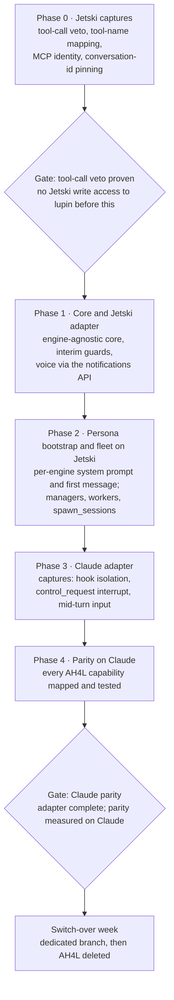

# UHW Build Order: Jetski/AGY First

Oct 13, 2026 · @Richard P Ruiz

## Summary

Build the Jetski/AGY family first, but treat that as a build order, not a switch-over criterion. AH4L runs on Claude Code, so full parity is still measured against Claude, and the Claude adapter must be complete before switch-over week starts.

Decisions recorded alongside this ordering:

- **Fleet scope:** full parity before switch-over: managers, workers, `spawn_sessions`, arbiter inputs and owed-work pokes.
- **Supervisor:** a new host-side service with its own systemd user unit and port, alongside `lupin-arbiter-app`.
- **Plan document:** kept in both places, a doc in this project plus its Markdown export in `unified-headless-wrapper/src/rnd/v0.0.2/`.

## Why Jetski first works

Jetski first removes the riskiest integration work from the start of the project and keeps the core honest.

| Reason | What it buys |
| --- | --- |
| No AH4L hook interference | Jetski and AGY never read `~/.claude/settings.json`, so AH4L hooks cannot fire inside them. The `--setting-sources` isolation test leaves the critical path until Claude work starts. |
| Interrupt already measured | SIGINT behaviour was captured on 2026-10-12. Claude's `control_request` interrupt is still unverified. |
| Engine-agnostic core | Building against Claude first leaks Claude-only assumptions into the core: transcript paths, the PPID bridge file, hook payload schemas, mid-turn input. The engine that has none of these keeps the core general. |
| Early use | You can talk to the implementation while the Claude adapter is still being built and debugged. |

## Problems to plan around

Five problems follow from Jetski first; the first two gate what a Jetski persona may do.

| Problem | Why it matters | Plan |
| --- | --- | --- |
| **No guards yet** | The pre-tool guards (stash, kill, branch-lock, merge-head, commit-scope) have no proven path under headless Jetski: tool calls are auto-denied, and whether a hook can veto one is untested. A Jetski persona started with `--dangerously-skip-permissions` in lupin runs unguarded. | **Gate:** no write access to lupin until a capture shows a hook vetoing a real tool call. Until then, deny rules in Jetski's static permission file, or throwaway worktrees only. |
| **cosa-voice identity** | Asks, DMs and `spawn_sessions` need cosa-voice to know which persona it serves. Under Jetski that depends on environment variables reaching MCP child processes, which is unverified. Without it, personas can narrate and receive messages but cannot ask or DM. | **Capture:** environment inheritance, and whether Jetski accepts a per-session MCP config with its own `env` block (the more robust route). |
| **Personas lose their setup** | Persona behaviour lives in Claude-specific places: CLAUDE.md, `.claude/commands`, skills, memento rehydration, the `/plan-*` and `/spin-up-swe-team` workflows. Jetski loads none of it. | Build a **persona bootstrap** layer: system prompt plus first message carrying the persona's instructions, assembled per engine. Until it exists, Jetski personas do voice conversation and single tasks, not fleet workflows. |
| **Core shaped by the simpler engine** | Claude can do things Jetski cannot: an interrupt the process survives, possibly mid-turn input, `--permission-prompt-tool`, hooks inside the engine. | Declare these now as adapter capability flags: `interrupt_mode`, `accepts_input_mid_turn`, `tool_veto`, `system_prompt_flag`. Keep the fake engine simulating both families from day one. |
| **Response format tuned on Gemini** | The three-layer prompt gets tuned against Gemini first, and Opus will comply differently. | Useful cross-model data; do not treat Gemini's compliance rate as Opus's baseline. |

## Revised phase plan

Five build phases run Jetski first; two gates control risk: Jetski gets write access to lupin only after a tool-call veto is proven, and switch-over starts only after parity is measured on Claude.

&#91;embedded content: UHW build order · 5 phases, 2 gates\]

Phases 0 to 2 give you a usable Jetski harness early; phases 3 and 4 bring Claude to full parity before the week-long switch-over.

