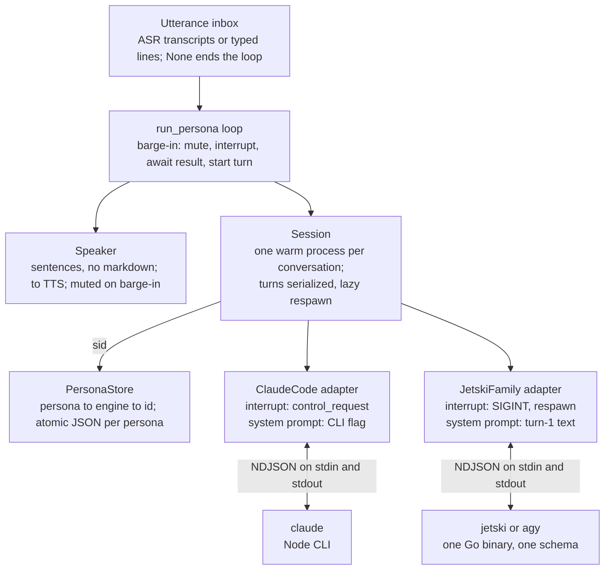
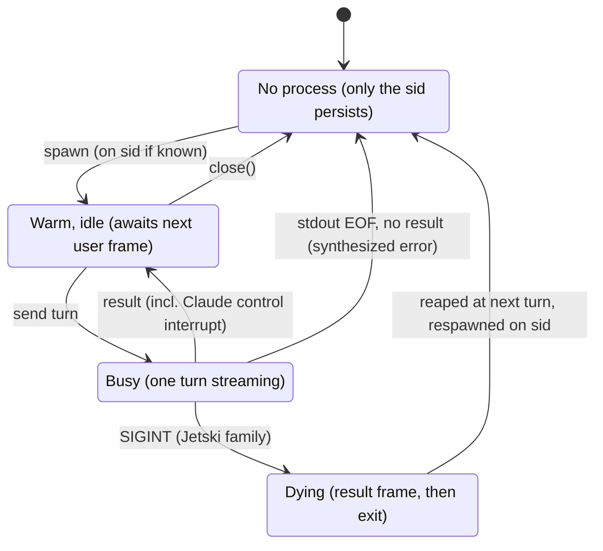

# Unified Headless Wrapper: Claude Code, Jetski, AGY

Oct 12, 2026 · @Richard P Ruiz

## Purpose and scope

One headless wrapper can drive Claude Code, Jetski and AGY, because all three expose the same protocol shape: NDJSON on stdin, NDJSON on stdout, one persistent process per conversation. This replaces the tmux + hook + buffer-file machinery for I/O, session tracking and barge-in. It does not yet replace pre-tool veto (see Open questions).

Scope is a single persona: one conversation, one warm engine process, one loop. Multi-persona fan-out and session-ID bridging are deferred to follow-up work. The reference implementation is `lupin_headless.py` (365 lines, POSIX only), tested against `fake_engine.py`, a mock that reproduces the captured behavior of both protocol families.

## Empirical findings

AGY and Jetski are one engine: AGY's help hides most flags, but every Jetski flag tested worked on AGY, its errors print `jetski:`, and both emit an identical schema. The three vendor-style reference docs that started this study were wrong on invocation, schema and interrupt status; everything below comes from captures run on macOS (Jetski) and Linux (AGY).

| Concern | Jetski / AGY (captured) | Claude Code (known, not re-captured) |
| --- | --- | --- |
| Invocation | `-p` per turn, or `--input-format stream-json --output-format stream-json` persistent | `-p --input-format stream-json --output-format stream-json --verbose` |
| Input frame | `{"event":"user","message":{"role":"user","content":…}}` | `{"type":"user","message":{…}}` |
| Output frames | `init` once, `step_update`\*, `result` per turn | `system/init`, `stream_event`, `assistant`, `user`, `result` |
| Session id | `init.conversation_id`; stable across resume and respawn | `session_id`; re-read every turn |
| Resume | `--conversation <id>`, works with stdin mode | `--resume <id>` |
| Text deltas | `step_update.text_delta` on `agent_response`; DONE frame carries a tail | `stream_event` text\_delta with `--include-partial-messages` |
| Tool frames | `step_type:"tool"`, emitted ACTIVE then DONE (observe only) | `tool_use` / `tool_result` blocks |
| Interrupt | SIGINT yields `status:"ERROR", error:"interrupted"`, then the process exits rc=1 | `control_request` interrupt; process survives (unverified here) |
| Protocol interrupt | `control_request` "not supported yet" | supported |
| Resume after interrupt | Orphaned ACTIVE tool step kept; a `system_message` step reconciles it; model recalls coherently | not tested |
| System prompt | No flag; `--agent` accepts any name unvalidated | `--append-system-prompt` |
| Structured output | `--json-schema` gives `result.structured_output`, at about 2x input tokens (second model call) | `--json-schema` |
| Usage accounting | `result.usage` and `duration_seconds` are conversation-cumulative; per-call usage on DONE frames | per turn on `result` |
| Prompt caching | Intra-turn only; `cache_read_tokens=0` across turns, in both per-turn and persistent modes | not tested |
| Warm process gain | First turn 4.2-4.5 s, warm turn 1.9-2.6 s for "say hi" | not tested |
| Permissions | Static `"permissions.allow"` (flat dotted key) in `~/.gemini/<app>/settings.json`; a missing rule auto-denies, stdout empty, rc=0 | settings `permissions`, hooks, `--permission-prompt-tool` |
| Timeout default | Jetski 0 (none); AGY 5 min | none |

Two AGY specifics: its app data lives in `~/.gemini/antigravity-cli/` (the `~/.gemini/settings.json` file is Gemini CLI's, not AGY's), and it lacks the Google-internal tools `code_search`, `moma_search` and `skill_search`.

## Architecture

The loop never sees an engine-specific frame: adapters translate every protocol into one event stream, and the Session owns all process lifecycle.

&#91;embedded content: wrapper layers · loop, session, adapters, engines\]



Adding an engine means writing one adapter: `argv()`, `user()`, `interrupt()`, `parse()`, plus two class attributes (`interrupt_mode`, `system_prompt_flag`). Nothing above the adapter changes.

### Normalized event model

Every turn yields zero or more events and ends with exactly one `result`. That invariant holds even when the engine dies without a result frame; the Session synthesizes one.

| `Ev.kind` | `text` | `session` | `status` | `raw` |
| --- | --- | --- | --- | --- |
| `init` |  | engine session id |  | init frame |
| `text` | delta |  |  | source frame |
| `tool` | tool name |  |  | tool frame (pre-execution, observe only) |
| `tool_done` | tool name (Jetski) or `tool_use_id` (Claude) |  |  | tool frame with output |
| `usage` |  |  |  | usage dict for one model call (Jetski) or one turn (Claude) |
| `result` | final response, or error / stderr tail | id if present | `ok`, `error`, `interrupted` | `structured_output` if `--json-schema` |

## Engine adapters

The two adapters differ in exactly four places: argv, the input frame's discriminator, the interrupt mechanism, and where the system prompt goes. Everything else is parsing.

|  | `ClaudeCode` | `JetskiFamily` (`jetski`, `agy`) |
| --- | --- | --- |
| argv | `claude -p --input-format stream-json --output-format stream-json --verbose --include-partial-messages` | `<bin> --input-format stream-json --output-format stream-json`; AGY adds `--print-timeout 0` |
| Resume | `--resume <sid>` | `--conversation <sid>` |
| Input frame | `{"type":"user",…}` | `{"event":"user",…}` |
| `interrupt_mode` | `control`: send `control_request` / `interrupt`, process keeps running | `signal`: SIGINT the process group, process exits after its result frame |
| `system_prompt_flag` | True: `--append-system-prompt` on **every** spawn (it is per process, not persisted) | False: prefixed to the conversation's first user message, so it persists in history |
| Usage source | `result.usage` (per turn) | DONE `step_update.usage` per model call; `result.usage` ignored because it is cumulative |
| Status mapping | `is_error` to `error`, else `ok` | `SUCCESS` to `ok`; `error:"interrupted"` to `interrupted`; anything else `error` |

Permissions are a constructor-level choice, not an adapter difference: `--dangerously-skip-permissions` is opt-in (`--skip-permissions` on the CLI). Without it, the Jetski family needs allow-rules in settings, or a tool-using turn ends empty.

Adding a fourth engine with a different shape (Gemini CLI, Codex, an open-weight harness) is one class. If it has no persistent mode, it needs a small per-turn Session variant whose `argv()` carries the prompt and which spawns once per turn, giving up the warm-process gain.

## Session lifecycle

A Session keeps one warm process per conversation and spawns it lazily, so the only cost of a Jetski interrupt is one cold start on the following turn.

&#91;embedded content: Session states · 4 states, 6 transitions\]



A Claude Code control interrupt never leaves the Busy state through Dying: its result frame returns the Session straight to Warm. A stdout EOF without a result frame (the permission auto-deny case) goes from Busy to No process; the Session reaps the process and synthesizes an `error` result carrying the stderr tail.

1. **`turn(text)`** takes the turn lock, reaps a dying or dead process, spawns if needed, prefixes the system prompt on a new Jetski-family conversation, writes one user frame, and yields events until the first `result`.
2. **`interrupt()`** is a no-op unless a turn is in flight. Control mode writes a `control_request`. Signal mode sets `_dying` and sends SIGINT to the process group; the in-flight turn still receives its `ERROR`/`interrupted` result frame and closes normally.
3. **Respawn** happens inside the next `turn()`: wait for the old process to exit (10 s grace, then SIGKILL), then spawn with `--conversation <sid>`. Waiting first guarantees one writer per trajectory.
4. **`close()`** closes stdin (stream-json engines exit on EOF), waits 5 s, then SIGKILLs the group. Call it from a `finally` or a FastAPI shutdown handler: `start_new_session=True` means a terminal Ctrl-C never reaches the child, which is how the probe run orphaned an engine.

The turn lock serializes turns; `interrupt()` deliberately does not take it, so the ASR task can call it while another task is iterating the turn.

## Failure semantics and defensive rules

The result frame is the only trustworthy end-of-turn signal; exit codes, stdout content and field presence all lie in at least one captured case.

| Rule | Why (captured evidence) |
| --- | --- |
| Never trust the exit code | Permission auto-deny exits rc=0 with empty stdout; an interrupt exits rc=1 after a proper result frame |
| Synthesize a result on EOF | A turn must always end in one `result`; the stderr tail carries the auto-deny explanation |
| Detect interrupts from `error == "interrupted"`, or from our own `_interrupting` flag | Jetski reports `status:"ERROR"`, not `CANCELED`; Claude's control-interrupt status is unverified |
| Never overwrite a known sid with `""` | An `--effort` validation error returns `conversation_id: ""` |
| Re-read the sid from every frame that carries one | Cheap, and Claude Code has historically changed ids on resume |
| Per-turn usage from DONE frames, not `result.usage` | Jetski's `result.usage` and `duration_seconds` are conversation-cumulative |
| Raise the stream line limit to 16 MiB | One `run_command` DONE frame carried a full `ls -la`; larger tool outputs exceed asyncio's 64 KiB default |
| Always drain stderr | An undrained stderr pipe can block the child |
| Don't validate tool names against `init.tools` | `read_file` ran while `init` listed only `view_file` |
| Kill the process group in `finally` | `start_new_session=True` isolates the child from terminal signals; the `ctl` probe orphaned one |
| One writer per conversation | Wait for the dying process to exit before respawning on the same sid |

## Single-persona loop

The loop treats any utterance that arrives mid-turn as a barge-in, and handles it in three ordered steps: silence the speaker, interrupt the engine, await the old turn's result frame. Only then does the new turn start.

```python
while (text := await inbox.get()) is not None:
    if current and not current.done():
        speaker.cancel()          # 1. silence immediately; later deltas are dropped
        await sess.interrupt()    # 2. control_request or SIGINT
        await current             # 3. its result frame closes the turn
    current = asyncio.create_task(one_turn(text))
```

`one_turn` routes events: `text` deltas to the `Speaker`, `tool` events to the log, `usage` into a per-turn sum, and `result` to three actions. Those are flushing the speaker, saving the sid to the `PersonaStore`, and running the `awaiting_user` check.

- **Speaker.** Buffers deltas and speaks whole sentences with markdown, links and the LaTeX arrows seen in captures stripped. `cancel()` mutes it until the next turn, so the deltas that arrive between barge-in and the result frame are never spoken.
- **System prompt.** Defaults to short spoken-style rules. It goes into `--append-system-prompt` for Claude Code and into the first message of a new Jetski-family conversation.
- **`awaiting_user`.** A placeholder (does the response end in `?`) for one of the local intent classifiers. `--json-schema` would give the same signal at about twice the input tokens, plus a second, different utterance from the one already spoken.
- **PersonaStore.** Maps persona to engine to sid in `~/.lupin/personas/<id>.json`, written by atomic replace. A restarted loop resumes the conversation; `--new` forgets it.
- **Input.** The demo inbox reads typed lines; typing while the agent speaks is a barge-in. Swap in the ASR transcript queue without touching anything else.

Run it with `python3 lupin_headless.py --engine agy --persona alpha`, adding `--skip-permissions` to auto-approve tools.

### Verification

`test_headless.py` drives both protocol families through `fake_engine.py`, which reproduces the captured frames, SIGINT exit, control interrupt, 100 KB tool frames, history persistence and the permission auto-deny. All scenarios pass:

- **Turns.** A normal turn returns `ok` with exactly one result.
- **Barge-in.** An interrupt mid-count returns `interrupted` and stops the deltas.
- **Respawn.** Jetski respawns with a new pid on the same sid; Claude keeps its pid.
- **Recall.** The engine recalls both earlier turns, and the system prompt persists in Jetski history.
- **Cold resume.** A fresh Session resumes from a stored sid.
- **Auto-deny.** It becomes an `error` result carrying the stderr text.
- **Full loop.** The loop with a mid-turn barge-in persists the sid, and nothing is spoken after the barge-in.

The mock proves the wrapper's logic, not the engines' behavior. The Claude Code row of the findings table still needs its own captures.

## Open questions and verification checklist

Dynamic pre-tool veto is the one open question that decides the architecture: whether the Jetski family can drop hooks entirely. The rest are refinements.

- [ ] **Pre-tool veto via MCP indirection.** Deny the native `command` tool, allow a Lupin-owned MCP `run` tool that asks a FastAPI `/veto` route before executing. Check whether `"permissions.deny"` exists and what rule string allows an MCP tool. Works the same for all three engines if it holds.
- [ ] **Claude Code captures.** Capture persistent mode: when `system/init` fires, the shape of the control-interrupt `result` (`subtype`, `is_error`), and whether `--resume` keeps the session id.
- [ ] **System-prompt route for the Jetski family.** `--agent` is unvalidated; find where agent definitions live (`jetski agents`) and whether `system_prompt_override` or `append_prompt_sections` are reachable from config.
- [ ] **Per-persona isolation.** Test a separate `--app_data_dir` per persona with the OAuth token symlinked, then resume in it. Settings, conversations and token currently share one directory.
- [ ] **Shutdown latency during a tool call.** The model-streaming interrupt exited in about 0 s; the earlier capture, interrupted mid-`run_command`, suggests about 6 s.
- [ ] **Cross-turn caching.** Run two resumes seconds apart with a large prefix; `cache_read_tokens` stayed 0 on both "say hi" probes.
- [ ] **Protocol interrupt for the Jetski family.** `control_request` is "not supported yet"; check `agy changelog`. When it lands, flip `interrupt_mode` to `control` and the respawn disappears.
- [ ] **`trustedWorkspaces` semantics.** An untrusted cwd still ran; what does trust gate?

## Implications for session-ID bridging

Owning the process changes where the session id comes from: it arrives in-band on the first frame, so discovering it out of band may no longer be necessary. Five hypotheses to test in the next discussion:

1. **Discovery becomes reading.** The id is in `init` (Jetski family) or `system/init` and `result` (Claude Code), on the wrapper's own stdout. Nothing has to find it on disk, in logs, or by "most recent conversation" (`--continue`, which races once a second instance exists).
2. **Identity is stable by construction.** A Jetski conversation id survived resume, respawn after SIGINT, and stdin-mode resume. The bridge may reduce to the `PersonaStore` map (persona to engine to sid) plus one rule: write it on every result.
3. **The writer is unique by construction.** The Session's turn lock and reap-before-respawn guarantee one process per conversation, which is the property a lockfile protects. A lockfile may then only be needed across hosts or across separate wrapper processes, not within one.
4. **Hook-time correlation disappears.** Hooks fire inside the engine and must recover which session they belong to. The wrapper is the caller, so every event is already attributed.
5. **Cross-engine personas are a dictionary entry.** One persona can hold a Claude sid and a Jetski sid side by side. Moving a persona between engines is a context-transfer problem (summarize, re-seed), not an id problem.

One caveat carries into that discussion: Claude Code's id stability on `--resume` in persistent mode is not yet captured, and hypothesis 2 rests on it for that engine.
