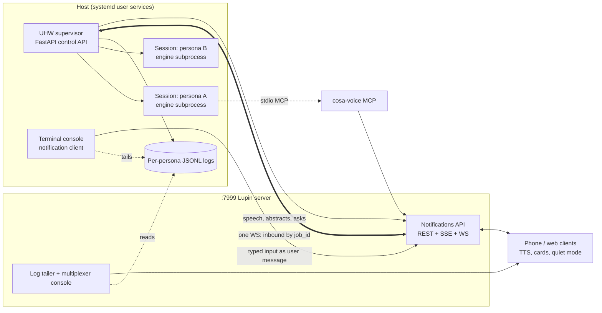
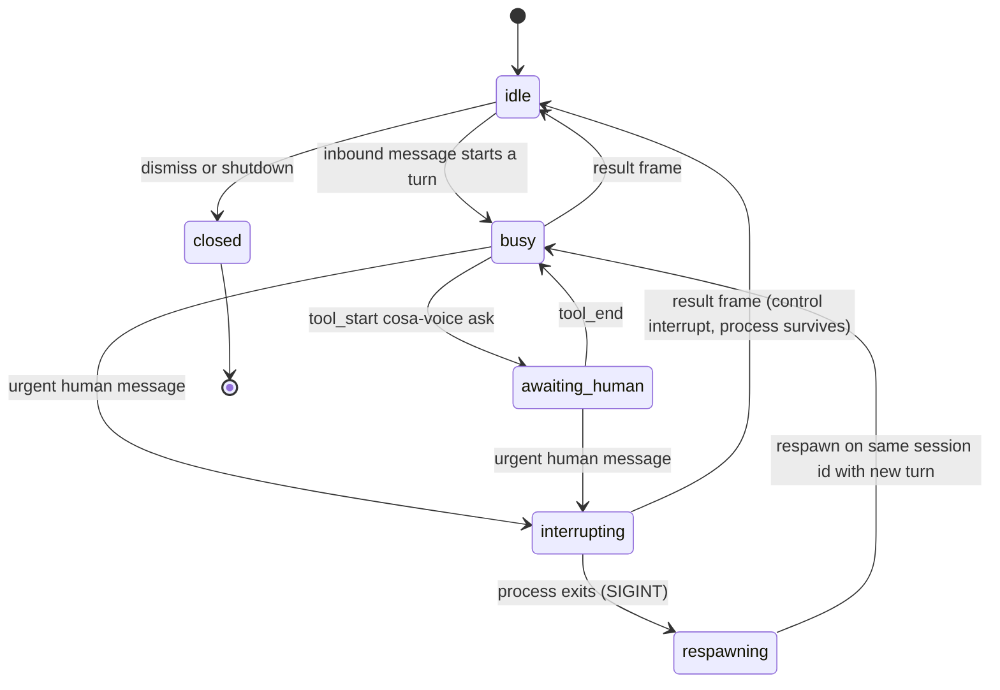
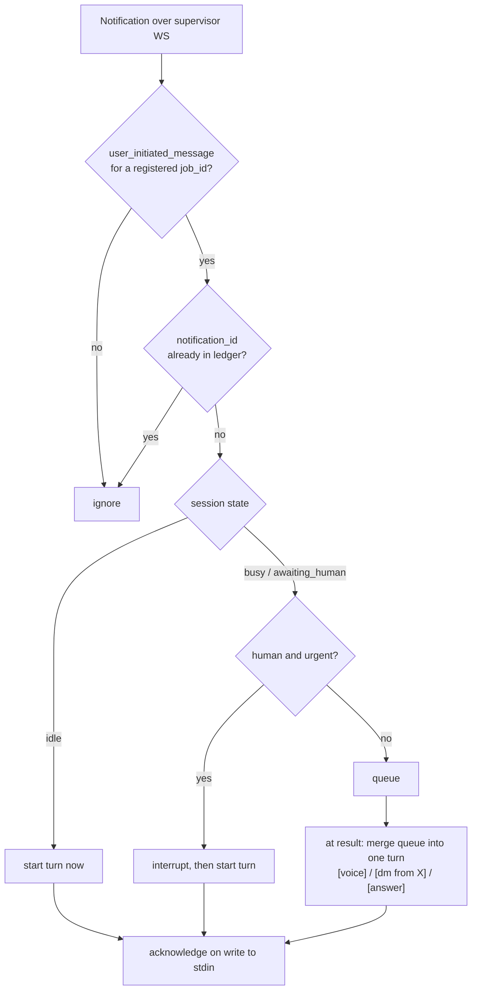
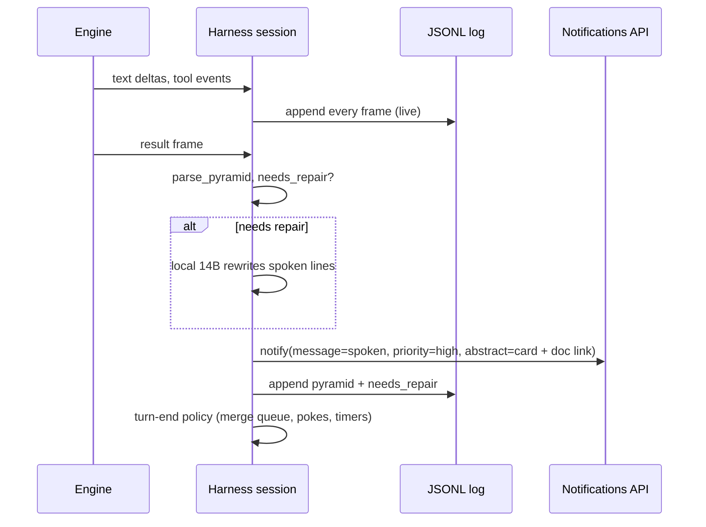
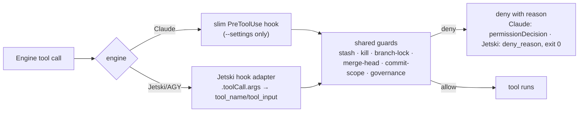
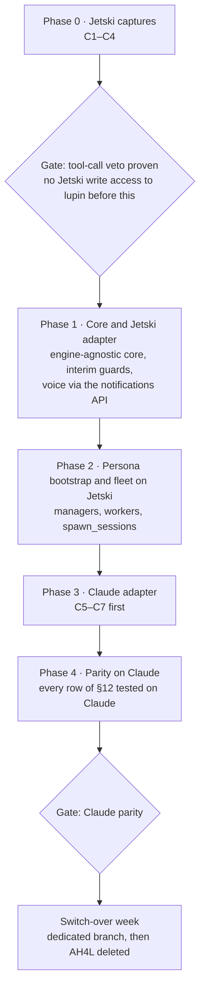

# UHW Implementation: Planning Framework

**As of:** 2026-10-14 · **Author:** Rick Ruiz · **Status:** framework. Decisions are locked; sections marked **To expand** get filled in, in the order given in §16. §14 expanded 2026-10-14. Part A (AGY) and Part B (Jetski) results applied 2026-10-15 and 2026-10-18; Phase 0 complete for the Jetski family; evidence in `2026.10.15-phase0-part-a-agy-results.md` and `2026.10.15-phase0-part-b-jetski-results.md`.

**Companion documents**
- `2026.10.12-unified-headless-wrapper-claude-code-jetski-and-agy.md`: protocol captures and the prototype design
- `2026.10.12-uhw-build-order-jetski-and-agy-first.md`: build order and gates

---

## 0. Purpose and bottom line

The Unified Headless Wrapper (UHW) replaces the ad hoc harness for Lupin (AH4L) completely. AH4L drives Claude Code inside tmux through eight user-scope hooks, a notification listener per session, and tmux keystroke injection. UHW drives Claude Code, Jetski and AGY as headless subprocesses that speak stream-json, from one host-side supervisor. All voice enters and leaves through the Lupin notifications API.

The work happens on one dedicated branch. The Jetski/AGY family is built first, then Claude reaches full parity, then there is a one-week switch-over, after which AH4L is deleted. The two modes never run at the same time.

---

## 1. Decisions log

| # | Decision | Ruling | Where decided |
|---|---|---|---|
| D1 | Naming | No abbreviations. `Ev` becomes `EngineEvent`. `Event` collides with `asyncio.Event`/`threading.Event` (23 uses in lupin) and with SSE/WS/heartbeat "events". `UhwEvent` names a project that disappears at cutover. | 10-13 |
| D2 | Code style | Lupin house style: spaces inside parentheses, Requires/Ensures docstrings. | 10-13 |
| D3 | Rollout | One dedicated branch. AH4L and UHW never run at the same time. One switch-over week after implementation and testing, then AH4L is removed entirely. No backend switch, no compatibility re-exports, no coexistence tests. | 10-13 |
| D4 | Hook isolation during development | Claude children launch with `--setting-sources project,local` + a generated `--settings` file + `--strict-mcp-config --mcp-config`. The flags stay after cutover: explicit config, never whatever happens to be in `~/.claude`. | 10-13 |
| D5 | Voice transport | All voice I/O goes through the notifications API, in both directions. | 10-13 |
| D6 | Inbox topology | One WebSocket per supervisor, routed by `job_id` to an `asyncio.Queue` per persona. No buffer files, no tmux injection, no pane probing. | 10-13 |
| D7 | Identity | One stable identity per persona, used for `job_id` (routing in), `sender_id` (speech out and client mute state) and the log directory. It survives respins. | 10-13 |
| D8 | Inbound routing | idle → start a turn · busy + human + urgent → interrupt, then start · everything else → queue, merged into the next turn. Peers and answers never interrupt. | 10-13 |
| D9 | Sync vs async | Asks the harness makes are awaitables (`asyncio.to_thread( notify_user_sync, … )`) and never block. Asks the model makes are MCP tool calls; while one is pending the session is in `awaiting_human`. | 10-13 |
| D10 | `progress_group_id` | Only for real iterative progress (tests 40/120 → 80/120). Never for grouping a turn's speech. | 10-13 |
| D11 | Speech policy | Narrate for every persona. Spoken lines go out at `priority="high"`. Muting stays in the client (per-session quiet mode keyed on `sender_id`, plus the global TTS slider). | 10-13 |
| D12 | Response pyramid | Three layers: spoken (headline + 2 supporting lines) → abstract card → document link. Opus writes all three once, in plain text with section markers, headline first. The harness parses mechanically. The local 14B silently rewrites a reply that breaks the format. `needs_repair` is logged every turn. JSON-schema output (Option A) is the fallback if plain text proves unreliable. | 10-13 |
| D13 | Streaming | Tokens stream to the log. Voice gets one notification at `result`. Measure the gap between the spoken block closing and `result` before adding early speech. | 10-13 |
| D14 | Session log | One append-only JSONL per persona/session with every frame, from a single writer. The source of truth for all observation. | 10-13 |
| D15 | Console | The console is a notification client: history scrolls into normal terminal scrollback, the input box stays at the bottom (`prompt_toolkit` + `patch_stdout`), a voice **mirror line sits above the prompt**, a **`!` prefix means urgent**, typed input is posted to the notifications API. | 10-13 |
| D16 | Web view | Reuse the console-tee pipeline (`cc_transcript_tailer`, REST backlog, roster, multiplexer client), pointed at the harness logs instead of Claude transcripts. | 10-13 |
| D17 | Switch-over scope | **Full parity**: managers, workers, `spawn_sessions`, arbiter inputs and owed-work pokes all run on UHW before switch-over week. | 10-13 |
| D18 | Supervisor placement | A new host-side service with its own systemd user unit and port, alongside `lupin-arbiter-app`. | 10-13 |
| D19 | Build order | Jetski/AGY first, Claude second. Parity is still measured on Claude. | 10-13 |
| D20 | Document venue | A Claude doc in the project plus Markdown in `unified-headless-wrapper/src/rnd/`. | 10-13 |
| D21 | Owed-work source | The global task store is the only source of owed work. Retire `heartbeat_task_state` (native `Task*` transcript replay) and the deprecated mirror. | 10-18 |
| D22 | Native task tools | Ignored in every engine (Claude `TodoWrite`/`TaskCreate`, any Jetski-family equivalent). Workflows that reference them are rewritten to use the store. | 10-18 |
| D23 | Jetski behavior layer | planning-is-prompting: all of its skills, with explicit use of the cascade review and adversarial SWE crew workflows. Inventoried before the interface decision. | 10-18 |
| D24 | Arbiter | Folded into the supervisor as its fleet-health module. It reads the session logs and the registry, not Claude transcripts; its tmux live-notify path is retired. | 10-18 |
| D25 | Threat model and authorization | Guard against confusion and prompt injection, not against a deliberately adversarial agent; no OS isolation. Role filtering of `tools/list` is published and documented as exposure only. The authorization check at `tools/call`/supervisor endpoints and the engine veto exist from day one but run in **observe** mode: allow, and log "would deny". Each rule carries a mode (`enforce`/`observe`/`off`), so turning one on is a config change. Guards ported from AH4L keep `enforce` (parity). | 10-18 |
| D26 | Chief of staff | A `chief_of_staff` role sits above managers: the persona you talk to, which staffs managers. All crew communication goes through the crew's manager. When human-in-the-loop can't reach you, the chief of staff consults the online preference learner and answers in your stead. This is the integration point for testing that infrastructure. | 10-20 |
| D27 | Escalation | Workers always ask through their manager. Managers may ask you directly; when you're unavailable and they need an answer, they fall back to the chief of staff. No manager exists without a chief of staff. The preference learner already runs in shadow mode, watching asks and your answers and predicting yours; the improvement target is its Bayesian learner, possibly an LLM working inside strict design-system parameters. | 10-20 |
| D28 | Narration | All work is narrated; only some is spoken. Every persona, crew included, narrates through `notify` and its end-of-turn reply. Speech is a client-side decision (priority, quiet mode by `sender_id`, slider): progressive disclosure for voice. Replaces the 10-18 narrowing that silenced crew replies. | 10-20 |
| D29 | Interface architecture | Accepted as partitioned. MCP (cosa-voice) for models; the notifications API for AI-to-human communication; one PreToolUse hook shim per engine family for the engines; the `lupin` CLI for operators; the supervisor owns all state, and persona manifests are rendered per engine at spawn. | 10-20 |
| D30 | Commands become skills | All slash commands (lupin and planning-is-prompting) become skills, so Claude and Jetski run from the same source. | 10-20 |
| D31 | Models per role | Not a decision now. Jetski runs any listed Gemini or Claude model; only Claude Code is limited to Claude. Noted: `gemini-launch-candidate-high` was slowest to first token (about 19 s, C13). | 10-20 |

---

## 2. Conclusions established (from reading the code and docs)

### 2.1 AH4L as it stands
- **Hooks are installed for the whole user account.** `install-cosa-voice.sh` merges `src/conf/claude-code-hooks.json` into `~/.claude/settings.json`: SessionStart, PreToolUse (plus `memento_record_guard` on `Write|Edit`), PostToolUse, Stop, Notification, UserPromptSubmit, SessionEnd, PermissionRequest. cosa-voice is registered `--scope user` in `~/.claude.json`. **So every `claude -p`, from any directory, runs the full AH4L stack.**
- About 25k lines under `src/lupin_cli/claude_code/hooks/`. The largest pieces are `register_session.py` (2.8k), `stop.py` (2.6k), `session_bridge.py` (2.5k), `hook_common.py` (2.1k) and `cc_notification_listener.py` (1.7k).
- Session identity: the bridge file `cc-{PPID}.json`. `session_bridge` checks `$CLAUDE_SESSION_ID` first.
- Seams that already exist: `LUPIN_HOOK_SESSIONS_DIR` (row 8ccc20ab) and `LUPIN_HOOK_LOG_DIR` (row 6fc8d78d). Note that `LUPIN_SESSIONS_DIR` is pinned by the tmux systemd unit.
- The pre-tool guards are pure functions, `*_deny_reason( tool_name, tool_input )`: stash, kill, branch-lock, merge-head, commit-scope, plus subagent governance (which also takes `session_id`).
- The Stop hook holds most of the policy: heartbeat self-poke, owed-work resolution (`_resolve_owed_state`), "anything else?" through the detached `idle_waiter`, board sweep, auto-narration, idle beacon.

### 2.2 Claude Code settings behavior (per current docs)
- Hooks **merge** across settings scopes. `--settings` can add or override keys but **cannot remove** hooks from another scope.
- `disableAllHooks` is all or nothing; no single hook can be disabled.
- `--setting-sources` picks which settings files load. Managed settings and `--settings` are separate layers.
- MCP servers in `~/.claude.json` are outside settings sources, so `--strict-mcp-config` is needed. Sign-in is not affected.

### 2.3 Notifications API
- `POST /api/notify`. Sync requests block over SSE until `responded` / `expired` / `offline`. Async requests are delivered over WebSocket.
- `POST /api/jobs/{job_id}/message` takes `priority: normal | urgent`. Messages carry `direction: human_to_ai | ai_to_ai`.
- `NotificationRequest` already has `abstract`, `idempotency_key` (reattach), `progress_group_id`, `sender_id`, `job_id`.
- Client TTS: only high/urgent priority is spoken. Per-session quiet mode demotes high to medium, keyed on the session parsed from `sender_id` (`notifications.js` around line 6660). There is also a global slider where 0% means silent.

### 2.4 UHW prototype (`lupin_headless.py`, 365 lines)
- `ClaudeCode` and `JetskiFamily` adapters, `Session` (one warm process, lazy respawn), `PersonaStore`, `Speaker`, a single-persona loop. `fake_engine.py` + `test_headless.py` pass for both families.
- Measured: SIGINT interrupt for Jetski/AGY; `--json-schema` structured output; no prompt caching across turns; about 2s gained by keeping the process warm.
- Not measured: Claude's `control_request` interrupt.

### 2.5 Measured on AGY 1.3.5 (Phase 0 Part A, 2026-10-15)
- A project-level PreToolUse hook blocks real tool calls in headless stream-json mode, even under `--dangerously-skip-permissions`. The model sees `tool call denied by pre-tool hook: <reason>`, and the turn still ends `SUCCESS`.
- Hooks and stdio MCP servers inherit the engine's environment. There is one MCP server per engine process. `mcp_config.json` `env` blocks apply; `${VAR}` is not expanded.
- `--conversation <unknown id>` is accepted silently and starts a new conversation with the engine's own id.
- AGY updates itself (1.3.3 → 1.3.5 between preflight and the run), and `agy update` has no flags.
- Model: `gemini-3.8-flash-high`. Hook payloads carry `modelName`, `transcriptPath`, `conversationId`, `stepIdx`, `workspacePaths`, `artifactDirectoryPath`.

### 2.6 Measured on Jetski 2026.10.14 (Phase 0 Part B, 2026-10-15)
- The hook contract matches AGY's. A project hook blocks real calls (C1 PASS), and an unknown `--conversation` id is silently replaced (C4).
- **The tool surface differs from AGY's** (`read_file`/`write_file`/`edit_file`, no `Cwd`, no fetch tool), so tool maps are per binary (§8).
- The hook payload adds `agentName`, `callerContext`, `executionId`, `isBattleMode`, `lastUserInput`, `parentConversationId`, `rootConversationId`.
- Jetski starts a Chrome DevTools MCP server by default (`--use_ls_chrome_devtools_mcp`).
- Follow-up (2026-10-18, Jetski 2026.10.16):
    - C3 PASS; MCP config and the `call_mcp_tool` shape are the same as AGY's.
    - `modelName` was `auto`, so the model must be pinned with `--model`.
    - `--agent` and `jetski agents` exist; `--mode` has `accept-edits`, `auto`, `plan`, `bestn`.
    - The Chrome DevTools flag can be turned off.
    - A top-level session has an empty `parentConversationId` and `rootConversationId` equal to its own id.

---

## 3. Architecture



**To expand:** supervisor port and unit name; control API surface (spawn, dismiss, list, interrupt, respin); behavior on supervisor restart (sessions respawn lazily from their stored ids).

---

## 4. Core types and identity

| Type | Purpose |
|---|---|
| `EngineEvent` | Normalized engine frame. Kinds: `init`, `text`, `tool_start`, `tool_end`, `usage`, `result`. |
| `InboundMessage` | `notification_id`, `persona_id`, `text`, `source` (human / peer / answer), `priority` (normal / urgent) |
| `ResponsePyramid` | `spoken`, `abstract`, `document`, `document_mode` |
| `SessionState` | idle / busy / awaiting_human / interrupting / respawning / closed |
| Persona identity | One stable id per persona: `job_id`, `sender_id`, log directory |
| Identity transport | `LUPIN_PERSONA_ID` in the spawn environment, inherited by hooks and MCP servers (C3, AGY). No bridge-file lookup. |

Prototype renames: `Ev`→`EngineEvent`, `sid`→`session_id`, `self.e`/`self.p`→`self.engine`/`self.process`, `rid`→`request_id`, `pid` (persona)→`persona_id`, `tool`/`tool_done`→`tool_start`/`tool_end`.

`sender_id` format the client parses: `claude.code@lupin.deepily.ai#<8 hex>` (`parseSenderId`); keep the 8-hex suffix stable per persona.

**To expand:** how the stable id is derived (building on `resolve_stable_session_id`).

---

## 5. Engine layer

### 5.1 Adapter capability flags

| Flag | Claude Code | Jetski / AGY |
|---|---|---|
| `interrupt_mode` | `control`: **verified** (C6): result `error_during_execution`, same process answers the next turn | `signal` (SIGINT; measured; process exits after its result frame) |
| `accepts_input_mid_turn` | **yes, absorbed** into the running turn (C7) | no |
| `tool_veto` | PreToolUse hook in `--settings` | project `.agents/hooks.json`, `deny_reason`: **confirmed on AGY and Jetski** (C1) |
| `system_prompt_flag` | yes (`--append-system-prompt`, every spawn) | no flag; Jetski loads workspace `AGENTS.md`/`GEMINI.md` and `--agent` definitions natively (C11) |
| MCP call timeout | not yet measured | **Jetski: 180 s, not configurable** per server (C14, C14b); asks use a ticket and re-poll |
| subagent tool | `Task`/`Agent` | Jetski: `invoke_subagent` (`Prompt`, `Role`, `TypeName`); hooks fire inside; vetoable by name (C12) |
| custom slash commands | `.claude/commands` | **none** (built-ins only); workflows are legacy, skills replace them (C11b) |
| agent definitions | `--agent` | `--agent`; body = system prompt; `tools:` is an allow-list of **native** tools, no wildcard; MCP tools are always available and cannot be listed (C11b, C11c) |
| global skills / rules | `~/.claude/skills`, `CLAUDE.md` | `~/.gemini/config/skills/`; always-on rules in `~/.gemini/config/rules/` (C11c) |
| per-turn usage in result frame | yes | Jetski: yes, `usage{input,output,cache_read,thinking,total}_tokens` (C11) |
| `permission_prompt_tool` | yes | no |
| session id pinning | `--session-id` | **no**: an unknown `--conversation` id is silently replaced (C4, AGY and Jetski) |
| tool surface | one | **per binary**: AGY and Jetski differ in tool names and arguments (§8) |
| session lineage in hook payload | not yet measured | Jetski: subagent iff `parentConversationId` non-empty; `rootConversationId` = top-level id. AGY: none |
| hooks and MCP servers inherit env | yes (docs) | **yes** on both binaries (C1, C3) |
| model selection | `--model` | Jetski defaults to `auto`: pin `--model` per persona |
| MCP server per engine process | not yet measured | **yes**, one per engine (C3, both binaries) |
| version pinning | `claude install <version>` | **no**: AGY self-updates; record `--version` per spawn |

### 5.2 Session state machine



### 5.3 Launch isolation (Claude)

```python
argv += [ "--session-id", session_id, "--setting-sources", "project,local",
          "--settings", str( UHW / "settings.json" ),       # user settings minus hooks, plus guards
          "--strict-mcp-config", "--mcp-config", str( UHW / "mcp.json" ) ]
env   = { "CLAUDE_SESSION_ID": session_id }
```

Vetting: run `vet-hook-isolation.sh` (written 10-13). It uses `LUPIN_HOOK_LOG_DIR` as a witness. Expected: run A shows the full stack; B, C and D show nothing; E shows `pre_tool_use` only; strict MCP shows `[]`.

### 5.4 Launch and resume rules (Jetski family, from Part A)

AGY launch, as measured:

```
agy --input-format stream-json --output-format stream-json --dangerously-skip-permissions --print-timeout 0 [--conversation <id>]
```

Hooks come from `<cwd>/.agents/hooks.json` (named-set shape). MCP servers come from `~/.gemini/config/mcp_config.json`.

- **Verify on every resume:** if `init.conversation_id != requested`, alert and stop. A stale id otherwise drops the persona's context silently.
- **Record per spawn:** engine `--version` and `modelName` (first hook payload) in the session log.

Jetski launch, as measured (Part B):

```
jetski --input-format stream-json --output-format stream-json --dangerously-skip-permissions \
       --use_ls_chrome_devtools_mcp=false --model <pinned> [--agent <persona>] [--mode <mode>] [--conversation <id>]
```

The Chrome flag was accepted (2026-10-18). `--model`, `--agent` and `--mode` exist but are untested in stream-json mode; verify them when the adapter is built.

**To expand:** persona bootstrap (§13) via `--agent` / `jetski agents`; the system prompt contents per engine; which `--mode` personas run in.

---

## 6. Voice in (inbox)



- At-least-once delivery: acknowledge on write to stdin, never on receipt. Unacknowledged messages come back through reconnect catch-up (`surface_owed_answers`).
- Late answers (`notification_responded`) and peer DMs (`ai_to_ai`) are queued, never interrupt.

**To expand:** the merged-turn envelope format; ledger persistence; the Claude mid-turn path if the capture confirms native queueing.

---

## 7. Voice out

### 7.1 Response pyramid format

```
<headline>
<supporting statement>
<supporting statement>
<<<abstract
- bullets, tables, details
<<<document persistent
# Full markdown…
```

| Layer | Destination |
|---|---|
| Spoken (≤3 lines, markdown stripped) | notification `message`, `priority=high` |
| Abstract | the same notification's `abstract` field: the clickable card |
| Document | a file (transient or persistent), linked from the abstract, rendered live in the clients |

- Layers are sparse. Most turns are spoken-only. The harness moves an oversized abstract into a transient document.
- Text between tool calls ("Let me check…") is never spoken.
- The standing order lives in `--append-system-prompt`, not CLAUDE.md.
- Part A baseline (`gemini-3.8-flash-high`, n = 1 per prompt): 8/8 well formed, and every layer appeared only where intended. But every reply used exactly three spoken lines, even "Say hello". Rules v2 should allow a single line. Keep v1 for the Jetski run so the two engines stay comparable.
- `needs_repair` leads to a silent 14B rewrite of the spoken lines from the full reply. Every turn logs engine, model, persona, `needs_repair` and line count. Format compliance by model is a project metric.

### 7.2 Turn lifecycle



### 7.3 Sync vs async

| Origin | Mode | Mechanism | State effect |
|---|---|---|---|
| Turn result | async | one notification at `result` | none |
| Real progress | async | explicit `notify` with `progress_group_id` | none |
| Model asks | sync, inside a tool call | cosa-voice holds the SSE stream | `awaiting_human` |
| Permission prompt | sync, in the engine | `--permission-prompt-tool` (Claude) / hook `allow_tool` (Jetski) | `awaiting_human` |
| Harness asks | sync, awaited | `asyncio.to_thread( notify_user_sync, … )`, reattach by `idempotency_key` | stays idle; new speech cancels it |
| Late answers | async in | `notification_responded` → inbox | queued |

Keep `MCP_TOOL_TIMEOUT` raised in the spawn environment for asks the model makes.

**To expand:** the system prompt text for the format; the repair prompt for the 14B; document storage paths and transient lifetime; abstract size threshold.

---

## 8. Tool gate



- Phase-1 shortcut for Claude: reuse `pre_tool_use.py` unchanged. Its buffer drain and bridge timestamp update are harmless under the separate sessions directory.
- Jetski hook rules (captured 10-12): absolute paths only; always exit 0; response keys at the top level; set an explicit timeout.
- **Gate G1:** passed for **AGY and Jetski** on 2026-10-15 (C1 on each).
- On a deny, the model sees `tool call denied by pre-tool hook: <deny_reason>`. Jetski prefixes it with `Encountered error in tool execution:`. The turn continues on both, so guards only return a reason string.

Tool map per binary (C2 on both, C3 on AGY). The adapter maps each binary's calls into one common shape, and guards only see that shape:

| Common shape | AGY | Jetski | Claude |
|---|---|---|---|
| `shell{command, cwd}` | `run_command`: `CommandLine`, **`Cwd`**, `WaitMsBeforeAsync` 10000 | `run_command`: `CommandLine`, `WaitMsBeforeAsync` 5000, **no `Cwd`** | `Bash` |
| `read{path}` | `view_file`: `AbsolutePath` | `read_file`: `Path` | `Read` |
| `write{path, content}` | `write_to_file`: `TargetFile`, `CodeContent`, `Overwrite` | `write_file`: `Path`, `Content`, `Overwrite` | `Write` |
| `edit{path, old, new}` | `replace_file_content`: `TargetFile`, `TargetContent`, `ReplacementContent`, … | `edit_file`: `Path`, `Target`, `Replacement` | `Edit` |
| `fetch{url}` | `read_url_content`: `Url` | none observed (`curl` via `run_command`) | `WebFetch` |
| `mcp{server, tool, arguments}` | `call_mcp_tool`: `ServerName`, `ToolName`, `Arguments` | same as AGY | `mcp__<server>__<tool>` |

AGY calls carry `toolAction` and `toolSummary`. On Jetski only `toolSummary` was seen, on `run_command`. Spoken progress cannot assume a summary is present.

Port rules:
1. Repo-resolving guards (commit-scope, merge-head) use the common shape's `cwd`. That is `args.Cwd` on AGY; where it is missing (Jetski), it is the session workspace from `workspacePaths`. Never the hook process's working directory.
2. `WaitMsBeforeAsync` lets a shell command outlive its tool call. The kill guard and the turn-age watchdog must not equate turn end with process end.
3. Listing, grep and glob all arrived through `run_command`, so the command-line guards cover nearly everything.
4. MCP calls are one generic tool on both binaries: match `call_mcp_tool` plus `args.ServerName`/`args.ToolName`. The memento Write/Edit guard matches the common `write`/`edit` shapes, never binary-specific names.
5. Subagent governance reads lineage directly on Jetski: a non-empty `parentConversationId` means subagent, and `rootConversationId` names the top-level session. AGY has no lineage fields and needs another route.
6. The first MCP call in a session is preceded by file reads (`read_file` ×2 on Jetski, `view_file` on AGY), probably of the tool definition. Guards must allow those reads, and the first cosa-voice call costs an extra step.

**To expand:** Jetski internal tools (`code_search` and others) if a prompt ever exercises them; subagent governance on AGY, which has no lineage fields; what file the engines read before an MCP call.

---

## 9. Turn-end policy

Moved out of `stop.py` and triggered when a turn ends:
- owed-work / heartbeat poke: `_resolve_owed_state`, relocated to a leaf module
- "anything else?": an asyncio timer with backoff, replacing the detached `idle_waiter`
- genuine-idle beacon; board sweep; role-goal poke

**To expand:** which signals carry over as they are and which get redesigned; mute and poke-cap settings.

---

## 10. Fleet

- The supervisor's control API backs `spawn_sessions` / `dismiss_sessions` / `list_spawned_sessions`. The cosa-voice tools call it instead of `start-cc-with-tmux.sh`.
- Worktrees: `cwd` per seat. Spawn cap and lineage manifest carry over from `session_spawner.py`.
- Self-respin: close, forget the session id, start a new session seeded with the memento. Replaces the `/clear` tmux injection in `self_respin_core.py`.
- DMs are inbox messages with `source="peer"`.

**To expand:** API contract; cap/admission logic; what the arbiter consumes (§11); Vertex routing (`--vertex`) equivalent.

---

## 11. Observability

- Per-persona JSONL log (D14): every `EngineEvent` with its raw frame, inbound messages and routing decisions, outbound speech and asks, interrupts, respawns, `needs_repair`.
- Terminal console (D15) and web view (D16) are both readers of the log.
- Arbiter inputs, written by an event sink: liveness (replaces bridge timestamp touches), heartbeat events, context pressure from `usage` (works for Jetski too; replaces transcript tailing), turn age.

- Each spawn records engine `--version` and `modelName`, since engines update themselves (§2.5). For AGY, context pressure can read `transcriptPath` from the hook payload.

**To expand:** log schema and rotation; what replaces the turn-age watchdog's tmux-pane check; frame-to-block mapping in the tailer.

---

## 12. AH4L coverage matrix

| AH4L capability | AH4L mechanism | UHW component |
|---|---|---|
| Spawn, fleet, worktrees | `start-cc-with-tmux.sh`, `session_spawner.py` | supervisor + control API (§10) |
| Identity / registry | bridge `cc-{PPID}.json` | stable persona identity (§4) |
| Voice in, between turns | listener → buffer → tmux Enter → UserPromptSubmit | inbox (§6) |
| Voice in, mid-turn | Pre/PostToolUse drain | queue; Claude native path if captured |
| Pre-tool guards | `pre_tool_use.py` | tool gate (§8) |
| Voice permission | `permission_request.py` | `--permission-prompt-tool` / Jetski `allow_tool` |
| Turn-end policy | `stop.py` | §9 |
| Peer DMs | `deliver_pending_peer_dms` | inbox `source="peer"` |
| Speech out | PostToolUse TTS, Stop auto-narrate | response pyramid (§7) |
| Liveness / context pressure / turn age | bridge timestamps, transcript tail, tmux pane | event sink (§11) |
| Self-respin | `/clear` via tmux | memento-seeded new session |
| Human attach | tmux TUI | terminal console + web view |
| Session end | SessionEnd kills listener | `Session.close()` |

---

## 13. Persona bootstrap (required for Jetski)

Persona behavior today lives in Claude-specific places: CLAUDE.md, `.claude/commands`, skills, memento rehydration, `/plan-*` and `/spin-up-swe-team`. Jetski loads none of it. A per-engine bootstrap has to assemble the system prompt and first message that carry the persona's instructions. Without it, Jetski personas can only do voice conversation and single tasks.

**Lead (2026-10-18):** Jetski has `--agent` ("Agent for the current CLI session") and `jetski agents` lists the available definitions. If a definition can carry a system prompt and instructions, persona bootstrap becomes "one agent definition per persona" instead of a hand-assembled first message. Next capture: `jetski agents`, where definitions live, and what fields they take.

**To expand:** assembly rules; which skills/commands get ported; memento format.

---

## 14. Captures (things to measure before building)

*Expanded 2026-10-14.* Ten captures, each a script in `src/captures/` that saves raw output to `src/captures/out/<capture>-<timestamp>/` and prints a verdict. Every script except C8 was exercised against mock engines (the Jetski mock honors project hooks and an MCP config; the Claude mock is `fake_engine.py`). The real engines still decide the verdicts. **Paste back `verdict.txt` and `facts.json` from each run**; the raw frames stay on disk for anything the verdict doesn't explain.

**Status 2026-10-15.**
- **Part A (AGY 1.3.5, `gemini-3.8-flash-high`):** done. C1 PASS, C2 PASS, C3 PASS, C4 PARTIAL, C9 8/8, C10 median 0.7 s.
- **Part B (Jetski 2026.10.14 → 2026.10.16, model `auto`):** C1 PASS, C2 PASS with a different tool surface, **C3 PASS** (2026-10-18), C4 PARTIAL, C9 8/8, C10 median 0.64 s. Rerun C9 with a pinned `--model`.
- **Claude C5–C8:** not started.

### 14.1 Summary

| # | Question | Engine | Blocks | Script | Pass means |
|---|---|---|---|---|---|
| C1 | Can a PreToolUse hook veto a real tool call in headless stream-json mode? | Jetski/AGY | **Gate G1** | `c1_tool_veto.sh jetski\|agy` | hook fired, sentinel call blocked, allowed call ran |
| C2 | Which tool names and argument keys appear in the stream and in hook payloads? | Jetski/AGY | tool gate mapping (§8) | `c2_tool_names.sh jetski\|agy` | `tool-map.tsv` covers list, read, search, glob, write, edit, shell, fetch |
| C3 | Does persona identity reach a stdio MCP server, one server per engine? | Jetski/AGY | asks, DMs, `spawn_sessions` | `MCP_CONFIG=<path> c3_mcp_identity.sh jetski\|agy` | each of two concurrent servers sees its own inherited tag |
| C4 | Can the conversation id be chosen before spawn? | Jetski/AGY | nothing (convenience) | `c4_pin_conversation.sh jetski\|agy` | engine reports the requested id; resume recalls |
| C5 | Do the D4 launch flags keep user-scope AH4L hooks out? | Claude | **Phase 3** (every later Claude capture) | `c5_hook_isolation.sh` (from `$LUPIN_ROOT`) | A = full stack; B, C, D = none; E = `pre_tool_use` only; strict MCP = `[]` |
| C6 | What does a `control_request` interrupt return; does the process survive? | Claude | interrupt path | `c6_claude_interrupt.sh` | interrupted result, same pid answers the next turn, session id = pinned |
| C7 | A user message written to stdin mid-turn: absorbed, queued or dropped? | Claude | soft injection (§6) | `c7_claude_midturn.sh` | any of the three is a valid finding |
| C8 | Is each in-place update of a progress card spoken, or only the first? | client | §7.3 | `c8_progress_group.py` (lupin venv) | manual: listen and record A ?/3, B ?/3 |
| C9 | How often does each model follow the response-pyramid format? | all | §7.1 tuning | `c9_c10_pyramid_probe.py` | a compliance rate per model (no threshold yet) |
| C10 | Gap from spoken block closing to `result` | all | D13 early-speech decision | same script | a median gap per model |
| C11 | Which instruction and extension surfaces does the engine load natively (rules files, commands, skills, agent definitions)? | Jetski/AGY | planning-is-prompting route (inventory §19.5), persona bootstrap (§13) | `c11_surfaces.py jetski\|agy` | per surface: codeword reached the model with every tool denied |
| C12 | Subagent tool name; do hooks fire inside subagents; can the tool be vetoed by name; what does `--mode plan` do? | Jetski/AGY | SWE-crew cardinal rule (§8), plan-mode steps | `c12_subagent_plan.py jetski\|agy` | tool found, child hook rows present, veto leaves no child calls |
| C13 | C9/C10 with a pinned `--model` | Jetski/AGY | §7.1 tuning per persona model | `MODELS="…" c13_pinned_model.sh jetski\|agy` | `modelName` = pinned; compliance rate and readable spoken lines |
| C14 | How long can one MCP tool call block before the engine times out or cancels? | Jetski/AGY | sync asks / `awaiting_human` (§5.2, §6) | `c14_mcp_wait.py jetski\|agy` | 620 s call answered; otherwise the timeout bracket |

### 14.2 Files

| File | Role |
|---|---|
| `drive.py` | Sends turns to one stream-json engine process (either family). Records every frame with a timestamp, prints one summary line per turn. Can interrupt after N text deltas (`control_request` or SIGINT), inject a second user message on the first tool event, and linger to catch a second result. Always reaps the process group. |
| `probe_hook.py` | Jetski/AGY hook. Logs every payload with an allow-listed env subset. Denies any tool call whose arguments contain `UHW_DENY_ME` with reason `UHW-VETO-7731`. Always exits 0. |
| `probe_mcp.py` | Dependency-free stdio MCP server. Logs its pid, ppid, cwd and env subset at startup (so C3 works even if the model never calls it) and serves one tool, `whoami`. |
| `facts.py` | Reads a run directory and prints the verdict lines; writes `facts.json` and `verdict.txt`. |
| `common.sh` | Output dirs, engine argv (the harness's own launch shape), project-level hook writer, portable `limited` timeout. |

Both probes log only `UHW_*`, `LUPIN_*`, `CLAUDE_SESSION_ID`, `CLAUDE_PROJECT_DIR` and `PWD`. Nothing else from the environment, so no tokens end up in a log you paste.

### 14.3 Per-capture detail

**C1 tool veto (Jetski/AGY).**
- *Method:* a throwaway workspace with `.agents/hooks.json` (project level, so nothing global changes) and the engine launched exactly as the harness will (`--input-format/--output-format stream-json --dangerously-skip-permissions`). The model is asked to `touch allowed.marker`, then `touch UHW_DENY_ME.marker`.
- *Also records:* hook payload keys, `toolCall` keys, whether the session id is in the payload, whether the parent env reached the hook, whether the model saw the deny reason.
- *If the hook never fires:* rerun with `HOOKS_FORMAT=B` (bare `"hooks"` key instead of a named set). If it still never fires, the likely cause is that `--dangerously-skip-permissions` bypasses hooks. Then add a static `"permissions.allow"` rule for the shell tool in `~/.gemini/<app>/settings.json`, drop the flag, and run again.
- *If no route works:* fall back to the design doc's MCP indirection (deny the native shell tool, allow a Lupin-owned MCP `run` tool that consults the guards). This changes §8.

**C2 tool names (Jetski/AGY).**
- *Method:* one turn asking for eight steps, one tool each, in a seeded workspace. The hook allows everything.
- *Output:* `tool-map.tsv` with stream name, hook name, argument keys and a sample, row by row. That table becomes the Jetski→Claude mapping the guards need (`run_command`/`CommandLine` → `Bash`/`command`, and so on).
- *Watch for:* stream and hook names disagreeing (the design doc already saw `read_file` run while `init` listed `view_file`).

**C3 MCP identity (Jetski/AGY).**
- *Prerequisite:* where Jetski reads MCP servers from is unknown. Run once without `MCP_CONFIG`; the script saves `--help` lines mentioning MCP to `discovery.txt` and exits.
- *Method:* with `MCP_CONFIG` set, the script backs the file up, registers `uhw-probe` with an env block (`UHW_PROBE_BLOCK=block-static`, `UHW_PROBE_EXPANDED=${UHW_PROBE_TAG}`), runs two engines concurrently with `UHW_PROBE_TAG=persona-1` and `persona-2`, then restores the file on exit.
- *One run answers:* inheritance, env block, `${VAR}` expansion, one server per engine vs shared, and whether PreToolUse fires on MCP tools (and the name format).
- *Pass:* identity by inherited env. The harness sets `LUPIN_PERSONA_ID` at spawn and cosa-voice reads it. That works because the persona id is known before spawn (D7).
- *Partial:* block applied but not inherited means a config file per persona, which needs a per-session config path (see §14.5).

**C4 conversation id pinning (Jetski/AGY).**
- *Method:* spawn with `--conversation <new uuid>`, then resume with the reported id and check recall.
- *Why it doesn't block anything:* identity keys on the persona id, which is known before spawn. If pinning fails, the harness records the conversation id from the `init` frame (it already re-reads it every frame).

**C5 hook isolation (Claude).**
- *Method:* the 10-13 vetting script, renamed. AH4L's own `LUPIN_HOOK_LOG_DIR` and `LUPIN_HOOK_SESSIONS_DIR` act as witnesses.
- *Warning:* run A is real. Its SessionStart starts a notification listener and its Stop hook may arm an "anything else?" ask.
- *If B or C shows hooks:* fall back to `CLAUDE_CONFIG_DIR` (costs a separate login and moves transcripts).

**C6 control interrupt (Claude).**
- *Method:* pinned `--session-id`, interrupt after 15 deltas of a long count, then ask for the last number in the same process.
- *Records:* the `control_response` frame, the interrupted result's `subtype` and `is_error` (needed by `ClaudeCode.parse`), pid continuity, session id stability.
- *If the count finishes before the interrupt:* the verdict says so; raise the count.

**C7 mid-turn message (Claude).**
- *Method:* during `sleep 15`, the driver writes "say BANANA" to stdin; `--replay-user-messages` shows when Claude consumed it.
- *Absorbed* means the inbox writes normal-priority messages straight to stdin while busy (native soft injection, no hook). *Queued* means the harness's own queue-and-merge (§6) is enough and the engine queue is redundant. *Dropped* means never write while busy.

**C8 progress groups (client).**
- *Method:* from the lupin venv, series A sends three high-priority updates sharing one `progress_group_id` (format `pg-<8 hex>`); series B (control) gives each a new id. The sender id uses the `claude.code@lupin.deepily.ai#<8 hex>` shape `parseSenderId` expects.
- *Record:* how many are spoken in each series, and whether series A updated one card in place.

**C9 / C10 pyramid probe (all engines).**
- *Method:* eight prompts, spanning a greeting, a fact, a table, tool use, an explanation, an explicit document request, a list and a sign-off. Each runs in a fresh conversation, `--repeat N` times.
- *Rules placement:* in `--append-system-prompt` for Claude and in the first message for Jetski, as the harness will place them.
- *Output:* `results.tsv` with `needs_repair`, spoken line count, which layers appeared, and timings. A summary prints the compliance rate and the median gap.
- *Note:* the Gemini numbers are not a baseline for Opus (risk table).

### 14.4 Run order and prerequisites

1. **C1** on Jetski (macOS) and AGY (Linux). Result decides Gate G1.
2. **C2**, then **C3** (needs `MCP_CONFIG`), then **C4**.
3. **C9/C10** on Jetski: no dependencies, and it starts the format data early.
4. **C5** on the Claude host. **C6, C7 and C9/C10 on Claude only after C5 passes**; their launch flags assume isolation works.
5. **C8** whenever a client is open.

Global state touched: only C3 (your MCP config, backed up and restored on exit) and C5 run A (real AH4L hooks). Everything else runs in `mktemp` workspaces.

### 14.5 Deferred captures (carried from the design doc's checklist)

Not needed for Phase 0. Each is scripted when its section is expanded.

| Item | Needed by |
|---|---|
| System-prompt route for Jetski (`--agent`, agent definitions) | §13 persona bootstrap |
| Separate `--app_data_dir` per persona (settings, conversations, token isolation) | §10 fleet, C3 partial case |
| Shutdown latency when interrupted mid-tool (≈0 s vs ≈6 s seen) | §6 barge-in latency |
| `permissions.deny` and rule syntax for MCP tools | §8 fallback (MCP indirection) |
| Protocol interrupt for Jetski (`control_request` "not supported yet") | §5.1 `interrupt_mode` |
| Cross-turn prompt caching with a large prefix | cost model |

---

## 15. Build phases and gates



Phase 0 status: **complete for the Jetski family** (2026-10-18). G1 passed for AGY and Jetski. Claude captures C5–C7 belong to Phase 3. Optional before Phase 1: rerun C9 on Jetski with a pinned `--model`.

Testing throughout: `fake_engine` simulates both families from the first day; parity tests per §12 row.

**To expand:** exit criteria per phase; switch-over-week checklist; deletion list (hooks tree, listener, `idle_waiter`, tmux injection, `self_respin_core`, `start-cc-with-tmux.sh`, transcript-path resolution in the tailer).

---

## 16. Fill-in order for the "To expand" sections

1. ~~§14 Captures~~ done 2026-10-14: scripts in `src/captures/`.
2. §4 Core types and identity.
3. §5 Engine layer, Jetski first.
4. §8 Tool gate. Per-binary map and six port rules recorded 2026-10-15/18.
5. §6 Voice in and §7 Voice out.
6. §11 Observability and the console.
7. §13 Persona bootstrap, then §10 Fleet and §9 Turn-end policy.
8. §15 Exit criteria, switch-over checklist and deletion list.

---

## 17. Risks

| Risk | Mitigation |
|---|---|
| Jetski runs without guards | Gate G1; static deny rules; worktrees only |
| Persona identity drifts across respins (routing breaks, un-mutes) | D7; test respin keeps `job_id` / `sender_id` |
| Plain-text pyramid format proves unreliable | `needs_repair` + 14B rewrite; fall back to `--json-schema` |
| Core shaped around the simpler engine | capability flags; fake engine covers both families |
| Pyramid prompt tuned on Gemini doesn't transfer to Opus | measure per model; don't share baselines |
| Loss of the tmux TUI for humans | console + web view from the log |
| Engine updates itself mid-experiment | record `--version` and `modelName` per spawn and per capture |
| Stale conversation id silently resets a persona | verify `init.conversation_id` on every resume (§5.4) |
| Tool names differ between engines of one family | per-binary tool tables behind one common shape; C2 rerun on every engine update |
