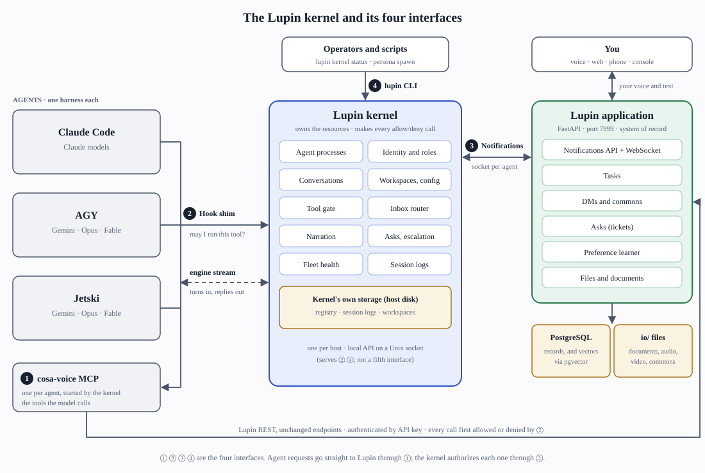
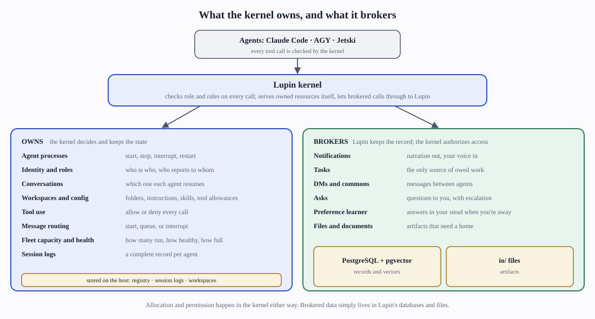
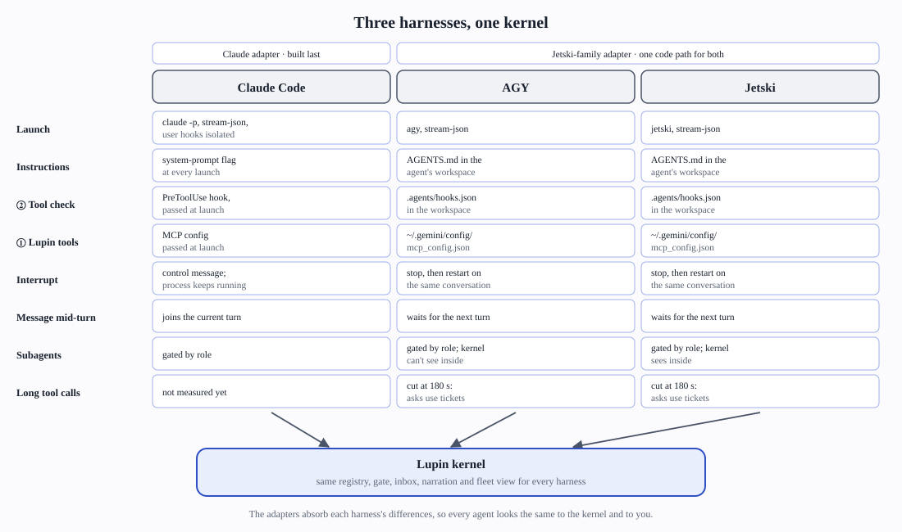
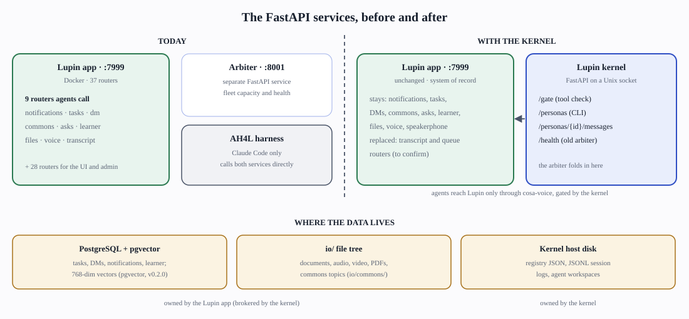

# The Lupin kernel

October 2026. How the kernel, its four interfaces and the three agent harnesses fit together. Shareable page: the private artifact "The Lupin Kernel". The SVGs in this folder follow the page theme when inlined and render standalone with light defaults. `build_svgs.py` regenerates them from `style.inc`.

The Lupin kernel is one service per host. It runs every AI agent and decides what each agent may do. Every tool an agent calls passes the kernel's check first. The kernel serves its own resources directly. For Lupin's resources (tasks, asks, DMs and the rest), the agent's cosa-voice tools call Lupin's existing endpoints once the kernel has allowed the call. The kernel authorizes; it does not relay.

It replaces AH4L, the Claude-only harness we use today. Claude Code, AGY and Jetski agents plug into the kernel on equal terms. A manager or worker therefore behaves the same whichever model or harness runs it.

## The four interfaces (D29)

1. **MCP tools (cosa-voice), for the models.** The tools let a model speak, ask, DM, post to the commons and read tasks. Tools are filtered by role. AGY and Jetski cap MCP calls at 180 s, so calls longer than 150 s return a ticket.
2. **Hook shim, for the harness.** It runs before every tool call and asks the kernel at `POST /gate` whether the call is allowed. Claude uses its PreToolUse hook; the Jetski family uses `.agents/hooks.json`. The shim runs in observe or enforce mode, and the ported AH4L guards stay at enforce.
3. **Notifications, between the agents and you.** The kernel holds one WebSocket per persona, `/ws/queue/cc-listener-{persona_id}`, which is the name Lupin's router already targets. It carries replies and peer messages in. Narration goes out through `POST /api/notify`.
4. **`lupin` CLI, for operators.** It calls `/personas` and `/health` on the kernel's Unix socket.

The kernel's own FastAPI app runs only on a local Unix socket and serves interfaces ②, ④ and health. It is not a fifth interface.

## Owned and brokered resources

The kernel makes every allocation and permission decision.

- **Owned resources** live on the kernel's host disk: agent processes, identity and roles, conversations, workspaces and config, the tool gate, the inbox router, narration, asks and escalation, fleet health (the former arbiter), and session logs.
- **Brokered resources** stay in the Lupin application, which remains the system of record: notifications, tasks, DMs and the commons, asks, the preference learner, and files and documents. For these the kernel authorizes each call, and the agent's MCP server makes the call itself.

## How the three harnesses plug in

AGY and Jetski share one adapter, since they use the same tool names, `AGENTS.md`, `.agents/hooks.json` and `~/.gemini/config/mcp_config.json`. Claude Code gets its own adapter, built last. The differences that matter:

- **Mid-turn messages:** Claude absorbs them mid-turn. AGY and Jetski take them on the next turn.
- **Interrupts:** Claude interrupts with a control message. AGY and Jetski stop and restart on the same conversation.
- **Subagents:** AGY does not fire hooks inside subagents.

## FastAPI services and data

**Today:**

- The Lupin app runs on :7999 in Docker. It has 37 routers, 9 of them agent-facing.
- The arbiter is a separate service on :8001.
- AH4L calls both directly.

**With the kernel:**

- The Lupin app is unchanged.
- The arbiter folds into the kernel (D24).
- Agents reach the agent-facing routers only through cosa-voice, and every call is gated by the kernel. No REST proxy is involved.

| Router | Disposition | Store |
|---|---|---|
| notifications, websocket | stays; kernel holds the connection | PostgreSQL (NotificationRepository; embeddings in pgvector) |
| tasks | stays; brokered | PostgreSQL (TaskRepository) |
| dm, commons | stays; brokered | PostgreSQL; `io/commons/<topic>.md` |
| v2_ask | stays; ticketed asks | PostgreSQL |
| decision_proxy | stays; preference learner in shadow mode | PostgreSQL (ProxyDecision, TrustState) |
| docs_files, io_files | stays; brokered | `io/` file tree |
| voice_persona, speakerphone | stays | n/a |
| arbiter (:8001) | folds into the kernel | kernel host disk |
| cc_transcript, claude_code_queue | replaced by session logs and the inbox router (to confirm) | kernel host disk |

## How an agent's call to Lupin is authorized

| Layer | Where | Decides |
|---|---|---|
| Exposure | cosa-voice MCP server, configured by the kernel from the role | Which tools `tools/list` shows. Exposure only (D25): a call to an unlisted tool is still served; the gate logs a would-deny (observe), and enforce is a config switch. |
| Gate | kernel `/gate`, via the hook shim | Whether this call, with these arguments, is allowed (e.g. a worker's ask goes to its manager). Runs before the MCP server sees the call. |
| Authentication | Lupin endpoint (`require_api_key_or_jwt`) | Which account is calling. The persona is the asserted `sender_id`. |

Role logic belongs in the first two layers. The one existing endpoint-side role check is the tasks router's manager-only guard, and it reads Claude Code bridge files, so it has to move to persona identity. Direct `curl` with the key is possible for an agent with shell access. That's accepted under D25; the gate can flag it in observe mode.

## Open items

1. Deny `invoke_subagent` on AGY for all roles (recommended).
2. Decide whether the kernel code lives in the UHW repo or in Lupin.
3. Move the tasks router's manager-only guard off Claude Code session bridge files and onto persona identity.
