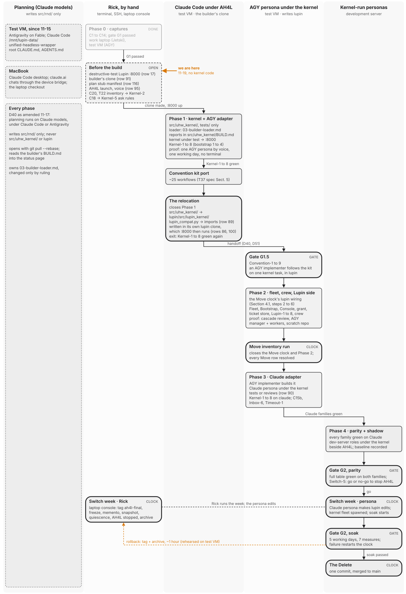

# Review: what the sequence rulings left open (row 96, 2026-11-17)

**Row 96 of "Outstanding actions"**, opened by its title: "Review: what the sequence rulings left open". A follow-up to row 85 ("Review: the build sequence's five contradictions").

**As of:** 2026-11-17, evening · written from the laptop (claude.ai, through the device bridge) before any ruling · this repository at `7e30b71`; lupin not read · the markdown file is the only copy. Rick read and approved the content of this review before it was written here.

## In brief

The morning's review of the build sequence (row 85) led to seven rulings. The builder's clone and its loader (row 87) led to seven more. Before redrawing the phase chart, the same reviewer read both sets of rulings back against the record. They hold together: every contradiction the first review named is resolved, and what could not be ruled is carried as rows 86 to 95.

This second reading found four gaps and one question about the chart itself:

1. **The relocated code is not tested again before the conventions gate.** The relocation rewrites the package's boundary after Kernel-1 to Kernel-8 pass, and nothing re-runs them.
2. **Nothing says which lupin tree serves which server on the test VM.** From the relocation on, the test VM has three jobs for lupin: the instance on port 7999 that carries the builder's own voice, the destructive-test server on port 8000 that the kernel targets, and the tree that gets written.
3. **The reading rule for lower-case "the move" collides with the Move clock's own checklist.** The rule says the kernel's imports change at the relocation. The checklist puts "the kept modules are imported" in the Move clock. It also leaves lupin-side lines unread.
4. **The build-platform decision still says Claude adapter testing on the test VM is "constrained (see open items)".** No open item says what the constraint is, and Phase 3 and its Claude reviewer now run there.
5. **The phase chart is now in the repository,** at `charts/2026.11.17-build-phases-and-drivers.html`, with its generator and a standalone SVG. How it is kept current needs a word; the recommendation is a zero-token check at every session's close that fails when the text the chart was drawn from has changed.

Five decisions are asked for. None reopens a ruling. Each one either finishes a ruling or decides where one applies.

## Where the record stands

**What was read.** The status page after row 87; the ruling protocol; the builder's loader `03-builder-loader.md`; the framework's Section 1 rows for the build platform, code location, dogfooding, Phase 1 code location and convention parity; Section 15 (chart, prose, table, three clocks) and Section 21; the switch-over spec's Section 4.1 and its amendments of 2026-11-17 (rows 85 and 87); the Phase 1 spec's Section 12 (acceptance); the console spec's Section 14; and every line in the framework, the status page and the specs that says "before", "after", "at", "from" or "until" "the move" in lower case (34 lines in 12 files, counted by `grep`).

**1. The relocation and the tests.**

- The switch-over spec, row 85 amendment: the relocation is "Section 4.1's step 1 alone: the package goes to `lupin/src/lupin_kernel/`, the verbatim `configuration_manager.py` copy is left behind, `lupin_compat.py` gives way to imports". It comes "after Kernel-1 to Kernel-8 and the convention kit port, before gate G1.5", and it closes Phase 1.
- Row 89 asks what `lupin_compat.py` stands for when Kernel-8 passes. It cannot be answered before the package exists.
- The Phase 1 spec, Section 12: Kernel-1 is `pytest tests/` against the fakes. Kernel-2, Kernel-3 and Kernel-5 to Kernel-8 are command-line runs against the destructive-test server. Kernel-4 is one spoken exchange through the web client. The proof workload is separate: one AGY persona by voice for a working day.
- Section 15, gate G1.5's row: "the convention kit ported and the package relocated into lupin first; then Convention-1 to Convention-9". No line in Section 15, the T19 spec or the loader re-runs Kernel-1 to Kernel-8 after the relocation.
- The row 85 narrative itself, against the option it did not choose: "a new implementer's first act is the riskiest mechanical change". The ruling moved that change to the outgoing session. It did not add a check after it.

**2. The lupin trees on the test VM.**

- Planning reads `/mnt/lupin-data/lupin`, a git checkout on `wip-v0.2.3-2026.11.04-online-preference-learning` (ruling protocol, Section 1; row 86). Row 32 records `lupin-app.ini`, `lupin-app-splainer.ini` and `docker-compose.cloud-gpu.yml` modified in that tree.
- The console spec, Section 14 (2026-11-09): the test instance runs in a container that "does not mount `~/.lupin`". No destructive-test server is defined on the test VM; standing one up is lupin ticket 8d67e474 (row 17).
- D45 as amended: from the relocation, lupin is written "in a writable lupin checkout on the test VM, on the dedicated branch". Row 86 asks the branch's name and whether that checkout can push.
- The loader: "The kernel under test targets the destructive-test server, never the instance on port 7999, which carries your own voice." Row 95 asks how the builder's AH4L session is launched and what gives it its voice.
- **Not established:** which tree or image the instance on port 7999 is built from; which tree the server on port 8000 will run from; whether the writable checkout is a new clone or the tree planning reads.

**3. "The move" in lower case.**

- The reading rule (switch-over spec, row 85 amendment): "'The move', 'after the move' or 'before the move' in lower case, where it speaks of the kernel's own package (what it imports, what it copies, where `lupin_compat.py` stands in), means the relocation. No older line is rewritten for this."
- The switch-over spec, Section 4.1, step 2, now the Move clock's: "Keep-and-import rows: the five git guards ported as gate rule evaluators; `task_store_client.py` and `task_store_map.py` imported; the five worktree modules and `link-worktree-venv.sh` imported; `vertex_env.py` wired for Phase 3."
- The fleet spec (framework Section 10.4 repeats it): the kernel's dismissal steps "import lupin's `reap_branch`, `seat_teardown`, `worktree_reaper`, `worktree_straggler_tickets` after the move". By the reading rule that is the relocation. By step 2 it is the Move clock.
- The 34 lines fall into three kinds:
  - **The kernel's own shape:** `identity.py`'s package name, the `configuration_manager.py` copy "deleted at the move", the `cc-listener-` constant in `lupin_compat.py`. These are clearly the relocation, except the listener constant, which row 85 kept with the Move clock by name.
  - **The kernel importing lupin modules:** the worktree modules, `CommonsStore.post` instead of the interim file write, `persona_normalization`. The rule and step 2 disagree on these.
  - **Lupin's side:** the tailer importing `log/mapper.py`, routes repointed at `GET/PUT /fleet/config`, the web console's kernel side, the Lupin-side halves of Log-6 and Console-4 to Console-7, and the Section 15 table's "Naming-2 with the Lupin changes before the move". The rule says nothing about these. Read naturally, they are the Move clock.

**4. The build-platform decision.**

- D32 (build platform), 10-23: "Claude is installed on the VM, but Claude adapter testing there is constrained (see open items)." The sentence entered with commit `3fac970`. No open item, register row or status row then or since names the constraint.
- Since then: Claude Code 2.1.326 runs on the test VM (status page, Platform row, read 11-17). Planning has used it there since 11-15, and the Phase 1 builder will be a Claude Code session there. D40 as amended puts the Claude adapter's build and a Claude reviewing persona in Phase 3 on the test VM (row 90).

**5. The chart.**

- Section 15's Mermaid chart was redrawn from its table under row 85. Section 15 is the authority on the order of phases.
- The swimlane chart adds who drives each stage and where. It was drawn from the record and reviewed by Rick, and is now saved with its generator (`charts/build_phase_chart.py`) so that it can be reproduced. Its header says it is a snapshot as of `7e30b71`.
- The Mermaid chart that went stale is the precedent: a second drawing of one table drifts unless someone owns it.
- The repository already enforces its invariants by zero-token checks that fail until the record agrees: `t19_acceptance_phase_check.sh --check` when a ruling is recorded (ruling protocol Section 6, step 3), `t19_hook_import_survivors.sh --check` at the Delete. The ruling protocol's closing step (Section 7) runs no check today.

## Problems and options

### 1. The relocated code is not tested again before the conventions gate

The relocation changes the code after its acceptance passed: imports replace the boundary module and a copied module is dropped. Gate G1.5 then observes an AGY implementer working in that tree. If the relocation broke something, the first sign would be a failed conventions gate. That would blame the convention kit or the implementer for a fault in the move.

- **Kernel-1 to Kernel-8 again, from `lupin/src/lupin_kernel/` against the destructive-test server, as the relocation's exit; not the day-long proof workload (recommended).** The builder records the run in `BUILD.md`, and the relocation is done only when all eight are green. *For:* Kernel-1 is a `pytest` run, and Kernel-2 to Kernel-8 are short command-line and voice checks. The whole set is an hour or two against a phase's work. A failure lands on the session that made the change, while it still has the context. *Against:* Kernel-4 needs Rick for a few minutes. The gate's row in Section 15 gains a line.
- **Kernel-1 alone (the fakes) and Kernel-2 (spawn against port 8000).** *For:* no human time. *Against:* the voice path (Kernel-4) and resume (Kernel-8) are what imports from lupin are most likely to disturb, and they go unchecked.
- **No re-run; gate G1.5 stands as the check.** *For:* nothing new. *Against:* the failure mode described above.

### 2. Nothing says which lupin tree serves which server on the test VM

From the relocation on, three things need lupin on the test VM, and they want different trees:

- the instance on port 7999 must stay up while the builder works, because it carries the builder's own voice;
- the server on port 8000 must run the code being built, or Phase 2's Lupin-side tests prove nothing;
- the writable checkout changes many times a day.

If one tree serves two of these jobs, either the builder can cut off its own voice mid-change, or the destructive tests run against code the implementer has not written yet.

- **Three trees (recommended).** Port 7999 stays on a tree that is only ever pulled, as today. The writable checkout on the dedicated branch is a separate clone. Port 8000 runs from that clone and is restarted at points the builder names in `BUILD.md`. *For:* each job gets the tree it needs. Restarts of port 8000 are already part of Kernel-7. *Against:* one more clone and its path. The ticket for the stand-up of port 8000 (8d67e474) must say which tree it runs from. Disk use on the VM is not yet measured.
- **Two trees: the instance on port 7999 and the server on port 8000 both from the pull-only tree; writes in a separate clone.** *For:* nothing new to stand up beyond the clone. *Against:* the destructive tests run against code that lags the writes until the next pull and restart, so a passing test can describe old code.
- **One writable tree serving both ports.** *For:* simplest. *Against:* the builder's voice is restarted by the builder's own edits.

Whichever is chosen, one fact is owed first, at zero tokens: which tree or image the instance on port 7999 is built from today (`docker inspect` on its container and `git -C` on the tree it names).

### 3. The reading rule and the Move clock's checklist disagree about the kernel's imports

The rule sends "what it imports" to the relocation. Step 2 of the Move clock is "the kept modules are imported". Lupin-side lines in lower case are not covered at all. The kernel's dismissal steps, which import lupin's worktree modules "after the move", are Phase 2 work under either reading. If a later session reads them as the relocation, it would put fleet wiring into the outgoing builder's last job.

- **A three-way rule, then a zero-token sweep that lists all 34 lines with their reading, confirmed in one click (recommended).**
  - Whatever `lupin_compat.py` stands for is replaced at the relocation. That is exactly row 89's list.
  - Everything the kernel had not done in Phase 1 (the worktree modules, the task store, the guards) is imported by the Phase 2 work that needs it, under the Move clock.
  - Everything on lupin's side is the Move clock.

  *For:* the rule follows what the code will do, needs no line rewritten, and matches step 2 and row 85's handling of the listener constant. *Against:* "the kernel's imports" now fall on both sides of the line, and the sweep's table becomes one more thing to read.
- **Every lower-case "the move" is the relocation.** *For:* one reading. *Against:* the relocation would swallow most of step 2 and the lupin-side wiring, which is what row 85 split it away from.
- **Every lower-case "the move" is the Move clock, except `lupin_compat.py` and the copied module.** *For:* close to the recommended rule. *Against:* it calls the interim file write (broadcast acknowledgements) Move-clock work even if `lupin_compat.py` is what performs it in Phase 1. The three-way rule settles that case by row 89's list instead.

### 4. The build-platform decision points at an open item that does not exist

The caveat was written on 10-23. If a constraint still holds (a sign-in, a plan's terms on a cloud VM, a quota), Phase 3 and the reviewing persona of row 90 run into it on the test VM. If nothing holds, the sentence is stale. Planning and the builder both run Claude Code on that host.

- **One click from Rick: either name the constraint, which becomes a row due before Phase 3, or strike the caveat by an amendment to D32 (recommended).** *For:* only Rick knows what he meant on 10-23. One answer closes it either way. *Against:* none beyond the click.
- **Strike it now as stale.** *For:* the evidence of daily use. *Against:* the builder runs Claude Code interactively under AH4L. Phase 3 runs it headless under the kernel, which may be exactly what was constrained.
- **Leave it.** *Against:* a sentence nobody can act on.

### 5. Whether, and how, the phase chart is kept current



- **Kept current by a source-digest check at each session's close (recommended).** The generator records a digest of exactly the text the chart encodes: Section 15's Mermaid block, the Stage and Platform columns of its table, and the Section 1 rows that say who drives what, D38 (code location), D40 (dogfooding), D45 (Phase 1 code location and write locations) and D51 (convention parity). D63 is left out: its sequence is mirrored in the table, and it is amended for unrelated reasons almost daily. A zero-token script, `charts/check_phase_chart.py`, recomputes the digest and exits non-zero when it no longer matches. It runs at every planning session's close (ruling protocol Section 7), as `t19_acceptance_phase_check.sh --check` already runs when recording. When it fails, the session redraws the chart (a new "as of" line and a new digest) or, short of budget, adds a row to "Outstanding actions": "redraw the phase chart". Being current, the files drop their date (`charts/build-phases-and-drivers.html` and `.svg`), the "as of" line stays inside, and git holds the history. A sketch, not yet written or tested:

  ```python
  # charts/check_phase_chart.py: zero tokens; exits 1 when the chart's sources have moved
  import hashlib, pathlib, re, sys

  here = pathlib.Path(__file__).resolve().parent
  fw = (here.parent / "01-framework.md").read_text(encoding="utf-8")
  s15 = fw[fw.index("## 15."):fw.index("## 16.")]

  sources = [re.search(r"```mermaid.*?```", s15, re.S).group(0)]
  sources += [f"{c[1]}|{c[4]}" for c in (l.split("|") for l in s15.splitlines())
              if len(c) == 6 and c[1].strip() not in ("Stage", "---")]
  sources += [l for l in fw.splitlines() if re.match(r"\| D(38|40|45|51) \|", l)]

  digest = hashlib.sha256("\n".join(sources).encode()).hexdigest()[:16]
  recorded = re.search(r'SOURCES_DIGEST = "(\w+)"',
                       (here / "build_phase_chart.py").read_text()).group(1)
  print("current" if digest == recorded else f"stale: sources {digest}, chart drawn from {recorded}")
  sys.exit(digest != recorded)
  ```

  *For:* drift is caught by the event that causes it, a change to the sources, at no token cost and with no calendar; it is the repository's own pattern (a `--check` script that fails until the record agrees); the chart stays usable as the one picture of who drives what. *Against:* false alarms, since the four decision rows are amended for reasons the chart does not show; each costs a glance and a re-run that changes only the digest. The check sees that the sources moved, not whether the drawing still matches them; that judgment is still a reader's, but only when the check fires. One more script, one more line in the closing step, and the image link in this narrative and the Section 21 row change with the rename.
- **A dated snapshot; never updated; a new dated file when a new picture is wanted.** The generator stays beside it, so a new snapshot is a constant changed and one command. Section 15 stays the authority. *For:* it cannot drift into contradiction, because it says what day it describes; nothing to run. *Against:* it goes out of date silently, and a reader must notice its date.
- **A living companion, updated by convention by every session that changes Section 15.** *For:* always current while the convention holds. *Against:* nothing enforces it; this is how the Mermaid chart went stale.
- **A periodic review (weekly, say).** *For:* simple to state. *Against:* the cadence is arbitrary, it spends Rick's attention whether or not anything changed, and saving operator attention is what the kernel is for.

## What follows without a decision

- The status page's "Phase" row said the handoff waits on the kit port. It now also names the relocation, which closes Phase 1 (row 85). This is corrected with this session's close; no ruling is changed.
- D63's (exit criteria and the switch-over) opening parenthetical still says "Phase 2 the move into lupin then …" and "G2 both families plus the soak". It stays as written: the protocol appends amendments rather than rewriting a ruled row, and row 85's amendment at the end of the row governs.
- If decision 5 is ruled as recommended: the check is written with a self-test and the digest constant added to the generator; the files are renamed without their date; this narrative's image link and the Section 21 row follow the rename; the ruling protocol's closing step gains the check.
- Whatever decision 3 rules, the sweep's table goes into the switch-over spec as an amendment, and row 89's list, when the builder writes it, becomes the relocation's half of that table.

**Not established here:** which tree or image serves port 7999 (owed as row 97); the disk available on the test VM for a third tree; what D32's "constrained" meant. **The first two were read on 2026-11-18; see the host reading below.**

## Host reading of 2026-11-18, before the walk-through

Added on the test VM by the session that walks the decisions, before any question was put (ruling protocol, Section 3: a narrative's host facts and counts are confirmed by script first). The text above is as the laptop wrote it. Source: `src/captures/t19_lupin_trees_test_vm.sh` (zero tokens, read-only), output in `src/captures/out/t19-lupin-trees-lupin-host-test-20261118.txt`; this repository at `f33c057`, lupin at `27e646d0ed`. This answers row 97.

**What the host shows.**

- **Both ports are served today, by two containers of one image, from one tree.** Port 7999 is the container `lupin-rest-cloud-gpu`; port 8000 is `lupin-rest-test`, created 2026-11-16 at 21:41 US Eastern, with its own local database container (`lupin-pgvector-test`). Both run the registry image `lupin:1.1.7-candidate`, and both mount `/mnt/lupin-data/lupin/src` as their code, writable. That is the tree planning reads.
- **So the destructive-test server appears to be standing** (row 17, lupin ticket 8d67e474; the overlay file `docker-compose.vm-test-overlay.yml` names that ticket). Seen: the container, healthy, and its database. Not seen: whether Rick counts row 17 as done, or anything the kernel's tests need from it.
- **The code is the tree, not the image.** The image supplies the runtime; the Python each server runs is whatever stands in `/mnt/lupin-data/lupin/src`. An edit to that tree reaches both servers.
- **That tree cannot push, and is not pulled from GitHub.** Its only remote is a file, `/mnt/lupin-data/lupin-wip.bundle`; its `.deployed-ref` reads `27e646d0ed… 2026-11-17T02:39:55Z push-bundle-reset`. It is on `wip-v0.2.3-2026.11.04-online-preference-learning`, with three tracked files changed (row 32's three) and thirteen untracked. Read from the marker's words, not from the deploy script: a deploy from the development server sets this tree to the ref it ships. What that does to work committed or uncommitted in the tree was not read.
- **Port 8000 is tied to that folder by its compose file.** The overlay mounts `.` and `./src`, relative to the compose folder, and shares the compose project `lupin` with port 7999's file. Running port 8000 from another clone is a change to how lupin's `lupin-vm.sh test-server` is invoked, or to the overlay; it is lupin work, not a path chosen here.
- **Disk is not a constraint.** 60 GB free under `/mnt/lupin-data`; the lupin tree is 3.3 GB.
- **The count in problem 3.** The script's pattern (`(before|after|at|from|until) the move`, case-sensitive, over the framework, the status page and the specs) finds 36 lines in 12 files, at `7e30b71` as at `f33c057`. The narrative says 34 in 12. The laptop's pattern is not recorded, so the two are not reconciled; the sweep that decision 3 recommends lists every line and settles the number.

**What it changes in problem 2.** The three options stand, with these corrections:

- The words "as today" in the recommended option are wrong. Today is the third option's shape, one tree behind both ports, except that nobody writes it yet.
- "A tree that is only ever pulled" is, on this host, a tree set by a deploy from the development server. The reasoning for keeping port 7999 on it is unchanged, and stronger: a deploy that resets the tree is a second reason not to write the kernel there.
- The recommended option now carries a cost the narrative did not know: port 8000 must be re-pointed at the writable clone (lupin work, and a few minutes of the test server down), and the clone needs a remote it can push to, which the existing tree does not have (row 86 asks this).
- The second option (both ports from the deployed tree, writes in a separate clone) is what the host gives with no change at all beyond the clone. Its weakness is as stated: port 8000 then runs the kernel's lupin-side code only after that code has travelled to the development server and been deployed back.

The recommendation stays three trees. Nothing in problems 1, 3, 4 or 5 is changed by the reading.

## The sweep under ruling 3 (2026-11-18)

Written after ruling 3, by `src/captures/t19_move_reading_sweep.py` (zero tokens; `--check` fails when a lower-case "the move" has no reading, or a reading matches no line). The pattern is `(before|after|at|from|until) the move`, case-sensitive, over the framework, the status page and the specs: 39 occurrences on 36 lines in 12 files. The "Rule" column names the part of the three-way rule: (a) what `lupin_compat.py` stands for, at the relocation; (b) what the kernel had not done in Phase 1, under the Move clock; (c) lupin's side, the Move clock.

| # | Where | Words | Reading | Rule | Why |
|---|---|---|---|---|---|
| 1 | `01-framework.md`:70 | before the move | the relocation | a | what stands behind `lupin_compat.py` before it |
| 2 | `01-framework.md`:83 | after the move | the Move clock | c | Lupin's tailer imports the mapper |
| 3 | `01-framework.md`:84 | after the move | the Move clock | b | the worktree modules and `vertex_env`, kept and imported |
| 4 | `01-framework.md`:86 | after the move | the relocation if row 89's list holds it; otherwise the Move clock | a | the interim acknowledgment write gives way to `CommonsStore.post` |
| 5 | `01-framework.md`:87 | at the move | the relocation | a | the `configuration_manager.py` copy is deleted |
| 6 | `01-framework.md`:94 | after the move | either: nothing changes at either |  | no copy of lupin's module, before or after |
| 7 | `01-framework.md`:295 | after the move | the relocation | a | the package's name |
| 8 | `01-framework.md`:508 | after the move | the relocation if row 89's list holds it; otherwise the Move clock | a | the interim acknowledgment write |
| 9 | `01-framework.md`:823 | after the move | the Move clock | b | the dismissal steps import the worktree modules |
| 10 | `01-framework.md`:1118 | before the move | the Move clock | c | Lupin's changes |
| 11 | `01-framework.md`:1234 | at the move | the relocation | a | the `configuration_manager.py` copy is dropped |
| 12 | `00-status.md`:184 | before the move | the relocation | a | session log, history: the rule against lupin imports |
| 13 | `00-status.md`:214 | after the move | the Move clock | c | session log, history: Lupin's web console |
| 14 | `2026.11.03-t10-stable-id-spec.md`:45 | after the move | the relocation | a | the package's name |
| 15 | `2026.11.03-t10-stable-id-spec.md`:45 | after the move | the Move clock | c | cosa-voice, lupin's side, imports the module |
| 16 | `2026.11.03-t10-stable-id-spec.md`:140 | after the move | the Move clock | b | superseded by D69 (canonical persona name), part 7: the kernel never normalizes |
| 17 | `2026.11.03-t10-stable-id-spec.md`:140 | before the move | either: nothing changes at either |  | no copy is needed before it |
| 18 | `2026.11.08-t17-log-schema-and-rotation-spec.md`:220 | after the move | the Move clock | c | Lupin's tailer imports the mapper |
| 19 | `2026.11.08-t17-log-schema-and-rotation-spec.md`:252 | after the move | the Move clock | c | the Lupin side of Log-6 |
| 20 | `2026.11.08-t17-log-schema-and-rotation-spec.md`:300 | after the move | the Move clock | c | the Lupin side of Log-6 |
| 21 | `2026.11.09-t16-fleet-spec.md`:203 | after the move | the Move clock | b | the dismissal steps import the worktree modules |
| 22 | `2026.11.09-t16-fleet-spec.md`:303 | after the move | the Move clock | c | Lupin's routes repointed |
| 23 | `2026.11.09-t16-fleet-spec.md`:307 | after the move | the Move clock | b | the worktree modules |
| 24 | `2026.11.09-t16-fleet-spec.md`:324 | after the move | the Move clock | b | a Phase 2 test of the dismissal steps |
| 25 | `2026.11.09-t20-console-spec.md`:12 | after the move | the Move clock | c | Lupin's tailer imports the mapper |
| 26 | `2026.11.09-t20-console-spec.md`:334 | after the move | the Move clock | c | the Lupin side of the console tests |
| 27 | `2026.11.10-t08-kernel-lifecycle-spec.md`:35 | after the move | the relocation | a | the unit names the package, so it changes when the package does |
| 28 | `2026.11.10-t08-kernel-lifecycle-spec.md`:114 | after the move | the relocation | a | the package ships with the tree it lives in |
| 29 | `2026.11.10-t08-kernel-lifecycle-spec.md`:133 | after the move | the Move clock | b | lupin's `worktree_reaper` |
| 30 | `2026.11.10-t15-turn-end-policy-spec.md`:20 | at the move | the relocation | a | the `configuration_manager.py` copy |
| 31 | `2026.11.10-t15-turn-end-policy-spec.md`:88 | at the move | the relocation | a | the `configuration_manager.py` copy |
| 32 | `2026.11.10-t19-exit-criteria-and-switch-over-spec.md`:370 | after the move | not read: the rule's own words |  | row 85's rule, quoting the phrase |
| 33 | `2026.11.10-t19-exit-criteria-and-switch-over-spec.md`:370 | before the move | not read: the rule's own words |  | row 85's rule, quoting the phrase |
| 34 | `2026.11.10-t28-broadcasts-spec.md`:14 | after the move | the relocation if row 89's list holds it; otherwise the Move clock | a | the interim acknowledgment write |
| 35 | `2026.11.10-t28-broadcasts-spec.md`:105 | before the move | the relocation if row 89's list holds it; otherwise the Move clock | a | the interim acknowledgment write |
| 36 | `2026.11.15-t35-canonical-persona-name-spec.md`:106 | after the move | either: nothing changes at either |  | no copy, before or after |
| 37 | `2026.11.15-t38-engine-neutral-naming-spec.md`:220 | until the move | the Move clock | c | kept with the Move clock by name (row 85; D71, engine-neutral naming, part 4), though the constant stands in `lupin_compat.py` |
| 38 | `2026.11.15-t38-engine-neutral-naming-spec.md`:225 | until the move | the Move clock | c | Lupin accepts both listener names |
| 39 | `2026.11.15-t38-engine-neutral-naming-spec.md`:248 | from the move | the Move clock | c | follows what Lupin accepts (D71, part 4) |

- 20: the Move clock
- 10: the relocation
- 4: the relocation if row 89's list holds it; otherwise the Move clock
- 3: either: nothing changes at either
- 2: not read: the rule's own words

**The readings that are judgments, not plain applications of the rule:**

- **The four lines about the broadcast acknowledgment** (`CommonsStore.post` "after the move"). The Phase 1 writer imitates Lupin's file protocol, and D45 (Phase 1 code location and write locations) puts any such behavior behind `lupin_compat.py`; if the builder's list (row 89) holds it, it is replaced at the relocation, and if not, under the Move clock. The sweep cannot say which before the package exists.
- **The lifecycle spec's two lines** (the unit's `ExecStart`, and how the package is updated). Read as the relocation: both follow where the package lives. The command's later form, `lupin kernel run`, is a lupin entry point and may arrive after the module path changes.
- **`identity.py` imported by cosa-voice.** Read as the Move clock (lupin's side), although it becomes possible at the relocation.
- **The old listener prefix.** Read as the Move clock, as row 85 and D71 (engine-neutral naming) say by name, although the constant stands in `lupin_compat.py`: it is the one thing in that module that outlives the relocation, and the builder's list must say where it stands in between.
- **The stable-identifier spec's import of `persona_normalization`.** Read as the Move clock, and superseded: D69 (canonical persona name) part 7 says the kernel never normalizes.

## Decisions requested and ruled

| # | Decision | Recommendation | Ruling (YYYY-MM-DD) |
|---|---|---|---|
| 1 | Whether the relocated code is tested again before the conventions gate | Kernel-1 to Kernel-8 again from `lupin/src/lupin_kernel/` against port 8000, as the relocation's exit; not the proof workload; recorded in `BUILD.md` | **As recommended** (2026-11-18): Kernel-1 to Kernel-8 run again from `lupin/src/lupin_kernel/` against port 8000 as the relocation's exit, recorded in `BUILD.md`; not the proof workload |
| 2 | Which lupin tree serves which server on the test VM from the relocation on | Three trees: port 7999 on the deployed tree (today's, which serves both ports; host reading of 2026-11-18); the writable clone on the dedicated branch; port 8000 re-pointed at that clone, restarted at named points | **As recommended** (2026-11-18): three trees. Port 7999 stays on the deployed tree `/mnt/lupin-data/lupin`; the kernel is written in a separate clone on the dedicated branch; port 8000 is re-pointed at that clone and restarted at points the builder names in `BUILD.md` |
| 3 | How lower-case "the move" is read | A three-way rule (what `lupin_compat.py` stands for → the relocation; what the kernel had not done in Phase 1 → the Move clock; lupin's side → the Move clock), then a zero-token sweep of the 34 lines, confirmed in one click | **As recommended** (2026-11-18): the three-way rule (what `lupin_compat.py` stands for, at the relocation; what the kernel had not done in Phase 1, under the Move clock; lupin's side, the Move clock), then a zero-token sweep of every such line, confirmed in one click |
| 4 | The build-platform decision's "constrained (see open items)" | Rick names the constraint (a row before Phase 3) or strikes the caveat by amendment | **Struck** (2026-11-18): Rick says no constraint holds now; the caveat is struck by an amendment to D32 (build platform) |
| 5 | Whether, and how, the phase chart is kept current | A source-digest check, `charts/check_phase_chart.py`, at every session's close: on failure redraw or add a row; the files lose their date; Section 15 stays the authority | **As recommended** (2026-11-18): a source-digest check, `charts/check_phase_chart.py`, at every session's close; on failure the session redraws the chart or adds a row; the files lose their date; Section 15 stays the authority |
| 6 | The sweep's readings (raised by ruling 3; added 2026-11-18) | The table above as written: 20 the Move clock, 10 the relocation, 4 by the builder's list, 3 either, 2 the rule's own words | **As recommended** (2026-11-18): the table confirmed as written |

## Glossary

| In words | Register key or name |
|---|---|
| The build-platform decision | D32 (build platform) |
| The code-location decision; the Phase 1 code-location decision | D38 (code location); D45 (Phase 1 code location and write locations) |
| Dogfooding | D40 (dogfooding) |
| Convention parity; the conventions gate | D51 (convention parity before the AGY handoff); gate G1.5, Convention-1 to Convention-9 |
| Exit criteria and the switch-over; the switch-over spec | D63; `specs/2026.11.10-t19-exit-criteria-and-switch-over-spec.md` |
| The relocation; the Move clock | the switch-over spec, Section 4.1 step 1; steps 2 to 6, closed by the inventory run (row 85) |
| The Phase 1 acceptance | Kernel-1 to Kernel-8 (Phase 1 spec, Section 12) |
| The builder's loader; the build log | `03-builder-loader.md`; `src/uhw_kernel/BUILD.md` (row 87) |
| The first review | `narratives/2026.11.17-review-build-sequence-contradictions.md` (row 85) |
